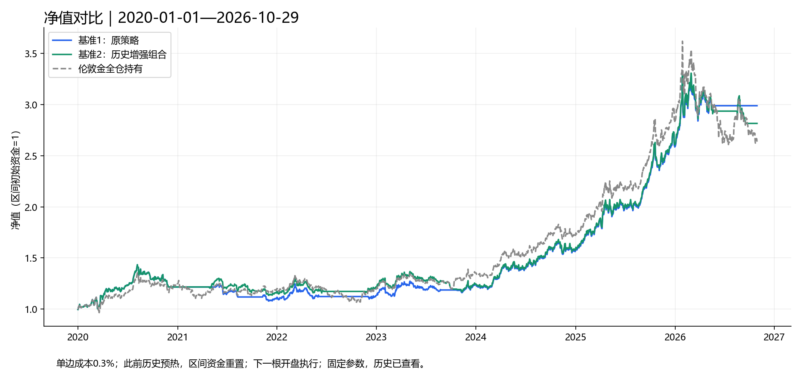
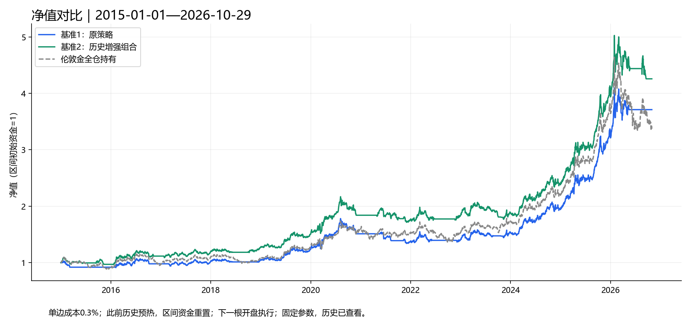
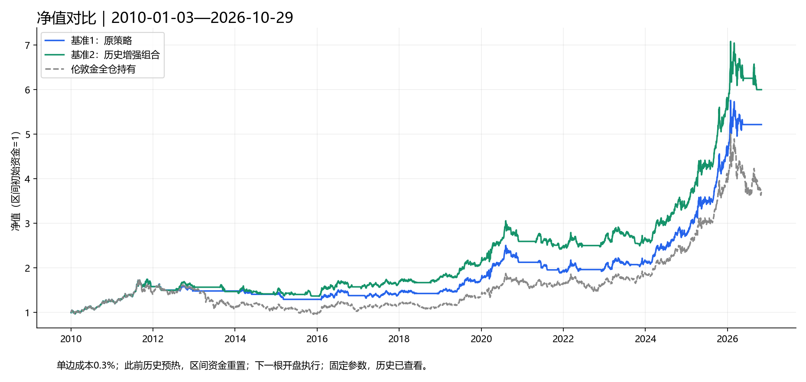
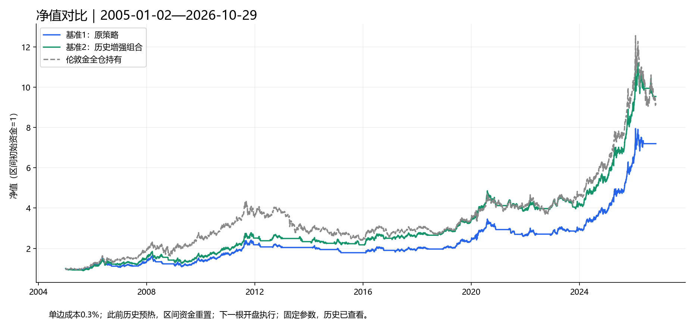
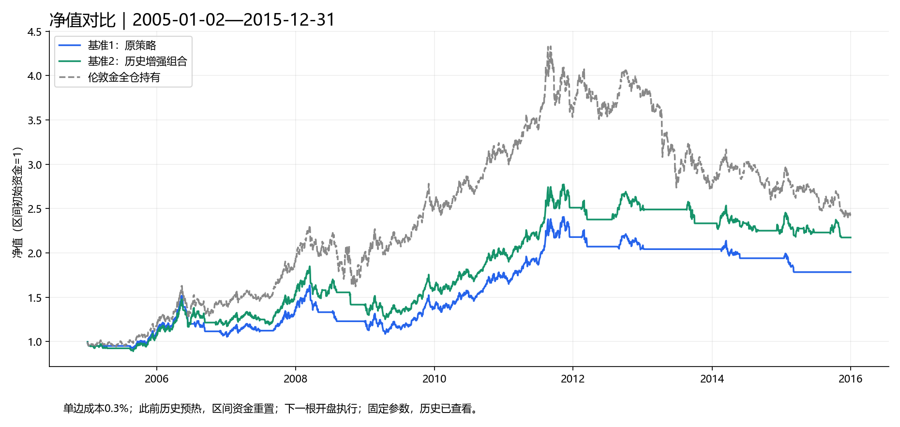
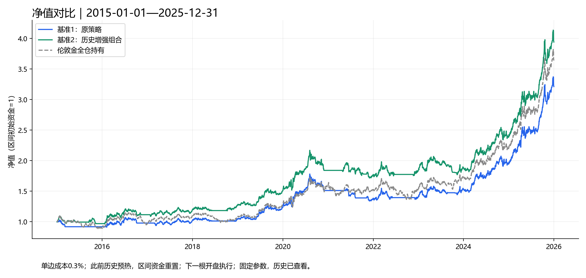
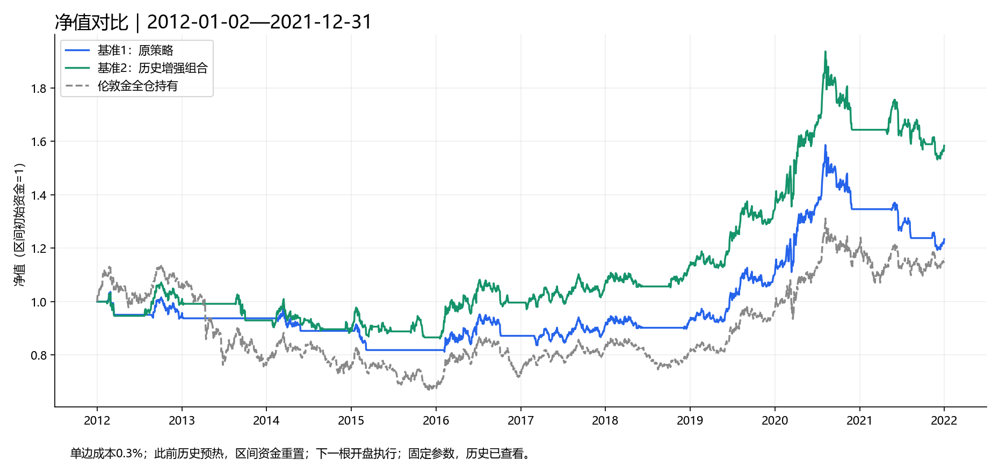

# 基准1与基准2：多区间及年度回测报告

**报告整理日期：2026年11月2日｜行情截止：2026年10月29日**

本报告整理已完成的六个区间及2012—2021区间回测，不重新训练、不调整参数。所有结果均为伦敦现货XAU/USD模拟，历史区间已被查看，不能作为全新样本外验证。

## 一、回测口径

- 基准1为原现货突破策略；基准2为历史增强组合（基准1＋线性回归＋二次曲线），与伦敦金全仓持有对比。
- 单边成本统一为0.3%，买入和卖出分别计费；全仓持有计入初始买入成本。
- 使用区间开始之前的历史数据预热；完成日信号在下一根开盘执行。
- 各独立区间初始资金重置为1；期末不强制清仓，无杠杆，不计现金利息。
- 年度表取2005年起连续运行的净值，跨年不清仓、不重置策略。
- 区间年化按实际日期跨度折算；年度表完整年份的年收益即该年的年度年化。
- 最大回撤以日净值计算；年度回撤以此前一年末净值作为年初起点，衡量当年内部回撤，不等于跨年连续最大回撤。
- 超额为相对伦敦金收益的百分点差，不是风险调整后的Alpha。
- 保留本地行情记录日期（含周日短时段）；这不是基金或银行积存金实盘收益。

## 二、六个区间净值对比

蓝线＝基准1；绿线＝基准2；灰色虚线＝伦敦金全仓持有。

### 1. 2020年至今

实际数据区间：2020-01-01—2026-10-29。

### 2. 2015年至今

实际数据区间：2015-01-01—2026-10-29。

### 3. 2010年至今

实际数据区间：2010-01-03—2026-10-29。

### 4. 2005年至今

实际数据区间：2005-01-02—2026-10-29。

### 5. 2005—2015年（含2015全年）

实际数据区间：2005-01-02—2015-12-31。

### 6. 2015—2025年（含2025全年）

实际数据区间：2015-01-01—2025-12-31。

## 三、区间汇总

每格依次为 **累计收益 / 年化收益 / 最大回撤**，单位均为%。

| 区间 | 基准1 | 基准2 | 伦敦金全仓 |
| --- | --- | --- | --- |
| 2020年至今 | 198.80 / 17.39 / 24.79 | 181.54 / 16.38 / 20.91 | 163.10 / 15.23 / 27.90 |
| 2015年至今 | 271.15 / 11.73 / 24.79 | 325.77 / 13.03 / 20.91 | 237.45 / 10.83 / 27.90 |
| 2010年至今 | 421.14 / 10.31 / 26.49 | 499.40 / 11.23 / 22.02 | 263.77 / 7.98 / 44.57 |
| 2005年至今 | 620.00 / 9.47 / 33.59 | 854.19 / 10.89 / 32.35 | 813.49 / 10.67 / 44.57 |
| 2005—2015年（含2015全年） | 78.35 / 5.40 / 33.59 | 117.39 / 7.32 / 32.35 | 141.86 / 8.37 / 44.57 |
| 2015—2025年（含2025全年） | 221.04 / 11.19 / 24.79 | 293.75 / 13.27 / 20.91 | 263.60 / 12.45 / 21.36 |

## 四、逐年收益、回撤与超额

收益、回撤单位为%；超额单位为百分点。2026年为未满年份，表中收益和超额按折算年化展示，回撤只统计已发生区间。

| 年份 | 基准1年化 | 基准1回撤 | 基准1超额 | 基准2年化 | 基准2回撤 | 基准2超额 | 伦敦金年化 | 伦敦金回撤 |
| --- | --- | --- | --- | --- | --- | --- | --- | --- |
| 2005 | 9.60 | 8.41 | -7.88 | 6.53 | 10.98 | -10.95 | 17.48 | 6.99 |
| 2006 | 0.76 | 29.73 | -22.60 | 15.31 | 20.99 | -8.06 | 23.36 | 21.70 |
| 2007 | 21.57 | 7.84 | -9.44 | 23.64 | 10.95 | -7.38 | 31.01 | 7.84 |
| 2008 | -8.42 | 25.35 | -14.05 | -6.72 | 23.96 | -12.35 | 5.62 | 29.84 |
| 2009 | 11.84 | 17.50 | -12.78 | 11.84 | 17.50 | -12.78 | 24.62 | 12.69 |
| 2010 | 29.40 | 7.89 | 0.00 | 29.40 | 7.89 | 0.00 | 29.40 | 7.89 |
| 2011 | 22.44 | 9.48 | 12.14 | 22.44 | 9.48 | 12.14 | 10.30 | 18.44 |
| 2012 | -4.93 | 9.74 | -11.96 | 0.30 | 8.29 | -6.73 | 7.03 | 13.83 |
| 2013 | -1.39 | 2.09 | 26.72 | -7.31 | 9.48 | 20.79 | -28.11 | 29.60 |
| 2014 | -5.02 | 9.27 | -3.36 | -4.25 | 12.61 | -2.58 | -1.66 | 17.92 |
| 2015 | -8.07 | 10.55 | 2.33 | -2.71 | 11.44 | 7.68 | -10.39 | 19.05 |
| 2016 | 6.51 | 8.45 | -1.97 | 15.05 | 9.28 | 6.56 | 8.48 | 17.44 |
| 2017 | 4.22 | 7.88 | -8.92 | 6.84 | 7.88 | -6.30 | 13.14 | 7.88 |
| 2018 | 2.46 | 5.07 | 4.00 | 6.77 | 5.00 | 8.31 | -1.55 | 13.42 |
| 2019 | 18.29 | 6.31 | 0.00 | 18.29 | 6.31 | 0.00 | 18.29 | 6.31 |
| 2020 | 22.20 | 15.15 | -2.93 | 22.20 | 15.15 | -2.93 | 25.13 | 14.21 |
| 2021 | -8.35 | 12.93 | -4.72 | -3.61 | 12.76 | 0.01 | -3.63 | 13.62 |
| 2022 | 1.58 | 11.77 | 1.91 | 3.76 | 11.66 | 4.09 | -0.33 | 20.62 |
| 2023 | 9.11 | 8.80 | -4.03 | 2.33 | 14.47 | -10.82 | 13.15 | 11.19 |
| 2024 | 27.22 | 7.99 | 0.00 | 27.22 | 7.99 | 0.00 | 27.22 | 7.99 |
| 2025 | 64.35 | 9.79 | -0.21 | 64.35 | 9.79 | -0.21 | 64.56 | 9.67 |
| 2026* | 19.17 | 13.97 | 27.80 | 9.91 | 15.29 | 18.54 | -8.63 | 27.90 |

*2026年截至10月29日，折算年化不是全年预测。实际年内收益：**基准1 +15.61%、基准2 +8.13%、伦敦金 −7.19%**；实际年内超额分别为+22.80、+15.32个百分点。表中超额由未四舍五入的数值计算，可能与显示值相减相差0.01个百分点。

## 五、2012—2021专项对比

实际区间：**2012-01-02—2021-12-31**，含2021全年；单边成本0.3%，此前历史预热，固定参数、下一根开盘执行。

| 方案 | 累计收益 | 年化收益 | 最大回撤 | 平均仓位 | 对伦敦金累计超额 |
| --- | --- | --- | --- | --- | --- |
| 基准1 | 23.35% | 2.12% | 24.79% | 51.10% | +7.09个百分点 |
| 基准2（历史增强组合） | 58.35% | 4.71% | 20.91% | 66.99% | +42.09个百分点 |
| 伦敦金全仓持有 | 16.26% | 1.52% | 41.18% | 100.00% | — |

## 六、结果概述

1. 基准2在六个区间中的五个区间收益高于基准1；2020年至今基准1收益更高。
2. 2005年至今，基准2年化10.89%，略高于全仓10.67%，最大回撤32.35%，低于全仓44.57%。
3. 2005—2015，两套策略均未跑赢全仓持有，不能认为策略在所有市场阶段都占优。
4. 2012—2021，基准2累计收益58.35%、年化4.71%、最大回撤20.91%，在三者中收益最高、回撤最低，但绝对年化仍不高。
5. 本次只整理既有结果，包含训练期和已查看历史，不据此推断未来收益或自动调整正式参数。

## 七、结果来源与复现材料

- [六区间完整HTML报告](../基准1/保留结果/six-windows-annual-2026-11-02/report.html)
- [六区间及年度原始统计](../基准1/保留结果/six-windows-annual-2026-11-02/summary.json)
- [2012—2021原始统计](../基准1/保留结果/comparison-2012-2021-2026-11-02/summary.json)
- [基准1独立运行说明](../基准1/README.md)
- [基准2独立运行说明](../基准2/README.md)

行情快照SHA256：`6a7a642d5cb84df7e659e11502d9bd04bc6efb443ccc3b13314ac380b17829f6`。

文中图片引用本地保留结果的绝对路径；若将报告移至其他电脑，需要同时带上图片并调整路径。
