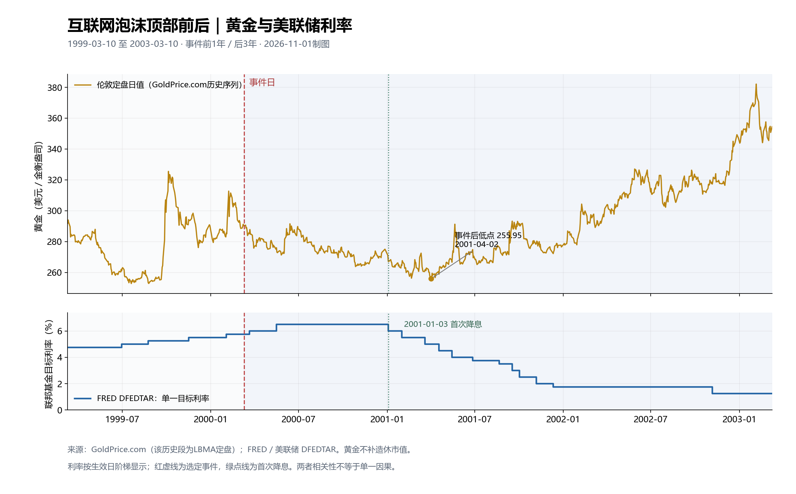
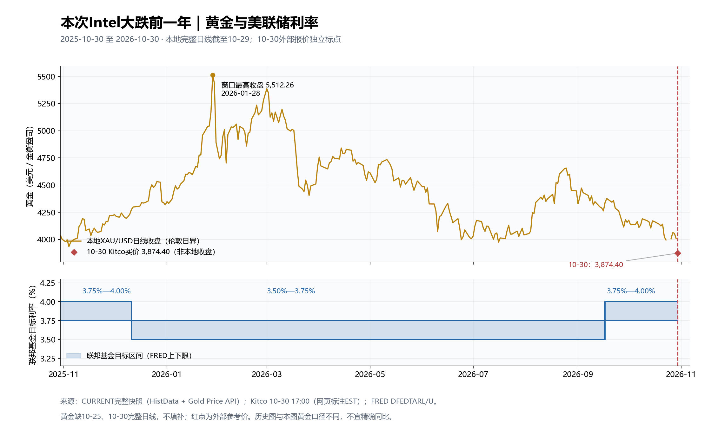
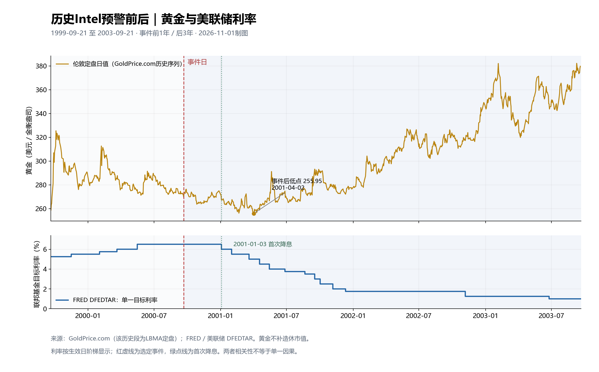

# 黄金重大事件图谱与长期研究主报告

整理日期：2026-10-30（北京时间）。本次为文档合并，不代表重新核验全部历史新闻或重算预测。

这是今后黄金事件、宏观、波段复盘与长期判断的唯一主报告入口。新研究按北京时间追加，明确行情截止、预测发布日与截止日；旧预测保留，不因新版本覆盖。机构档案和误差统计统一在[机构黄金预测与实绩综合报告](机构黄金预测与实绩综合报告.md)更新。

## 合并目录

- [当前三个月预测与复盘后规则，2026-10-30晚间](#forecast-20261030-r2)：GOLD-20261030-R2，旧版保留。
- [已到期预测复盘，2026-10-30](#expired-audit-20261030)。
- [原始事件图谱与逐日研究](#original-atlas)：原文完整保留，标题日期和各节日期均为历史记录。
- [主要波段复盘，历史截止2026-10-15](#waves-20261015)：保留当时三个月前瞻与依据。
- [最近20轮收获与冻结预测，归档2026-10-30](#dialogue-20261030)：区分事实、假设、主观概率及每日确认条件。
- 每日操作口径：[研究规则](../gold-macro-monitor/研究规则.md)。每日检查明细可以独立留档，但完整研究正文统一追加本报告。

合并前文件逐字节备份于 `archive/2026-10-30-report-merge/`，含SHA256清单。旧专题保留为冻结历史副本，停止独立维护。本文不自动改变基准1或触发实盘交易。

---

# 黄金重大公共事件图谱（2023 年初—2026-10-03）

更新时点：2026-09-17（北京时间）  
主要价格口径：伦敦现货金/LBMA 金价，美元/盎司；日内点位为约数，不与国内人民币金价直接等同。

## 阅读口径

- “重要事件”指明显改变利率、美元、避险、央行购金或资金流预期，并形成可辨认黄金行情的公开事件；不是逐条新闻清单。
- “事前预期”是当时市场主流定价，不是事后解释；“结果/预期差”决定短线方向。
- “即时反应”通常指当日到两个交易日；“后续”指约一周到一个月。若同期有多个冲击，归因标为“复合”。
- 点位和百分比均为约数，适合复盘定性，不适合精确成交核算。

## 先看四年主线

| 年份 | 定价主线 | 黄金年度表现/阶段特征 |
|---|---|---|
| 2023 | 银行危机、加息见顶、巴以冲突、年末降息预期 | 全年约 +15%，年末 2,078 美元，创当时年度收盘纪录；央行购金估计贡献约 10%—15% |
| 2024 | “降息推迟”与央行购金脱钩、地缘冲突、9 月超预期降息 | 40 次创新高，全年均价 2,386 美元、同比约 +23% |
| 2025 | 特朗普关税与美元信用担忧、ETF 回流、降息周期 | 53 次创新高，全年均价 3,431 美元、同比约 +44%，四季度均价 4,135 美元 |
| 2026 至今 | 年初避险泡沫、油价/通胀再起、降息周期逆转为加息 | 1 月冲破 5,500 后，6 月一度跌破 4,000；9 月首次加息后回到约 4,260—4,310 |

年度数据来源：[世界黄金协会 2023 年回顾](https://www.gold.org/goldhub/research/gold-market-commentary-december-2023)、[2024 年需求趋势](https://www.gold.org/goldhub/research/gold-demand-trends/gold-demand-trends-full-year-2024)、[2025 年需求趋势](https://www.gold.org/goldhub/research/gold-demand-trends/gold-demand-trends-full-year-2025)、[2026 年中展望](https://www.gold.org/goldhub/research/gold-mid-year-outlook-2026)。

## 核心分析方法：市场先交易预期，再交易预期差

市场通常不会等到事件公布才行动，而会经历四步：

> 信息逐步出现 → 概率被市场提高 → 资金提前买入或卖出 → 事件公布后只交易“实际结果减去已计价预期”

因此，“利空事件发生但黄金不跌”并不矛盾。可能是利空已经提前卖完；同理，“降息后黄金下跌”也可能是此前涨得太多，而降息幅度或未来指引不及预期。

### 四种最常见的交易结构

| 类型 | 事件前怎么走 | 事件落地后的常见反应 | 判断关键词 |
|---|---|---|---|
| 买预期、卖事实 | 预期利多，黄金提前上涨 | 结果符合预期后不涨、冲高回落 | 利多兑现 |
| 卖预期、买事实 | 预期利空，黄金提前下跌 | 结果没有更坏，落地后止跌反弹 | 利空出尽 |
| 超预期冲击 | 市场几乎没有准备 | 公布后快速单边上涨或下跌 | 意外、黑天鹅 |
| 预期方向正确但程度错误 | 已经提前交易，但实际结果更强/更弱 | 原趋势再次加速，或立即反转 | 预期差 |

### 关键事件的“提前计价—落地反应”总表

| 事件 | 事件前市场怎样提前交易 | 是否已充分计价 | 事件是否出乎预料 | 落地后的黄金表现 | 交易结构 |
|---|---|---|---|---|---|
| 2023-02 强非农 | 市场原本提前买入通胀回落和放慢加息，黄金已涨至约 1,950 | 否，市场没有准备好面对极强就业 | 是，明显强于预期 | 当日急跌约 2.5%，随后继续回落 | 意外利空，快速下跌 |
| 2023-03 鲍威尔鹰派证词 | 资金开始卖金、押注 50bp 加息 | 部分计价 | 鹰派程度偏强 | 黄金先跌至约 1,810 | 利空预期继续强化 |
| 2023-03 美国银行危机 | 市场此前仍在交易继续加息，并未购买系统性避险 | 几乎未计价 | 是，典型突发事件 | 两周内由约 1,810 升至 1,980—2,000 | 黑天鹅式快速上涨 |
| 2023-05 Fed 最后一次加息 | 市场提前交易“本轮最后一加”，黄金已接近历史高位 | 较充分 | 动作符合预期，措辞稍鸽 | 一度冲至约 2,070，随后回落 | 买预期、卖事实 |
| 2023-06 鹰派暂停 | 市场提前购买“暂停即将转向宽松” | 对暂停充分计价，对鹰派点阵准备不足 | 指引比预期鹰 | 金价逐步跌向 1,900 | 动作利多、指引利空 |
| 2023-07 加息 25bp | 市场已充分押注加息 | 充分 | 否 | 当日反应很小 | 事件本身失去驱动力 |
| 2023-10 巴以冲突 | 黄金此前因高收益率被卖至 1,820 附近，期货空头较多 | 未计价 | 是 | 10 月上涨 6.8%，重回 2,000 | 意外避险+空头回补 |
| 2023-12 Fed 鸽派转向 | 市场已提前买入 2024 降息，但 Fed 正式确认程度仍超预期 | 部分 | 是，点阵和口风偏鸽 | 黄金年末创 2,078 收盘纪录 | 预期得到强化，继续上涨 |
| 2024-01—02 降息推迟 | 年初市场过度购买 3 月降息，黄金和债券均偏乐观 | 降息利多买得过多 | 数据比预期强 | 黄金回吐但韧性较强 | 买预期后的修正 |
| 2024-03 无明显单一催化突破 | 宏观资金并未充分买入，传统模型仍偏空 | 未充分计价央行和亚洲需求 | 不是单次事件，而是需求持续超预期 | 黄金突破 2,100 后加速 | 结构性需求被迟发现 |
| 2024-04 伊以风险升级 | 地缘风险逐日升温，资金提前追入黄金 | 到冲突发生时已有较多计价 | 首轮袭击被预料，全面升级未发生 | 先冲高；局势受控后快速跌回 | 买预期、局势降温卖事实 |
| 2024-06 强非农+中国暂停购金 | 市场预期就业降温，并默认中国继续增持黄金 | 未计价 | 两项同时偏空，超出预期 | 单日跌逾 3% | 双重意外利空 |
| 2024-07 软 CPI | 市场已经逐步买入 9 月降息，但信心不足 | 部分 | 通胀弱于预期 | 突破 2,400，开启下一上涨段 | 数据确认预期，继续买入 |
| 2024-08 Jackson Hole | 降息预期已推升黄金至高位 | 较充分 | 鲍威尔正式确认宽松方向 | 站稳 2,500，但没有一次性暴涨 | 预期确认而非意外 |
| 2024-09 Fed 降息 50bp | 市场在 25bp与50bp之间摇摆，黄金提前上涨 | 部分 | 选择 50bp，偏鸽 | 9 月上涨 4.6%，继续创新高 | 程度超预期的利多 |
| 2024-11 特朗普胜选 | 选情接近，部分资金已交易特朗普胜率上升 | 部分 | 胜选及政策组合强化美元/收益率预期 | 黄金数日回落约 3%—5% | 结果确认、利空延续 |
| 2024-12 鹰派降息 | 市场提前购买降息，仍期待 2025 多次降息 | 对本次降息充分计价，对未来路径准备不足 | 点阵图比预期鹰 | 会后跌逾 2% | 降息落地反而下跌 |
| 2025-04 全面关税 | 市场知道会加税，但低估范围、税率及制度冲击 | 未充分计价 | 是 | 初期去杠杆震荡，随后避险和美元信用交易推动金价突破 3,500 | 意外冲击，先乱后涨 |
| 2025-04 施压 Fed 独立性 | 市场预期只有口头批评 | 未充分计价“卖美国资产”风险 | 程度偏强 | 美元下跌，黄金快速上涨 | 美元信用意外利多 |
| 2025-05 中美贸易缓和 | 黄金已充分购买关税长期化和冲突升级 | 黄金多头偏拥挤 | 缓和程度好于预期 | 黄金从高位明显回撤 | 利多预期被证伪 |
| 2025-09 Fed 降息 25bp | 市场提前数周买入降息，黄金已到约 3,700 | 充分 | 动作符合预期，措辞不够鸽 | 金价停涨整理，债券收益率反升 | 买预期、卖事实 |
| 2026-01 黄金冲破 5,500 | 地缘、财政和延续牛市预期被资金与期权不断追买 | 严重过度计价 | 随后政策领导人和抗通胀预期发生逆转 | 多头踩踏，金银快速下跌 | 拥挤交易反转 |
| 2026-02—03 战争与油价冲击 | 市场先按历史经验购买战争避险 | 避险利多很快被计价，但通胀后果未计价 | 油价和通胀持续性超预期 | 黄金先涨，随后因加息预期转跌 | 第一阶段避险涨、第二阶段利率跌 |
| 2026-06 重新加息预期 | 市场原本仍相信经济走弱后会降息 | 未充分计价政策逆转 | Fed 指引明显偏鹰 | 金价跌向 4,300并一度低于 4,000 | 重大预期反转 |
| 2026-08-28 Jackson Hole 偏鹰 | 会前市场仍希望放慢紧缩；讲话后开始持续卖金、提高 9 月加息概率 | 随时间逐步充分 | 讲话偏鹰 | 金价从约 4,600 开始下行 | 利空预期开始提前交易 |
| 2026-09 强非农、PPI、CPI | 每项数据都提高加息概率，资金继续卖黄金、买美元/推高收益率 | 到会前已高度计价 25bp 加息 | 数据偏强，但方向逐渐不再意外 | 黄金在决议前已跌至约 4,260 | 连续卖预期 |
| 2026-09-16 Fed 加息 25bp | 8 月 28 日约 4,600 至决议前约 4,260，黄金提前下跌约 340 美元、约 7.4% | 对 25bp 加息高度充分计价 | 加息本身不意外；“还可能再加”略偏鹰 | 决议后最低约 4,235，但随后回到 4,300 上方 | **卖预期、买事实/利空出尽式修复** |

### 以 2026 年 9 月这次加息为标准案例

这次不能简单写成“美联储加息，所以黄金下跌”，完整逻辑是：

1. **8 月 28 日开始形成预期：** Jackson Hole 偏鹰，市场开始提高 9 月加息概率；黄金从约 4,600 下跌。
2. **数据连续确认：** 强非农、PPI和CPI让加息概率进一步升高；做多美元、做空黄金的资金提前入场。
3. **决议前基本买完/卖完预期：** 黄金到约 4,260，累计下跌约 7.4%。准确地说，是“加息利空被提前卖完”，不是加息发生后才开始卖。
4. **事件落地只看预期差：** 加息25bp符合主流预期；继续加息的暗示略鹰，但没有出现50bp加息等重大意外。
5. **所以没有再大跌：** 决议后一度跌至约 4,235，是对偏鹰指引的反应；随后回到4,300上方，是空头止盈、利空兑现和技术修复，而不是“加息本身利好黄金”。

若要判断落地后会不会继续原方向，必须依次问：

- 事件发生概率在会前是多少？若已接近 80%—90%，动作本身通常驱动力有限。
- 市场提前走了多远？若黄金已连续下跌 5%—10%，需要更大的超预期利空才能继续加速。
- 结果有没有出现新的信息？幅度、投票、点阵图和记者会往往比“加息/降息”标题重要。
- 仓位是否拥挤？做空拥挤时，即便利空落地也可能因空头回补上涨。
- 美元和实际利率是否确认？黄金反弹若同时伴随美元和实际利率回落，持续性通常更好；只有金价单独反弹，可能只是技术修复。

## 2023：从“继续猛加息”到“加息结束”

| 时间/事件 | 事前市场预期 | 结果与市场反应 | 黄金即时及后续走势 | 定性 |
|---|---|---|---|---|
| 1 月：美国通胀继续回落、中国重开 | Fed 加息将放慢，但仍会维持高利率 | 美元、实际利率回落，软着陆交易升温 | 从年初约 1,825 上行至月末约 1,930 | 利率利多 |
| 2 月 3 日：强非农 | 就业温和降温 | 就业远强于预期，终端利率被上调 | 当日急跌约 2.5%，2 月由 1,950 一带回落至约 1,825 | 典型“数据→利率→金价” |
| 3 月 7—8 日：鲍威尔鹰派证词 | 25bp 为主 | 市场一度重新押注 50bp | 金价先跌至约 1,810 | 利空被银行危机迅速逆转 |
| 3 月 10—19 日：SVB、Signature 倒闭及瑞信救助 | 银行业总体可控、继续加息 | 金融稳定风险突发，降息预期提前，债券收益率大跌 | 约两周从 1,810 附近升至 1,980—2,000；3 月涨约 8.5% | 强避险+降息预期 |
| 3 月 22 日：Fed 加 25bp | 银行危机后可能暂停 | 仍加息但措辞弱化，市场押注周期将结束 | 高位震荡，未能持续站稳 2,000 | 结果偏鸽但已部分计价 |
| 5 月 3 日：Fed 加 25bp 至 5.00%—5.25% | 最后一加或接近最后一加 | 删除“进一步紧缩”暗示；同时地区银行压力未消 | 一度冲上 2,070 附近，随后因强数据和获利回吐回落 | 利多兑现 |
| 6 月 14 日：首次暂停加息 | 暂停已被充分预期 | 点阵图仍暗示年内再加两次，“鹰派暂停” | 由约 1,950 走弱，月底接近 1,900 | 预期差偏鹰 |
| 7 月 26 日：最后一次加息 25bp | 加息几乎完全计价 | 利率升至 5.25%—5.50%，后续依赖数据 | 当日反应有限，随后受美元和实际利率压制 | 已计价事件 |
| 8 月—10 月初：Jackson Hole、“更高更久”、美债收益率飙升 | 年内不再大幅加息，但降息会较快到来 | 强增长与财政供给令长债收益率升至多年高位 | 金价从约 1,980 下探至 1,820 附近 | 实际利率主导的持续利空 |
| 10 月 7 日：哈马斯袭击以色列、冲突扩大 | 市场此前偏空黄金、期货仓位很轻 | 地缘尾部风险突然上升，空头回补 | 10 月从低于 1,850 升至月底 1,997，月涨 6.8%；27 日重回 2,000 | 强避险冲击 |
| 11 月 1 日 Fed 暂停、11 月 14 日软 CPI | 高利率维持，首次降息仍较远 | 通胀低于预期，收益率和美元明显回落 | 金价重新逼近 2,000 | 利率利多 |
| 12 月 1 日：鲍威尔讲话被市场鸽派解读 | Fed 会反驳过早降息预期 | 市场继续抢跑降息；薄流动性放大行情 | 12 月 4 日亚洲盘一度冲至约 2,135，随后快速回吐 | 预期拥挤造成假突破 |
| 12 月 13 日：Fed“鸽派转向” | 暂停，但不一定认可快速降息 | 点阵图显示 2024 年约三次降息，鲍威尔承认讨论降息 | 美元/收益率下降，金价年末收于 2,078 的纪录水平 | 年度最关键政策转折 |

补充证据：银行危机使黄金 Q1 上涨约 9.2%，3 月 ETF 转为净流入；10 月巴以冲突启动的行情把金价推回 2,000 美元上方。[银行危机复盘](https://www.gold.org/goldhub/research/gold-market-commentary-march-2023)、[10 月复盘](https://www.gold.org/goldhub/research/gold-market-commentary-october-2023)。

## 2024：降息不断推迟，黄金却与利率阶段性“脱钩”

| 时间/事件 | 事前市场预期 | 结果与市场反应 | 黄金即时及后续走势 | 定性 |
|---|---|---|---|---|
| 1—2 月：强就业、热 CPI，3 月降息预期破灭 | 年初一度定价 3 月开始、全年约六次降息 | 降息时间不断后移，美元和实际利率上升 | 金价主要在 2,000—2,080 整理，跌幅小于传统模型暗示 | 央行购金提供底 |
| 3 月初—8 日：央行购金、亚洲需求与资金突破 | 宏观仍不支持大涨 | 金价在缺少单一新闻下突破前高，空头被迫回补 | 快速突破 2,100、2,180；“无明显催化上涨”成为结构性信号 | 与美债收益率脱钩 |
| 3 月 20 日 Fed：维持年内三次降息预测 | 市场担心点阵图削减至两次 | 点阵图比担忧更鸽 | 金价首次突破 2,200 | 利率预期助推 |
| 4 月上旬：热 CPI、央行/中国需求、伊以紧张 | 热通胀通常压金 | 金价无视收益率上升继续创新高；地缘风险加速追涨 | 4 月 12 日逼近 2,430 | 结构需求+避险盖过利率 |
| 4 月 19—22 日：以色列有限反击伊朗、局势未进一步升级 | 担心全面战争 | 冲突受控，避险溢价快速消退 | 日内大幅冲高回落，随后从 2,400 上方跌至约 2,300 | 典型避险溢价回吐 |
| 5 月 20 日：伊朗总统坠机、中国需求 | 地缘风险仍高、央行需求坚实 | 再度触及约 2,450 纪录高位 | 随后因高位获利回吐而整理 | 复合利多 |
| 6 月 7 日：强非农 + 中国央行暂停增持 | 就业降温、中国继续购金 | 两项关键支撑同时不及预期 | 当日跌逾 3%，6 月上半月回到约 2,300 | 2024 最清晰单日利空之一 |
| 7 月 11 日：美国 CPI 意外转弱 | 通胀温和 | 降息概率快速上升，收益率和美元下跌 | 金价突破 2,400，并开启夏季上行段 | 利率利多 |
| 7 月 31 日—8 月 5 日：Fed 暗示 9 月可降息、弱非农及日元套息平仓 | 9 月降息概率高，但经济仍稳 | 衰退担忧与全球去杠杆并存 | 黄金先被流动性抛售，随后恢复避险上涨 | 先卖现金、后买避险 |
| 8 月 23 日 Jackson Hole：鲍威尔称“调整政策的时候到了” | 市场已有降息预期 | 官方确认降息周期将启 | 金价站稳 2,500 上方 | 确认式利多 |
| 9 月 18 日：Fed 首降 50bp | 25/50bp 两种预期并存 | 选择 50bp，幅度偏鸽；美元走弱 | 9 月涨 4.6%，月底约 2,630并八次新高 | 超预期宽松 |
| 10 月 1 日起：伊朗导弹袭击、美国大选和财政忧虑 | 地缘与选举风险升温 | 避险、期限溢价和央行需求共同推升 | 10 月继续创高，接近 2,790 | 避险+“财政黄金” |
| 11 月 5 日：特朗普胜选、共和党横扫预期 | 结果存在较大不确定 | 美元、美债收益率因关税/赤字预期上升 | 金价从纪录区明显回落，数日内跌约 3%—5% | “特朗普交易”短线利空 |
| 12 月 18 日：Fed 降 25bp但给出鹰派指引 | 降息已计价，市场盼 2025 多次降息 | 点阵图削减未来降息次数，收益率飙升 | 黄金会后跌逾 2% | 不是降息本身，而是路径偏鹰 |

来源：[2024 年 9 月 50bp 降息复盘](https://www.gold.org/goldhub/research/gold-market-commentary-september-2024)、[2024 年 12 月鹰派降息复盘](https://www.gold.org/goldhub/research/gold-market-commentary-december-2024)、[强非农与中国央行暂停购金](https://www.gold.org/goldhub/gold-focus/2024/06/indias-gold-market-update-demand-takes-breather-following-festival-rush)。

## 2025：关税、美元信用与 ETF 回流成为新主轴

| 时间/事件 | 事前市场预期 | 结果与市场反应 | 黄金即时及后续走势 | 定性 |
|---|---|---|---|---|
| 1 月 20 日特朗普就任及关税预告 | 会加关税，但力度/节奏未知 | 政策不确定性上升；COMEX 因潜在进口关税出现库存迁移 | 金价持续创新高，向 2,800—2,900 推进 | 政策风险溢价 |
| 2 月：关税反复、央行购金与 ETF 回流 | 市场期待谈判降温 | “宣布—暂缓—再威胁”使波动率和对冲需求上升 | 金价稳步站上 2,900 | 不确定性利多 |
| 3 月中：金价首次突破 3,000 | 降息节奏仍有限 | 资金把关税理解为滞胀与美元资产风险，ETF 流入增强 | 突破心理关口后加速，月内站上 3,100 | 资金流驱动 |
| 4 月 2 日：“解放日”全面关税 | 会加税，但范围和税率低于最终公布 | 全球股市、美元和美债信用同时受冲击；初期去杠杆后避险买盘占优 | 先剧烈震荡，随后突破 3,200并继续加速 | 滞胀+制度风险 |
| 4 月 21—22 日：特朗普施压鲍威尔、美元信任受损 | 白宫会批评 Fed，但不至于威胁独立性 | “卖出美国资产”交易加强，美元下跌 | 金价触及约 3,500；4 月全月约 +6% | 美元信用溢价 |
| 5 月中：中美阶段性贸易缓和 | 关税冲突长期化 | 风险资产反弹、避险需求下降 | 金价从高位明显回撤并进入约 3,100—3,400 整理 | 避险回吐 |
| 6 月中：中东冲突升级 | 冲突可控 | 地缘风险重新上升，随后停火预期又削弱溢价 | 金价突破整理上沿后回吐，呈“冲突升级买、降温卖” | 事件交易 |
| 8 月—9 月初：就业走弱、降息概率上升、Fed 独立性担忧 | Fed 可能重启降息 | 美债短端收益率回落，ETF 与期货多头增加 | 8 月及 9 月初强势上行至 3,700 附近 | 利率+资金流 |
| 9 月 17 日：Fed 降 25bp | 25bp 几乎完全计价 | 降息落地但措辞不够鸽，债券收益率反升 | 金价在 3,700 附近停顿，但 ETF 仍流入 | 利多兑现、结构仍强 |
| 10 月：美国政府停摆/贸易摩擦再起 | 财政谈判最终解决 | 政策数据真空、财政和贸易不确定性推高对冲需求 | 黄金跨上 4,000，并在高波动中继续新高 | 财政信用+避险 |
| 12 月：连续降息后 Fed 释放谨慎信号 | 市场仍期待 2026 继续降息 | 降息空间与通胀风险重新拉扯 | 高位震荡，年末维持在 4,000 上方 | 利率利多边际减弱 |

2025 年最重要的变化不是单一数据，而是投资者开始同时对冲“关税滞胀、美元走弱、美国资产集中度和央行独立性”。世界黄金协会估算，贸易忧虑约解释当年前四个月黄金回报的 10%—15%。来源：[2025 年 4 月风险溢价复盘](https://www.gold.org/goldhub/research/gold-market-commentary-april-2025)、[9 月 Fed 降息后市场](https://www.gold.org/goldhub/gold-focus/2025/09/weekly-markets-monitor-tentative-easing)。

## 2026 至今：从极端避险冲高，到通胀迫使 Fed 重启加息

| 时间/事件 | 事前市场预期 | 结果与市场反应 | 黄金即时及后续走势 | 定性 |
|---|---|---|---|---|
| 1 月：地缘与财政风险、期权追涨 | 2025 牛市惯性延续 | 杠杆和期权动量把避险行情放大 | 1 月下旬日内突破 5,500，出现明显超买 | 避险+技术性泡沫 |
| 1 月底：Fed 新领导人预期与拥挤交易逆转 | 宽松/弱美元叙事延续 | 更强调抗通胀和政策信誉的预期上升，多头踩踏 | 金银快速大跌，黄金进入数月修正 | 预期反转+去杠杆 |
| 2—3 月：中东能源冲击、油价上行 | 地缘冲突通常直接利多金 | 初期避险利多，随后油价推高通胀和利率预期；现金/美元需求增强 | 黄金先冲后跌，说明“战争≠必涨”，取决于油价与实际利率 | 双刃剑 |
| 3 月 18 日 Fed 维持利率、强调通胀 | 市场仍希望年内降息 | 通胀黏性使降息预期明显降温 | 金价承压，延续从 1 月高点的修正 | 利率利空 |
| 4—5 月：油价、关税通胀与政策干预预期反复 | 经济走弱会促使降息 | 通胀与增长同时不确定，长端利率和美元波动 | 黄金宽幅反弹与回撤并存，未回到 1 月极值 | 滞胀支撑、利率压制 |
| 6 月 17 日 Fed 偏鹰、紧缩预期强化 | 维持利率，但未来路径分歧 | 点阵/措辞令市场接受“可能重新加息” | 金价跌向 4,300，6 月下旬一度低于 4,000 | 重大政策再定价 |
| 6 月 24 日附近：跌破 4,000 | 4,000 为强心理支撑 | 加息重定价叠加止损，形成技术性加速 | 从 1 月高点最大回撤接近 30% | 基本面+技术共振 |
| 7 月—8 月中：政策干预/收益率控制讨论、美元走弱 | 仍担心 Fed 紧缩 | 对美债市场与政策干预的担忧重新增加，资金回补黄金 | 8 月强劲上涨并一度到 4,500 上方 | 财政/货币制度风险 |
| 8 月下旬 Jackson Hole：Warsh 偏鹰 | 市场希望放慢紧缩 | 抗通胀立场更坚定，加息概率上升 | 黄金从约 4,600 一带明显回落 | 预期差偏鹰 |
| 9 月 4 日强非农 | 就业明显降温 | 就业新增显著强于预期、失业率稳定 | 美元与收益率升，黄金自高位回落 | 数据利空 |
| 9 月 10—11 日 PPI/CPI 偏热 | 通胀温和回落 | CPI/PPI确认通胀仍高，加息概率升至约九成 | 黄金跌向 4,300—4,350；但因加息已高度计价而未单边崩跌 | 加息预期先行消化 |
| 9 月 16 日 Fed 加息 25bp | 市场已高度预期 25bp，关键在后续指引 | 一致票把区间升至 3.75%—4.00%，并暗示年内仍可能再加；美元和收益率上升 | 决议前最高约 4,366，随后跌至约 4,235，收于约 4,263；次日亚洲/伦敦时段反弹至 4,300 上方 | 结果符合、路径更鹰，先跌后技术修复 |

截至本报告，9 月加息的官方事实为：FOMC 以 12—0 一致通过加息 25bp，理由是经济稳健且通胀仍高。[Fed 官方声明](https://www.federalreserve.gov/newsevents/pressreleases/monetary20260916a.htm)；黄金会后跌逾 1%，见[路透市场报道](https://www.marketscreener.com/news/gold-falls-more-than-1-after-fed-hikes-interest-rates-ce785bd2d18bf223)。世界黄金协会对上半年的总结是：1 月超过 5,500、6 月短暂跌破 4,000，在基准宏观情景下更可能围绕中枢宽幅震荡（约 ±5%），而非直线趋势。

## 把事件归为六类：以后遇到新闻先看属于哪一类

| 类型 | 通常的第一反应 | 最容易出现的反转条件 | 代表事件 |
|---|---|---|---|
| Fed/通胀/就业 | 实际利率与美元上升则金跌，反之金涨 | 结果已经充分计价；措辞与点阵比动作更重要 | 2023.12 鸽派转向、2024.12 鹰派降息、2026.09 加息 |
| 银行/流动性危机 | 避险、降息预期使金涨 | 危机受控；缺现金时黄金也会先被抛售 | 2023.03 银行危机 |
| 战争/地缘 | 第一阶段通常买金 | 冲突受控；若油价推高通胀和利率，黄金可转跌 | 2023.10、2024.04、2026 能源冲击 |
| 关税/财政/美元信用 | 滞胀与信用对冲利多黄金 | 达成协议、美元反弹、收益率上升 | 2025.04 |
| 央行购金 | 提供中长期底部，对日内刺激较小 | 暂停购金与强数据叠加会放大跌势 | 2024.06 |
| 仓位/技术/ETF | 趋势可自我强化 | 拥挤、多头止损、流动性不足会造成急跌 | 2023.12 假突破、2026.01 冲高回落 |

## 三条复盘结论

1. **金价交易的是“预期差”，不是新闻标题。** 降息也能跌（2024-12、2025-09），加息预期被提前消化后也可能反弹（2026-09-17）。
2. **2023 年后黄金对美债实际利率的敏感度下降，但没有消失。** 央行、亚洲实物需求与财政/地缘风险抬高了底，但当美元与实际利率同时急升时仍会出现深回撤。
3. **战争冲击分两阶段。** 第一阶段是避险买金；第二阶段若变成油价和通胀冲击，市场转而押注加息，黄金可能反而下跌。2026 年对此展示得最完整。

## 数据限制

- 不同来源使用 LBMA AM、LBMA PM、连续期货或 OTC 现货，单日高低点会略有不同。
- 事件窗口不是因果实验；同日经常同时存在美元、收益率、仓位和地缘因素。
- 2026-09-17 尚未收盘，因此“次日反弹”只是盘中状态，不代表最终日线确认。
- 本文是研究复盘，不构成买卖建议；国内 ETF/积存金还受 USD/CNY、基金跟踪误差、交易时段和费率影响。

## 后续固定研究方法（以后每次更新均按此执行）

以后新增重大事件时，不只记录“发生了什么”，还要按以下顺序研究并写入本文件：

1. **事件前共识：** 市场原先预期什么，概率约多少，黄金已经提前上涨或下跌多少。
2. **提前计价程度：** 分为“未计价、部分计价、高度计价、过度计价”。
3. **实际预期差：** 动作、幅度、措辞、投票和未来路径，分别比预期偏鹰、偏鸽或一致。
4. **跨市场确认：** 同时检查美元指数、美债名义/实际收益率、油价、VIX、股票、黄金 ETF 和期货仓位。
5. **事件后窗口：** 记录当日、1个交易日、5个交易日、20个交易日的黄金表现；区分瞬时反应与趋势改变。
6. **历史类比：** 至少选择两次结构相似事件，但说明宏观背景和仓位差异，不能只按事件名称机械类比。
7. **三路径预测：** 输出未来最可能的三种走势、触发条件、目标区间、失效条件和概率，概率合计100%。
8. **事后校准：** 下一次更新时检查原概率是否合理，记录预测偏差，而不是删除旧判断。

### PCA 因子分析规范

PCA（主成分分析）的用途是把一组高度相关的市场变量压缩为少数共同因子，回答“当前是谁在主导黄金”，而不是单独直接预测金价。

建议输入变量均使用同频变化率或差分，并先标准化：

- 美国2年、10年国债收益率及10年实际收益率；
- 美元指数、USD/CNY；
- CPI、核心 CPI、PCE、非农和失业率的“实际值减市场预期”；
- 原油、VIX、标普500；
- 全球黄金 ETF 净流量、COMEX净多仓、央行购金；
- 地缘政治风险或新闻情绪指标。

固定执行规则：

- 使用滚动窗口，日频建议252或504个交易日；月频建议60个月。
- 所有输入必须滞后到当时真实可获得的日期，防止使用未来数据。
- 每次重新拟合后，根据载荷给主成分命名，例如“实际利率/美元因子”“避险因子”“通胀/油价因子”“资金流因子”。
- 保留累计解释方差达到约70%—85%的主成分，不固定只取三个。
- 用主成分得分进入回归、分类或状态模型，再产生概率；PCA本身不输出上涨概率。
- 对预测进行滚动样本外检验，记录方向命中率、区间覆盖率和概率校准，不使用全样本回看结果冒充实时能力。
- 载荷符号可整体翻转，因此解释时看变量之间的相对方向，不机械解读正负号。

### 三路径输出模板

| 排名 | 情景名称 | 概率 | 目标区间 | 预期路径 | 主要触发条件 | 失效条件 |
|---|---|---:|---:|---|---|---|
| 1 | 基准情景 | — | — | — | — | — |
| 2 | 上行情景 | — | — | — | — | — |
| 3 | 下行情景 | — | — | — | — | — |

概率不是确定性结论。每次出现 Fed 决议、CPI、非农、战争升级、重大关税或金融稳定事件后，必须重新计算，而不是沿用旧数字。

## 当前三个月情景树（2026-09-17 至 2026-12-17）

起始参考区间约为4,260—4,310美元/盎司。以下为事件预期差、当前价格结构与宏观因子结合的研究判断；由于本次尚未完成严格的滚动PCA样本外拟合，概率属于“结构化主观概率”，不是PCA模型的统计输出。

| 排名 | 情景 | 概率 | 三个月主要目标区间 | 可能的运行方式 | 触发条件 | 失效/转向信号 |
|---|---|---:|---:|---|---|---|
| 1 | 高位宽幅震荡、逐步消化加息 | **50%** | **4,100—4,450** | 4,200附近反复争夺，反弹受4,400—4,450压制；数据一冷一热造成双向波动 | 第二次加息概率不上不下；美元和实际利率不再快速创新高；地缘风险维持但不失控 | 连续站稳4,450转入上行情景；有效跌破4,100转入下行情景 |
| 2 | 通胀/就业降温，利空出尽后上修 | **27%** | **4,450—4,750** | 先筑底，再因加息预期下降、空头回补和避险需求上行；接近4,600会遇到8月套牢盘 | CPI/PCE连续低于预期；油价回落；Fed弱化第二次加息；美元与实际利率同步下降；或出现新的金融/地缘风险 | 实际利率重新上升、Fed确认继续加息且金价跌回4,300下方 |
| 3 | 二次加息被充分定价，向下寻找新平衡 | **23%** | **3,850—4,100** | 跌破4,200后测试4,100；若止损集中，可能短暂下探4,000或3,850—3,950，再出现实物买盘 | CPI/PPI继续偏热；油价维持高位；强就业；Fed明确年内再加一次；美元和实际利率共振上行 | 通胀明显降温、美元转弱，或跌破4,000后迅速收复4,100 |

### 当前概率为什么这样分配

- 从8月28日约4,600到决议前约4,260，9月加息利空已经提前交易约7.4%，降低了“第一次加息后继续直线暴跌”的概率。
- Fed仍暗示可能再次加息，说明4,200下方风险没有消失；因此不能把决议后的反弹直接定义为新一轮牛市。
- 2026年黄金在1月超过5,500、6月又跌破4,000，证明波动率和仓位反转均很高，基准判断应是宽幅区间，而不是狭窄横盘。
- 4,450—4,600区域存在前期成交和套牢压力；4,000—4,100区域则兼具心理关口和潜在长期买盘，二者构成当前三个月的大致风险边界。

### 概率更新规则

- 若连续两项核心通胀数据低于预期，且10年实际收益率同步下降：从下行情景转移5—10个百分点至上行情景。
- 若第二次加息概率升至约80%以上，且黄金仍守住4,200：说明利空再次被提前消化，提高震荡或利空出尽反弹概率。
- 若第二次加息概率升高同时黄金有效跌破4,100：提高下行情景至35%—45%。
- 若出现市场未预料的金融危机或战争升级：不能简单套用旧概率，应先判断是“纯避险”还是“油价—通胀—加息”冲击，再重新建树。

## 周末更新：加息后的首次完整定价（2026-09-20）

### 市场已经发生了什么

- 9月16日决议日，现货金最高约4,368、最低约4,235，收于约4,264。
- 9月17日收于约4,341，9月18日再升至约4,378；周五盘中最高接近4,400。
- 从决议日低点4,235到周五收盘4,378，反弹约143美元、约3.4%；已高于决议前约4,260的参考位。
- 9月17日初请失业金为19.6万，低于市场预期20.7万和前值20.6万，说明就业仍有韧性，本应支持鹰派利率预期。
- Fed点阵显示18名决策者中16名预计年内至少还需加息一次；截至周五，市场给10月再次加息的概率已超过50%，高于一周前约42.5%和一个月前约7.2%。
- 同期10年期美债收益率触及约5%，但油价连续回落、美元走软，缓解了黄金的压力。

价格来源：[XAU/USD历史数据](https://www.investing.com/currencies/xau-usd-historical-data)；宏观信息来源：[初请失业金](https://apnews.com/article/dce6a66774436365a96bf3792bc1b86b)、[周五跨市场复盘](https://www.marketscreener.com/news/wall-st-ends-mixed-as-oil-takes-a-pause-ce785adadc80f123)、[黄金周五反弹](https://www.marketscreener.com/news/gold-climbs-to-one-week-high-heads-for-weekly-gain-on-easing-oil-prices-ce785adadd88ff2d)。

### 预期交易判断

本轮行情应拆成两个阶段：

1. **第一次加息：基本卖完预期。** 8月28日约4,600到决议前约4,260的下跌，已提前消化25bp加息；落地没有50bp等重大意外，所以出现利空兑现反弹。
2. **第二次加息：已经开始计价，但尚未完成。** 市场概率升至50%以上，不能再说市场“没有感受到第二次加息”；但黄金在强初请、5%长债收益率和更高加息概率下仍收复4,370，说明油价回落、美元转弱、空头回补及配置买盘暂时更强。

因此，当前不是“没有波动”，而是**第一次加息利空出尽后强力修复，同时第二次加息预期开始形成，两个方向互相抵消**。

### 关键信号

| 观察位/变量 | 当前含义 |
|---|---|
| 4,400—4,420 | 第一阻力。有效站稳说明市场能够承受第二次加息预期，目标转向4,500—4,600 |
| 4,330—4,350 | 短线强弱分界；守住则反弹结构尚在 |
| 4,260—4,280 | 决议前与决议日收盘区域；跌回其下说明利空出尽交易失败 |
| 4,235 | 决议日低点；有效跌破意味着市场开始交易更激进的连续加息 |
| 10年美债约5% | 若继续升而黄金不跌，是相对强势；若美元也同步走强，黄金压力会显著增加 |
| 油价100美元附近 | 回落可减轻通胀/加息压力；重新急升则会强化第二次加息定价 |

### 更新后的未来三个月三路径

| 排名 | 情景 | 概率 | 目标区间 | 主要逻辑 |
|---|---|---:|---:|---|
| 1 | 第二次加息逐步计价，但黄金保持宽幅震荡 | **48%** | **4,200—4,500** | 鹰派利率与油价回落、配置需求互相抵消，围绕4,300—4,450反复 |
| 2 | 通胀/油价降温，黄金突破修复 | **28%** | **4,500—4,750** | 站稳4,420后确认相对强势；第二次加息概率回落，空头继续回补 |
| 3 | 连续加息预期强化，反弹失败 | **24%** | **3,950—4,200** | 油价重升、PCE/非农偏热、美元与实际利率同步上行，跌破4,235触发止损 |

与9月17日版本相比，上行情景由27%调至28%，下行情景由23%调至24%，基准震荡由50%调至48%。原因是：黄金的会后反弹强于预期，但第二次加息也比此前更快进入市场定价，两端尾部风险同时略有增加。

### 下一组可验证事件

- 9月24日：美国初请失业金。单次影响中等，主要检验19.6万的低值是否可持续。
- 9月29日：JOLTS职位空缺。若职位空缺重新走高，会强化就业过热和第二次加息预期。
- 9月30日：核心PCE及GDP终值。是下一次真正可能改变黄金方向的高等级事件。
- 10月2日：非农就业。将与PCE共同决定市场是否把10月加息从“略高于五成”推向高度确定。

## 权威机构2026年末预测对照（更新于2026-09-20）

比较基准采用9月18日现货金收盘约4,378美元/盎司。机构预测的发布日期和口径差异很大：年末点位、第四季度均价、全年均价和12个月目标不能混为同一指标。

### 可以直接比较的年末点位

| 机构 | 发布/更新日期 | 预测口径 | 目标 | 相对4,378空间 | 目前适用性 |
|---|---|---|---:|---:|---|
| LBMA 16名专业分析师调查 | 2026-08-11 | 2026年末平均预测 | **4,500** | **+2.8%** | 较高；调查区间3,879—5,100，能代表专业市场分歧，但早于9月加息 |
| Goldman Sachs Research | 2026-08-28 | 2026年末点位 | **4,900** | **+11.9%** | 中等；官方最新明确点位之一，但报告假设市场削弱2026加息预期，9月实际加息使这一前提变差 |
| J.P. Morgan Global Research | 2025年末发布 | 2026年末点位/第四季度路径 | **5,000** | **+14.2%** | 中低；属于年初展望，尚未反映2026年油价冲击、1月泡沫和9月重新加息 |
| Deutsche Bank CIO | 2025-11发布 | 2026年12月点位 | **4,500** | **+2.8%** | 低；预测较旧，但结果接近最新LBMA共识 |

来源：[LBMA 2026年中调查](https://www.lbma.org.uk/articles/gold-price-lbma-snapshot-survey-of-professional-analysts)、[Goldman Sachs 2026-08-28报告](https://www.goldmansachs.com/insights/articles/gold-is-forecast-to-climb-as-central-banks-buy-the-precious-metal)、[J.P. Morgan 2026市场展望](https://www.jpmorgan.com/insights/global-research/outlook/market-outlook)、[Deutsche Bank年末预测表](https://www.db.com/files/documents/2025/11-NOV/Kapitalmarktausblick-2026.pdf?language_id=3)。

### 不能直接当作年末收盘、但有参考价值的预测

| 机构 | 日期 | 预测口径 | 数值 | 解读与局限 |
|---|---|---|---:|---|
| ING Research | 2026-06-24 | 2026年第四季度均价 | **4,600** | 相当于当前上方约5.1%；当时假设Fed维持利率不变，现已被9月加息证伪，需打折看待 |
| Deutsche Bank Research | 2026-06-23 | 2026年第四季度均价 | **4,800** | 相当于当前上方约9.6%；该预测也以Fed年内不加息为重要前提；报告同时指出若加息3—4次，黄金可能到3,800 |
| Deutsche Bank CIO | 2026-09-15 | 12个月目标（至2027年9月附近） | **5,000** | 不是2026年末目标；发布日期较新，理由为央行需求、赤字、弱美元和地缘风险 |
| UBS CIO | 2026-08-25 | 未来12个月目标 | **5,400** | 不是年底目标；对应2027年8月附近，不能用来判断今年12月一定到达 |
| 世界黄金协会 | 2026-07-01 | 下半年情景分析，不是点位预测 | **基准约4,100±5%；上行情景4,500以上，强催化可近5,000** | 适合做情景边界；协会明确说明这些是模型情景而非正式价格预测 |

来源：[ING预测重置](https://think.ing.com/articles/golds-correction-prompts-a-forecast-reset/)、[Deutsche Bank 2026年9月展望](https://www.deutsche-bank.de/pk/sparen-und-anlegen/finanzmarktexpertise/perspektiven-im-fokus/makro-und-anlageklassenausblick-ausgabe-sept-2026/rohstoffe-anhaltender-preisdruck.html)、[UBS 12个月目标](https://www.ubs.com/global/en/wealthmanagement/insights/chief-investment-office/house-view/daily/2026/latest-25082026.html)、[世界黄金协会年中情景](https://www.gold.org/goldhub/research/gold-mid-year-outlook-2026)。

### 机构共识应该怎样读

- **最新且口径最干净的共识锚：约4,500。** LBMA在7月调查、8月公布的16名专业分析师年末均值为4,500，最高5,100、最低3,879。
- **大型投行偏多目标集中在4,800—5,000。** 但大部分目标早于9月加息，或依赖“Fed不加息/削弱加息预期”，现在需要降低权重。
- **当前4,378已经接近4,500共识。** 到4,500只需约2.8%，所以LBMA共识并不意味着年底还有很大上涨空间。
- **4,900—5,000需要新的利多催化。** 从当前分别需要约11.9%和14.2%，通常要求通胀与油价回落、第二次加息概率下降、美元/实际利率转弱，或发生新的避险冲击。
- **如果第二次甚至更多加息兑现，机构目标会继续下修。** 现有报告中最明确的压力测试来自Deutsche Bank：若出现3—4次加息，曾给出约3,800的下行情景。

### 综合机构预测后的研究判断

| 年末区间 | 研究概率 | 对机构预测的对应关系 |
|---|---:|---|
| **4,300—4,600** | **52%** | 覆盖LBMA 4,500、ING Q4均价4,600和当前震荡结构，是最集中的共识区 |
| **4,600—5,000** | **27%** | 对应Goldman 4,900、J.P. Morgan 5,000及WGC上行情景，需要通胀降温或避险催化 |
| **3,900—4,300** | **21%** | 对应LBMA低端、WGC偏空情景以及连续加息压力测试；需要美元和实际利率持续走高 |

据此估算的概率加权年末中枢约在**4,500—4,580美元/盎司**。这不是简单平均机构数字，而是考虑9月加息已经发生、第二次加息概率超过50%后，对旧预测进行了下调权重。

## 日度更新：第二次加息交易压住4,400（2026-09-22）

### 最新变化

- 9月21日黄金在不同现货收盘口径下约收于4,343—4,377，盘中最低约4,322；未能有效突破上周五接近4,400的高点。
- 美元走强和第二次加息预期带来获利回吐；但中东风险仍提供支撑，黄金没有重新跌回加息决议日收盘约4,264。
- Brent原油周一下跌约3.4%至100.34美元附近，10年美债收益率由5%附近回落至约4.95%。这减轻了通胀与实际利率压力，但风险资产同时大涨，削弱了黄金的纯避险需求。
- Fed官员继续强调通胀黏性并支持年内第二次加息。Goldman Sachs已从“只加一次”改为预计10月再加25bp；MUFG则倾向10月暂停、12月加息，并给12月加息约55%—60%的判断。
- 市场对“年内至少再加一次”的累计概率已进入约70%—75%区域；因此第二次加息不再是尾部风险，而是基准预期的重要组成部分。

来源：[路透黄金市场报道](https://www.marketscreener.com/news/gold-eases-on-firmer-dollar-profit-taking-mideast-conflict-in-focus-ce785adbda8df721)、[周一油价与美债变化](https://apnews.com/article/3cb34d37f609dde5fb94d695e9665869)、[Fed官员讲话](https://apnews.com/article/5acf1f7e4f38ac77329fa0b9aaddd30f)、[MUFG利率判断](https://www.mufgresearch.com/rates/september-2026-fed-rates-call-update/)。

### 预期交易解释

当前行情从“第一次加息利空出尽”进入了“第二次加息逐步计价”的阶段：

1. 4,235至4,400的反弹说明第一次加息本身已经提前卖完。
2. 4,400附近无法突破，说明市场开始要求为第二次加息支付更高折价。
3. 油价和美债收益率回落却没有推动黄金突破，说明短线利好被美元走强、风险偏好回升和获利回吐抵消。
4. 黄金仍明显高于4,264，又说明第二次加息尚未形成类似8月底至9月中旬的单边抛售。

结论：**目前是区间内重新平衡，不是向上突破，也不是新一轮下跌已经确认。**

### 更新后的关键位置与概率

| 项目 | 判断 |
|---|---|
| 上方第一确认位 | 4,400—4,420；日线站稳才有资格看4,500 |
| 短线中轴 | 4,340—4,360；围绕此处反复代表市场等待新数据 |
| 第一支撑 | 4,300—4,320；跌破后看4,260—4,280 |
| 趋势风险位 | 4,235；跌破代表第二次加息交易开始占主导 |

| 未来三个月情景 | 概率 | 目标区间 |
|---|---:|---:|
| 第二次加息逐步计价、继续宽幅震荡 | **50%** | **4,200—4,500** |
| PCE/就业降温，突破4,500 | **25%** | **4,500—4,750** |
| 第二次加息提前至10月且数据持续偏热 | **25%** | **3,950—4,200** |

相较9月20日，上行情景由28%降至25%，下行情景由24%升至25%，震荡情景由48%升至50%。原因是4,400突破失败、Goldman转为预测10月加息；但油价和美债收益率回落，尚不足以把判断改为单边看空。

### 下一次验证顺序

1. 9月22日纽约联储主席Williams讲话：观察其是否明确支持10月加息；讲话方向比一般经济数据更直接。
2. 9月24日初请失业金：若继续接近20万或更低，就业韧性将支撑鹰派定价。
3. 9月29日JOLTS职位空缺。
4. 9月30日核心PCE：下一次最可能真正改变4,200—4,500区间判断的事件。

## 日度更新：第二次加息也接近充分计价（2026-09-23）

### 价格与政策定价

- 9月22日现货金约从4,369开盘，最高4,376、最低4,292，收于约4,336，日跌约0.8%。伦敦定盘价为4,313.15。
- 黄金盘中一度跌破4,300，但没有延续下杀，重新收回4,330附近；说明4,290—4,320出现承接。
- 市场对12月前至少再加息一次的定价升至约90%，高于9月21日约70%—75%的累计判断。
- 美元走强继续压制黄金；油价和短端收益率回落则帮助黄金从日内低点修复。
- Williams在9月22日的主要讲话主题是美国国债市场运行，并未给出足以超越点阵图的新政策承诺。因此，市场继续交易既有的“年内再加一次”路径，而不是受到新的突然鹰派冲击。

来源：[9月22日XAU/USD数据](https://www.investing.com/currencies/xau-usd-historical-data)、[路透黄金报道](https://www.marketscreener.com/news/gold-eases-as-traders-cement-bets-for-higher-for-longer-interest-rates-ce785ad8dc8ef522)、[纽约联储Williams讲话活动](https://www.newyorkfed.org/newsevents/events/markets/2026/0922-2026)、[伦敦定盘数据](https://www.westmetall.com/en/markdaten.php/kontakt.php?action=table&field=USD_ozt_London)。

### 当前预期交易发生了怎样的变化

此前的逻辑是“第一次加息卖完预期、第二次加息刚开始计价”；现在应更新为：

> 第一次加息已经兑现，第二次加息也正在接近充分计价。下一轮能够造成持续下跌的新预期，不再只是‘会不会第二次加息’，而是‘是否提前到10月’以及‘是否还会出现第三次加息’。

判断依据：

1. 第二次加息概率升到约90%，已经不是小概率尾部风险。
2. 在概率大幅升高、美元走强的情况下，黄金仅温和收低，且盘中跌破4,300后迅速收回，表现出相对韧性。
3. 这不等于马上上涨；4,400仍未突破，说明市场也不愿在PCE和非农前追高。
4. 如果未来只是兑现一次25bp加息，而没有第三次加息信号，黄金可能再次出现“卖预期、买事实”。
5. 如果市场开始计价10月和12月连续各加一次，则现有价格尚未充分反映，4,235仍可能被重新测试。

### 当前技术与事件边界

| 区域 | 含义 |
|---|---|
| 4,400—4,420 | 上行确认位；突破并站稳才看4,500 |
| 4,330—4,360 | 当前平衡区；第二次加息与油价回落相互抵消 |
| 4,290—4,320 | 新形成的短线承接区；9月22日已测试 |
| 4,260—4,280 | 加息决议附近支撑；跌破代表反弹结构明显转弱 |
| 4,235 | 决议日低点；有效跌破通常需要连续加息或新通胀冲击 |

### 更新后的三种走势

| 情景 | 概率 | 未来三个月区间 | 核心条件 |
|---|---:|---:|---|
| 第二次加息充分计价后维持宽幅震荡 | **52%** | **4,200—4,500** | 年内只再加一次；PCE和就业没有连续大幅超预期 |
| 利空逐渐出尽并向上突破 | **25%** | **4,500—4,750** | PCE降温、油价继续回落、美元与实际利率转弱，站稳4,420 |
| 市场改为交易连续两次以上加息 | **23%** | **3,950—4,200** | 10月加息概率显著上升，同时12月仍保留再加一次；跌破4,235 |

与9月22日版本相比，基准震荡由50%升至52%，下行情景由25%降至23%，上行情景保持25%。原因不是宏观转鸽，而是第二次加息概率升到约90%后，黄金仍守住4,290并收回4,330，显示这一利空已被更大程度提前计价。

### 最近验证事件

- 9月23日21:45（北京时间）：美国9月S&P Global制造业与服务业初值。数据强、价格分项高，会增加10月加息压力；数据弱则利于黄金修复。
- 9月24日20:30：初请失业金。若继续低于20万，将强化就业韧性。
- 9月30日20:30：核心PCE和GDP终值，仍是决定第二次加息时间以及是否讨论第三次加息的核心数据。

## 日度更新：超强PMI触发新的鹰派预期（2026-09-24）

### 昨夜事件与价格

- 美国9月制造业PMI初值升至57.0，预期约53.6—53.7、前值53.9，为2022年5月以来最强。
- 服务业PMI升至58.7，预期约55.8、前值56.5；综合PMI升至58.4，前值56.0。
- 投入成本指数从59.9跃升至66.4，为2022年10月以来最高。它比单纯的增长数字更值得警惕，因为同时强化“经济强、成本通胀高”的加息逻辑。
- 现货金约从4,363开盘，最高4,369、最低4,275，按纽约日线口径收于约4,290，日跌约1.7%；数据公布后曾迅速跌到约4,280。
- 美元走强是主要压力；10年名义和实际收益率没有同幅度急升，令黄金在4,275附近暂时获得承接。

来源：[S&P Global PMI数据汇总](https://tradingeconomics.com/united-states/manufacturing-pmi/news/586149)、[PMI预期与实际值](https://squawknews.com/news/349835-us-preview-flash-pmis-seen-moderating-but-scope-for-renewed-price-pressures)、[PMI后黄金反应](https://www.kitco.com/news/article/2026-09-23/spot-gold-drops-4280oz-flash-sp-composite-pmi-improves-584-september)、[XAU/USD日线](https://www.investing.com/currencies/xau-usd-historical-data)。

### 为什么这次不是简单的“第二次加息已计价”

在PMI公布前，市场已接近充分计价年内第二次加息，所以仅仅确认“再加一次”未必能让黄金继续大跌。但PMI带来了两项新增信息：

1. 经济增长并未因高利率和高油价迅速失速，Fed更有空间提前加息。
2. 投入成本重新大幅上升，使市场开始考虑第二次加息之后是否仍需维持更高利率，甚至出现第三次加息。

因此，昨夜黄金跌破4,300，是从“第二次加息已计价”向“10月提前加息/连续加息风险”移动，而不是重复交易同一条旧消息。

不过，单份PMI属于调查数据，尚不能独立确认连续加息。若9月30日核心PCE没有同步走热，昨夜的新鹰派预期仍可能回吐。

### 当前关键位置

| 区域 | 判断 |
|---|---|
| 4,330—4,360 | 已由平衡区转成第一反弹阻力；收复后才说明PMI利空被消化 |
| 4,275—4,300 | 当前即时支撑，正在接受考验 |
| 4,235—4,260 | Fed决议低点和收盘区；本轮最重要防线 |
| 4,180—4,220 | 若4,235失守，下一潜在承接区 |
| 4,400—4,420 | 中短期趋势重新转强的确认位，目前距离较远 |

### 三路径概率调整

| 情景 | 概率 | 三个月区间 | 条件 |
|---|---:|---:|---|
| PMI很强但PCE未进一步恶化，黄金在低位宽幅震荡 | **48%** | **4,150—4,450** | 年内仍主要只计价一次额外加息，4,235附近获得买盘 |
| 核心PCE/就业随后降温，PMI利空回吐 | **20%** | **4,450—4,700** | 收复4,360并最终站稳4,420 |
| 10月提前加息并开始计价第三次加息 | **32%** | **3,900—4,200** | PCE、非农和价格分项继续偏热，黄金有效跌破4,235 |

与9月23日版本相比，下行情景由23%升至32%，上行情景由25%降至20%，基准震荡由52%降至48%。这是因为PMI不仅强于预期，而且成本指数显著上升，构成新的、此前没有充分计价的信息。

### 今晚初请失业金（北京时间20:30）

市场预期约20.1万，前值19.6万。单周数据影响低于昨夜PMI，但会决定黄金是否立即再测4,235—4,260。

| 实际值 | 对加息预期 | 黄金可能反应 |
|---|---|---|
| 低于19万 | 就业更强，强化10月加息 | 先测4,275，失守则看4,235—4,260 |
| 19万—21万 | 基本符合预期 | 4,275—4,330震荡，影响有限 |
| 21万—22万 | 略显降温 | 可能反弹至4,330—4,360，但不足以逆转PMI影响 |
| 高于22万 | 明显就业降温 | 第二次加息时点可能后移，黄金有机会进一步修复 |

今晚还需观察Fed官员讲话，但除非明确支持或反对10月加息，否则初请和随后PCE比一般性讲话更有定价价值。

## 盘中更新：PMI利空后暂时企稳（2026-09-24，初请公布前）

- 亚洲时段现货金约在4,284—4,291，日内区间约4,274—4,303，较前收盘小幅下跌约0.1%。
- 价格没有继续复制昨夜从4,370到4,275的急跌，说明PMI利空第一轮已释放；但反弹也未能站上4,303，买盘仍偏谨慎。
- Reuters概括当前为两股力量夹击：进一步加息预期压制黄金，而油价回落降低通胀压力并限制跌幅。
- 截至本次更新，9月24日初请失业金仍未正式公布。市场预期约20.1万、前值19.6万；不能把日历中的20.1万预测误写成实际值。

来源：[Kitco盘中金价](https://www.kitco.com/charts/gold)、[Reuters盘中分析](https://www.marketscreener.com/news/gold-muted-as-fed-policy-tightening-prospects-weigh-ce785adedb8ff22d)、[美国初请发布状态](https://getfirstprint.com/events/initial-claims/2026-09-24)。

### 当前判断

这是**急跌后的弱势企稳**，尚不是反转：

- 重新站上4,303只代表离开日内低位；
- 收复4,330—4,360，才能说明超强PMI的利空开始被吸收；
- 跌破4,274，则会直接测试4,235—4,260的Fed决议支撑带；
- 有效跌破4,235，下行情景将由32%进一步上调。

三个月概率暂不调整：震荡48%、上行20%、下行32%。原因是初请尚未公布，4,235也尚未失守，没有足够的新证据修改上一版概率。

## 消息核查：特朗普是否称“中期选举降息换选票”（2026-09-24）

结论：**没有找到特朗普明确公开说“要求降息是为了增加中期选举选票”的可靠原话。** 目前能确认的是三组彼此相关、但不能混成一句直接引语的事实：

1. 9月16日Fed加息后，特朗普公开要求美国利率降至1%或更低，并要求“快速”降息。
2. 9月9日共和党中期选举大会上，他明确要求选民把他视为在选票上，并把共和党胜选与税收、财富及一项有条件的5,000美元“Trump dividend”承诺相联系。
3. 媒体和市场分析普遍认为，低利率、低房贷成本和资产价格上涨有助于执政党选情；这是合理政治动机推断，但不是特朗普本人明确承认“降息换选票”。

来源：[Reuters：特朗普要求利率降至1%或更低](https://www.marketscreener.com/news/trump-says-us-interest-rates-should-be-1-or-lower-ce785bd2d181f327)、[特朗普9月9日演讲逐字稿](https://rollcall.com/factbase/trump/transcript/donald-trump-speech-rnc-midterm-convention-dallas-september-9-2026/)、[AP：中期选举大会及5,000美元承诺](https://apnews.com/article/5be7a32b6cffb5b1eaa58d982fdb3448)。

对黄金的含义：特朗普的降息施压可提供“Fed独立性/美元信用”风险溢价，但短线无法替代Fed实际政策。只要通胀、PMI和就业仍强，市场更可能先交易加息；只有政治压力实质改变Fed路径，才会成为持续性黄金利多。

## 历史核查：特朗普是否曾通过政治压力改变利率

结论分三层：

- **施压行为：确定发生过。** 2018—2019年特朗普持续公开批评Powell和Fed，要求大幅降息、零利率甚至量化宽松，并曾讨论能否撤换Powell。
- **施压之后利率确实下降：确定发生过。** Fed在2019年7月、9月和10月连续三次降息，每次25bp，累计75bp。
- **能否证明是特朗普迫使Fed降息：不能下确定结论。** Fed官方理由是全球增长放缓、贸易不确定性和通胀偏弱；特朗普自己的贸易政策也加剧了经济风险，客观上创造了降息理由。

学术证据提供了介于两者之间的判断：NBER研究利用特朗普批评Fed推文的精确时间，发现这些言论会降低市场的预期利率，并通过债券、股票和宏观渠道影响实际货币政策。这说明政治压力并非完全无效，但仍不能证明某次FOMC决定是对白宫命令的直接服从。

来源：[NBER：总统推文与央行独立性](https://www.nber.org/papers/w26308)、[2019年7月Fed决议](https://www.federalreserve.gov/newsevents/pressreleases/monetary20190731a.htm)、[特朗普2019年公开要求降息](https://trumpwhitehouse.archives.gov/briefings-statements/remarks-president-trump-marine-one-departure-60/)、[Powell关于Fed独立性的记者会回答](https://www.federalreserve.gov/mediacenter/files/fomcpresconf20190918.pdf)。

### 与2026年的区别

2026年9月Fed在特朗普要求利率降到1%或更低的背景下，仍以12—0一致票加息25bp。这是目前最直接的反证：特朗普的公开压力能够影响市场预期和风险溢价，但尚未显示他能直接命令FOMC改变当次决定。

真正能长期改变政策的渠道包括：任命主席和理事、改变委员会人事结构、通过法律调整Fed权限，以及持续的政治/法律压力。总统不能依法直接设定联邦基金利率。

### 美国历史上更强的成功先例

更接近“政治压力迫使货币政策转松”的案例不是特朗普，而是尼克松与Fed主席Arthur Burns。主流历史研究认为，Burns受到尼克松在1972年大选前维持宽松政策的压力，随后通胀恶化。Johnson政府也曾向主席William McChesney Martin施压以维持低利率。来源：[Federal Reserve History](https://www.federalreservehistory.org/essays/federal-reserve-history)、[Fed理事关于货币政策政治压力的历史演讲](https://www.federalreserve.gov/boarddocs/speeches/2000/20001024.htm)。

### 对黄金的传导

- 若压力只停留在讲话：主要增加短线波动和Fed独立性风险溢价，黄金略偏利多，但实际利率仍占主导。
- 若市场相信Fed会因此提前降息：短端收益率和美元可能下降，黄金明显受益。
- 若政治干预损害抗通胀信誉：长期通胀预期和长债收益率可能上升；黄金获得信用对冲需求，但高实际收益率又构成压力，行情可能先震荡后分化。
- 若Fed像2026年9月一样公开顶住压力并继续加息：短期对黄金仍偏空，政治言论不能替代实际政策。

## 研究框架重估：把政治压力纳入黄金定价（2026-09-24）

此前框架主要依次观察通胀、就业、Fed路径、美元、实际利率、地缘风险和资金流。特朗普持续要求迅速降息、同时进入中期选举动员阶段后，需要增加一个独立的“货币政策政治化/制度信用”因子。

### 新的六层因果链

> 选举压力与总统言论 → 市场对Fed独立性的判断 → 预期政策利率与通胀风险 → 美元、短债和长债的不同反应 → ETF/央行/期货资金流 → 黄金价格

这个因子不能简单解释成“特朗普要求降息=黄金必涨”，必须分三种市场反应：

| 政治压力结果 | 利率和美元反应 | 黄金影响 | 当前可能性判断 |
|---|---|---|---|
| Fed顶住压力，按数据继续加息 | 短端、实际利率和美元偏强 | 短期利空 | 当前正在发生，9月12—0加息是证据 |
| Fed因政治/经济压力提前转鸽 | 短端收益率和美元下降 | 明显利多 | 需PCE、就业降温或FOMC口风改变确认 |
| 市场认为Fed独立性受损、通胀信誉下降 | 短端可能下降，但长债期限溢价/通胀预期上升，美元信用受损 | 黄金中长期利多，但短线高波动 | 中期选举前需要持续跟踪 |

### 期限必须分开

- **未来1—4周：** 政治压力权重较低。PMI、核心PCE、非农和10月FOMC加息概率仍决定方向。
- **未来1—3个月：** 若特朗普升级对Warsh或FOMC的公开攻击，并出现委员立场软化，政治因子权重上升。
- **未来6—12个月：** Fed人事、制度权限、财政赤字和美元储备信用，比单次CPI更重要；这是黄金可能长期维持高估值的重要来源。

### 加入政治因子后的PCA/模型设计

后续PCA数据集中新增以下可量化变量：

- 总统公开要求降息的次数、强度和媒体覆盖度；
- Fed—总统压力指数或同类新闻情绪指数；
- Fed独立性相关新闻后的2年期、10年期和盈亏平衡通胀即时变化；
- 短端收益率与长端期限溢价的背离；
- 美元指数、黄金和美债在政治言论窗口内的共同反应；
- 距离中期/总统选举的天数，以及白宫支持率和经济议题民调；
- Fed理事任命、撤换诉讼、国会立法等制度性事件虚拟变量。

政治言论本身不能直接作为买入信号。只有当它引发以下至少一个跨市场确认时，才视为可交易因子：

1. 2年期收益率明显下降；
2. 美元同步走弱；
3. 10年通胀预期或期限溢价上升；
4. 黄金ETF出现持续净流入；
5. Fed官员措辞或期货隐含利率路径实际转鸽。

### 对当前三个月概率的重新估计

政治压力提高了上行情景的尾部概率，但超强PMI和接近90%的第二次加息定价仍压制近期价格。综合两者后：

| 情景 | 新概率 | 区间 | 说明 |
|---|---:|---:|---|
| Fed顶住政治压力、只再加一次，黄金宽幅震荡 | **47%** | **4,150—4,450** | 当前基准情景；政治压力提供底，数据强势限制顶 |
| 政治压力与数据降温共同促成转鸽 | **24%** | **4,450—4,800** | 较此前20%上调；需收益率、美元和Fed路径共同确认 |
| Fed捍卫信誉、10月及其后连续加息 | **29%** | **3,900—4,200** | 较此前32%下调，但仍是主要风险；强PMI与高成本指数支持该情景 |

概率调整不是因为特朗普言论已经改变政策，而是因为它增加了两类中期可能性：政策更早转鸽，以及Fed独立性受损形成美元信用/通胀对冲需求。

### 新增事件监测规则

以后出现特朗普或白宫的利率言论时，报告必须记录：

- 原话和正式来源，避免把媒体推断写成总统承认；
- 言论发生前市场已计价的加息/降息概率；
- 言论后30分钟、1日和5日的黄金、美元、2年/10年收益率变化；
- Fed是否回应，回应是坚持独立性还是政策立场软化；
- 市场反应属于“短端宽松交易”还是“长端信誉风险交易”；
- 是否临近选举、人事任命或关键经济数据。

只有政治言论带来持续跨市场确认，才调整主预测；单次社交媒体发言原则上只调整尾部风险，不改基准趋势。

## 多因子总复盘与最终重估（2026-09-24）

黄金不是单一利率资产。回顾2023年以来的银行危机、巴以冲突、央行购金、2024年与实际利率脱钩、2025年关税与美元信用交易、2026年战争—油价—再加息链条后，当前应使用“机会成本、风险信用、真实需求、仓位技术”四个大类共同判断。

### 一、全部主要因素及历史验证

| 因素 | 影响机制 | 历史验证 | 当前方向 | 当前权重 |
|---|---|---|---|---|
| Fed政策与预期差 | 加息提高黄金机会成本；但已计价后影响衰减 | 2023年7月加息反应小；2024年12月“降息但偏鹰”反而大跌；2026年9月加息后先跌后涨 | 偏空 | 很高 |
| 美国实际利率 | 实际收益率越高，持有无息黄金的代价越高 | 2023年8—10月实际利率上升使金价跌至1,820；2026年6月再定价使金价跌破4,000 | 偏空 | 很高 |
| 美元 | 美元走强通常压低美元计价黄金 | 2024年特朗普胜选后美元/收益率共振使金价回撤；2025年美元信用交易则推动黄金 | 偏空 | 高 |
| 通胀 | 温和降温可带来降息利多；失控通胀可先推升黄金、后触发加息利空 | 2026年油价冲击显示“通胀保值”与“加息压制”可先后出现 | 双刃剑，当前偏空 | 高 |
| 增长与就业 | 弱增长提高降息/避险需求；强增长提高加息空间 | 2023年银行危机利多；2026年9月超强PMI使黄金跌破4,300 | 偏空 | 高 |
| 原油/能源 | 上涨初期增加避险与通胀交易，持续上涨后推高利率 | 2026年战争初期金涨，随后油价—通胀—加息链条令黄金转跌 | 油价回落略利多 | 高 |
| 地缘政治 | 突发阶段产生避险买盘；局势受控后溢价回吐 | 2023年10月黄金月涨6.8%；2024年4月冲突受控后快速回落 | 偏多但不稳定 | 中高 |
| Fed独立性/特朗普压力 | 转鸽预期压低短端；信誉受损提高美元信用和通胀对冲需求 | 2019年压力影响市场利率预期；2026年Fed仍一致加息，说明口头压力不能直接决定政策 | 中期偏多，短期有限 | 中 |
| 美国财政、债务与期限溢价 | 赤字和债务担忧削弱美债避险属性，提升无主权信用风险的黄金需求 | 2024—2025年黄金在高收益率环境下仍创新高 | 偏多 | 中高 |
| 央行购金 | 储备多元化形成与西方利率不完全相关的长期需求 | WGC估计央行购金贡献2023年涨幅约10%—15%；2026年7月净买23吨 | 偏多 | 很高（中长期） |
| 黄金ETF资金流 | 决定边际投资需求和趋势强度 | 2026年8月全球ETF净流入约180亿美元、增持121吨，总持仓4,189吨创纪录 | 强偏多 | 很高 |
| 亚洲实物需求 | 下跌时提供承接，高价时需求受抑 | 2023—2024年帮助黄金与实际利率脱钩；历史上大跌超过10%常吸引逢低需求 | 低位偏多 | 中 |
| 珠宝需求与回收 | 高价抑制珠宝需求、促进回收，形成上方压力 | 2024—2026高价环境中消费需求走弱 | 偏空 | 中低 |
| 期货仓位、期权和技术 | 拥挤时放大突破和踩踏，但不决定长期方向 | 2023年10月空头回补；2023年12月假突破；2026年1月超过5,500后多头踩踏 | 当前偏空但不极端 | 中高 |
| 风险资产与流动性 | 危机初期可能卖金换现金，随后才买避险 | 2024年8月套息平仓、2025年关税冲击均出现“先卖后买” | 中性 | 中 |
| 人民币汇率 | 人民币走弱会放大国内金价，走强则削弱国际金价涨幅 | 国内ETF、积存金与XAU/USD回报不完全一致 | 对人民币计价黄金略偏多 | 高（仅人民币投资者） |

资金流证据：[WGC 2026年8月ETF报告](https://china.gold.org/goldhub/research/gold-etfs-holdings-and-flows/2026/09)显示单月净流入约180亿美元、持仓增加121吨至4,189吨纪录高位；[WGC央行数据](https://www.gold.org/goldhub/data/gold-reserves-by-country)显示官方购金仍在延续。

### 二、为什么2023年后的黄金不能只看利率

传统关系仍有效：美元与实际利率同时快速上升时，黄金通常下跌。但2023年后出现三个结构变化：

1. 央行储备多元化成为稳定需求，不以短期收益率为唯一依据。
2. 财政赤字、制裁风险和Fed独立性争议使黄金获得“制度信用保险”价值。
3. ETF和亚洲资金对回撤反应更快，令利率冲击产生的跌幅更容易在关键区间遇到买盘。

所以应把实际利率理解为“短中期估值压力”，把央行、ETF和信用风险理解为“中长期底部抬升力量”。两者可以同时成立。

### 三、当前多因子总账

| 方向 | 当前证据 |
|---|---|
| 压低黄金 | 超强PMI、投入成本66.4、美元偏强、12月前第二次加息约九成、市场开始考虑10月提前加息 |
| 支撑黄金 | 油价回落、ETF持仓纪录高位、央行继续净买、地缘风险、财政/美元信用和政治干预风险 |
| 尚未确认 | 9月核心PCE、非农、10月是否立即加息、是否出现第三次加息、ETF在9月跌势中是否持续流入 |

净结论：**短线空头占优，但不是结构性熊市确认；中期是高波动宽幅震荡，长期结构需求仍偏多。**

### 四、重新给出三种最高概率路径

#### 未来一个月（至10月下旬FOMC前）

| 情景 | 概率 | 目标区间 | 触发条件 |
|---|---:|---:|---|
| 数据一强一弱，消化10月加息预期 | **50%** | **4,150—4,400** | 4,235附近有承接，PCE没有显著再加速 |
| PCE/非农继续偏热，10月加息高度确定 | **32%** | **3,950—4,180** | 跌破4,235，美元与实际利率同步走强 |
| 数据降温或突发避险，快速修复 | **18%** | **4,400—4,550** | 收复4,360并站稳4,420，第二次加息时点后移 |

#### 未来三个月/年底

| 情景 | 概率 | 年底主要区间 | 路径解释 |
|---|---:|---:|---|
| 再加一次后暂停，结构需求托底 | **48%** | **4,200—4,600** | 最可能；先测试低位，再向LBMA约4,500共识回归 |
| 数据降温、政治压力或风险事件促成转鸽 | **25%** | **4,600—4,900** | 对应Goldman等偏多目标，但需利率与美元确认 |
| 连续加息、实际利率进一步上升 | **27%** | **3,800—4,200** | 10月和12月连续行动或更高终端利率，ETF也转为流出 |

概率加权的年底研究中枢约为**4,380—4,480美元/盎司**。这低于此前4,500—4,580的估计，原因是超强PMI和成本指数带来了新的连续加息风险；但ETF与央行需求令下修幅度受到限制。

### 五、能够推翻本结论的信号

- **转强确认：** 日线站稳4,420，美元和10年实际收益率同步回落，ETF继续净流入。
- **转弱确认：** 日线有效跌破4,235，10月加息概率显著升高且12月仍保留再加一次。
- **结构牛市恢复：** 突破4,600并连续守住，同时出现政策转鸽或重大信用/地缘催化。
- **结构熊市风险：** 跌破4,000后ETF持续流出、央行购金明显放缓，且实际利率继续创新高。

这套多因子结论属于结构化研究判断；正式PCA模型仍需把上述变量标准化、滚动拟合并进行样本外验证后，才能把概率称为统计模型输出。

## 周末置信度再校准（截至2026-09-27）

> 9月27日为周日，现货黄金没有正常连续交易；本节使用9月25日纽约时段与周末参考报价。不同平台收盘切点存在差异，约为4,274—4,290美元/盎司，周末参考约4,285美元。

### 新增事实

- 现货黄金一周约跌2.4%，9月24日最低约4,244，说明4,235—4,260支撑正在接受第二次检验，但尚未形成有效破位。
- 9月25日Reuters口径显示，市场对10月27—28日再次加息25个基点的定价已升至约71%，高于9月议息会后约51%。
- 美元录得周度上涨，美债收益率继续抬升；这组三市场共振对无息黄金不利。
- 9月美国消费者一年期通胀预期升至约4.6%、五年期约3.4%，与强PMI共同强化“通胀黏性—继续加息”逻辑。
- 下一轮真正能重定价的事件为9月30日PCE、10月1日ISM制造业、10月2日非农；10月7日发布9月FOMC纪要，10月14日公布CPI。

### 重新估计：未来一个月

| 路径 | 概率 | 主要区间 | 当前含义 |
|---|---:|---:|---|
| 震荡消化第二次加息 | **47%** | **4,150—4,380** | 仍为基准，但上沿因美元和收益率上升而下调 |
| PCE/非农继续偏热，向下破位 | **36%** | **3,950—4,180** | 由32%上调；有效跌破4,235后概率会进一步升高 |
| 数据降温或突发避险，向上修复 | **17%** | **4,380—4,550** | 由18%小幅下调；至少要先收复4,360—4,420 |

方向性表达：未来1—4周“先测试4,235，甚至4,150”的置信度约**65%**；“直接恢复并站稳4,420上方”的置信度约**20%—25%**。两者不是互斥的全年结果，而是对近期先后路径的判断。

### 重新估计：未来三个月/年底

| 路径 | 概率 | 年底主要区间 | 条件 |
|---|---:|---:|---|
| 再加一次后暂停，结构资金承接 | **46%** | **4,180—4,580** | 最可能，黄金在高实际利率与ETF/央行需求之间宽幅震荡 |
| 数据明显降温或信用/地缘风险上升 | **23%** | **4,580—4,900** | 需要美元、实际利率和加息预期至少两项同时转弱 |
| 10月后仍保留继续加息，实际利率走高 | **31%** | **3,800—4,180** | 由27%上调，是当前最主要尾部风险 |

据此，年底概率加权研究中枢下调至约**4,330—4,430美元/盎司**。

### 对关键价格目标的置信度

- 年底收盘高于**4,600**：约**25%**；年底前盘中触及4,600：约**33%**。
- 年底收盘高于**4,800**：约**10%—13%**；年底前盘中触及4,800：约**15%—18%**。
- 年底收盘低于**4,200**：约**28%—32%**。
- 未来一个月有效跌破**4,235**：约**50%—55%**；继续跌破4,000：约**18%—22%**。

### 置信度为何不是更高

未来五个交易日同时包含PCE、ISM和非农，三个数据可以在一周内把10月加息概率重新推向90%或压回50%附近。当前给出的百分比是基于市场定价、跨资产方向和历史反应的条件概率，不是已经完成样本外验证的PCA统计概率；数据公布后应再次校准，而不应把周末概率当作固定结论。

资料：[Reuters 9月25日黄金与Fed定价](https://in.marketscreener.com/news/gold-heads-for-weekly-loss-as-stronger-dollar-fed-rate-outlook-weighs-ce785adfdb8fff22)、[BLS 2026年10月发布日历](https://www.bls.gov/schedule/2026/10_sched_list.htm)、[BEA 9月30日PCE安排](https://www.bea.gov/node/43001)、[Fed 2026年会议日历](https://www.federalreserve.gov/monetarypolicy/fomccalendars.htm)。

## Fed后续加息次数判断（2026-09-28）

- **Fed官方中位路径：** 2026年内再加息1次、每次25个基点；9月点阵图18人中16人预计年内至少还需一次。2027年是否继续并无多数共识，18人中8人预计至少再加一次。
- **市场当前路径：** 约三分之二至七成概率在10月会议加息；市场总体比Fed点阵图更鹰，除2026年再加一次外，也计入了部分2027年继续加息风险。
- **本报告判断：** 2026年剩余两次会议中，恰好再加1次约65%，不再加约23%，连续加2次约12%。把观察期延长至2027年底，最可能累计再加1—2次；累计3次及以上属于通胀继续恶化的尾部路径。

核心区别：当前不是已经确定进入连续加息周期，而是**一次加息属于基准预期，第二次及更多是数据驱动的风险情景**。9月30日PCE、10月2日非农和10月14日CPI将决定加息发生在10月还是推迟至12月，以及是否需要第三步紧缩。

资料：[Fed 2026年9月经济预测](https://www.federalreserve.gov/monetarypolicy/fomcprojtabl20260916.htm)、[J.P. Morgan对点阵图和市场定价的解读](https://am.jpmorgan.com/sg/en/asset-management/per/insights/market-insights/market-updates/on-the-minds-of-investors/sep-fomc-fed-on-the-move/)。

## 特朗普影响Fed路径的概率拆分（2026-09-28）

特朗普已公开要求接近1%甚至更低的利率，但9月FOMC仍以12比0一致通过加息。这说明政治压力真实存在，却没有直接控制当前投票。

| 影响渠道 | 主观概率 | 对政策/黄金的含义 |
|---|---:|---|
| 言论短期改变市场降息/加息预期 | **65%—75%** | 短端利率可能短暂回落，黄金获得事件性反弹，但若无数据配合通常难持续 |
| 使10月加息推迟到12月 | **35%—45%** | 临近中期选举会增加Fed沟通成本；更可能改变时间而非取消紧缩 |
| 阻止2026年剩余的一次加息 | **20%—25%** | 需同时出现PCE、就业降温；仅靠总统施压不足 |
| 迫使Fed在当前通胀环境直接降息 | **低于10%** | 与点阵图、委员表态和9月一致加息明显冲突 |
| 通过关税、财政、战争/能源政策间接改变Fed | **70%以上** | 这是更强渠道；若推高通胀反而增加加息，若压低油价/需求才利于转鸽 |

综合调整后，特朗普因素主要把“10月立即加息”的判断向“12月再加”迁移，却暂不足以改变2026年仍有一次加息的基准。报告维持年内不再加23%、再加一次65%、再加两次12%的总次数判断；在时点上，特朗普与选举因素令10月实际行动概率可低于纯期货定价，而12月承接被推迟的紧缩风险。

对黄金存在两面性：要求降息、干预Fed和损害制度信誉可利多黄金；但特朗普的关税、财政扩张或地缘政策若推高通胀和长端收益率，则短期可能压低黄金。不能把“特朗普要求降息”直接等同于“黄金必涨”。

证据：[Reuters关于特朗普要求1%利率及市场质疑](https://www.kitco.com/news/off-the-wire/2026-09-23/theres-reason-trump-only-one-talking-about-1-rates)、[Reuters关于9月加息后的白宫反应](https://www.marketscreener.com/news/trump-lashes-out-at-fed-after-warsh-backs-rate-hike-ce785bd2d08ef723)、[NBER对第一任期施压与利率预期的研究](https://www.nber.org/papers/w26308)。

## 加息周期与黄金三阶段联合预测（2026-09-28）

### 历史类比与当前周期定位

当前不是典型的单向加息初期，而是“降息后通胀重新抬头、Fed被迫重新紧缩”的二次加息周期。最有参考价值的不是单一年份，而是三段历史机制的组合：

- **1970年代的停止—再加息：** 过早放松后，能源和通胀预期反弹，迫使央行重新紧缩。当前能源、战争和供应链风险与之相似，但今天的通胀水平和工资机制远未达到当时极端程度。
- **1994年的预防式快速加息：** 经济仍强、失业率低，Fed通过提前加息阻止通胀扩散。当前强PMI、资本开支和就业韧性更接近这一路径。
- **2019年的政治压力与政策转向：** 特朗普施压能影响市场预期，但真正促成降息的是贸易冲突、全球增长放缓和低通胀，而非总统命令本身。当前通胀明显更高，因此直接复制2019年降息的门槛更高。

当前基本面：Fed预计2026年实际GDP增长2.3%、失业率4.1%、PCE通胀3.7%、核心PCE 3.4%；这些组合允许继续加息。世界层面同时存在能源/地缘风险、欧洲与日本偏紧政策和高财政赤字，令全球长端收益率不易快速下降。美国政府要求低利率、临近中期选举，但9月FOMC仍一致加息，政治压力更可能改变节奏而非立即逆转方向。

因此，本报告对周期的中心判断为：**2026年9月开启的再紧缩阶段可能持续6—12个月，累计再加1—3次25基点；最可能在2027年上半年见到4.25%—4.50%附近的周期峰值，随后高位停留，而非马上进入连续降息。**

### 一、2026年年底

#### 联邦基金目标区间

| 路径 | 概率 | 年底利率区间 | 含义 |
|---|---:|---:|---|
| 再加1次 | **65%** | **4.00%—4.25%** | Fed点阵图中位路径；可能在10月或12月实施 |
| 不再加息 | **23%** | **3.75%—4.00%** | 需要PCE、非农和CPI共同降温，政治压力只起辅助作用 |
| 再加2次 | **12%** | **4.25%—4.50%** | 需要通胀和就业连续超预期、能源价格再上冲 |

#### 对应黄金三条路径

| 黄金区间（美元/盎司） | 概率 | 主要条件 |
|---|---:|---|
| **4,180—4,580** | **46%** | 再加一次后暂停，ETF和央行需求承接 |
| **3,800—4,180** | **31%** | 连续加息、实际利率和美元继续上升 |
| **4,580—4,900** | **23%** | 数据降温、加息取消，或信用/地缘风险显著上升 |

### 二、2027年年中

#### 联邦基金目标区间

| 路径 | 概率 | 利率区间 | 周期状态 |
|---|---:|---:|---|
| 温和再紧缩后见顶 | **43%** | **4.00%—4.50%** | 最可能；累计再加1—2次并在高位观察 |
| 通胀二次扩散 | **37%** | **4.50%—4.75%** | 能源、关税、财政与强需求共振，累计再加3—4次 |
| 增长/就业突然转弱 | **20%** | **3.25%—3.75%** | 停止加息并开始降息；更像2019年而非1994年 |

#### 对应黄金三条路径

| 黄金区间（美元/盎司） | 概率 | 主要条件 |
|---|---:|---|
| **4,300—5,000** | **45%** | 高利率见顶、结构买盘继续，金价震荡抬升 |
| **3,600—4,300** | **28%** | Fed加至4.50%以上且美元/实际利率持续走强 |
| **4,900—5,600** | **27%** | 经济走弱导致降息，或出现重大信用/地缘冲击 |

### 三、2027年年底

#### 联邦基金目标区间

| 路径 | 概率 | 年底利率区间 | 周期状态 |
|---|---:|---:|---|
| 通胀逐步回落、峰值后小幅正常化 | **40%** | **3.75%—4.25%** | 基准路径；可能从上半年峰值降息0—2次 |
| 高通胀持续、更高更久 | **38%** | **4.25%—4.50%** | 接近点阵图鹰派群体；降息被推迟至2028年 |
| 衰退或金融压力触发明显降息 | **22%** | **3.00%—3.75%** | 经济硬着陆、信用事件或通胀快速下行 |

#### 对应黄金三条路径

| 黄金区间（美元/盎司） | 概率 | 主要条件 |
|---|---:|---|
| **4,600—5,400** | **43%** | 利率温和正常化、央行和ETF需求延续 |
| **3,900—4,700** | **32%** | 高利率持续、美元强、黄金资金流转弱 |
| **5,200—6,200** | **25%** | 明显降息叠加财政/信用或地缘风险；不是单靠降息即可实现 |

### 置信度等级与推翻条件

- **2026年底：中等偏高置信度。** 只剩两次会议，官方点阵图集中：18人中12人指向4.125%中点、4人指向4.375%、2人指向3.875%。
- **2027年中：中等偏低置信度。** Fed没有公布年中点位，且油价、战争、关税、就业和财政冲击可能改变峰值。
- **2027年底：低至中等置信度。** 9月点阵图本身高度分裂：8人指向4.375%、6人指向4.125%、3人指向3.625%、1人指向3.125%。

以下信号会迫使模型改判：连续三个月核心通胀低于约0.2%环比、失业率快速突破4.5%，将提高降息路径；核心通胀维持约0.3%以上、油价再冲高、工资和服务通胀扩散，将提高4.50%以上路径；Fed独立性受到实质制度冲击，则可能出现短端利率下降但长端收益率和黄金同时上涨的非常规组合。

资料：[Fed 2026年9月经济预测与点阵图](https://www.federalreserve.gov/monetarypolicy/fomcprojtabl20260916.htm)、[J.P. Morgan：Fed点阵图与市场定价比较](https://am.jpmorgan.com/sg/en/asset-management/per/insights/market-insights/market-updates/on-the-minds-of-investors/sep-fomc-fed-on-the-move/)、[Fed后续会议日程](https://www.federalreserve.gov/monetarypolicy.htm)。

## 每日更新：关键支撑破位与PCE前瞻（2026-09-30）

### 市场状态

- 9月28日现货黄金由约4,278下跌至4,115附近，单日约跌4.0%，最低约4,111；9月29日反弹约1.7%至4,185。
- 9月30日亚洲时段约4,182，盘中约4,167—4,188。4,235关键支撑已经有效失守，当前反弹尚未收复4,200。
- 美国10年期收益率约5.23%，处在2007年以来高位附近；美元指数约101.1。高收益率和偏强美元仍是黄金最直接的压力。
- 油价和霍尔木兹海峡不确定性通过“通胀—加息”渠道压低黄金，而不是产生传统避险上涨。这验证了报告此前关于地缘风险双向影响的判断。
- 10月加息25基点的市场概率约67.5%—70%，较9月会议后约51%显著上升。

### 新数据

8月JOLTS职位空缺降至707.9万，低于市场预期约722.5万和修正后的733.5万；但裁员仍低、招聘基本稳定。因此它属于温和降温信号，只能略微对冲鹰派压力，尚不足以推翻10月加息基准。

### 今晚关键数据（北京时间）

- 20:15：9月ADP私人就业；
- 20:30：8月PCE、核心PCE及二季度GDP终值。

市场共识约为：总体PCE环比+0.5%，核心PCE环比+0.3%。Cleveland Fed此前估计总体PCE约+0.34%，不同机构因能源与年度修订存在明显分歧，需特别关注历史数据修订。

| 数据结果 | 对Fed定价的估计 | 黄金第一反应区间 |
|---|---|---|
| 核心≤0.2%、总体≤0.4% | 10月加息概率可能回落至约50%—58% | 先看4,200—4,260，强则测试4,300 |
| 核心约0.3%、总体约0.5% | 加息概率维持约65%—72% | 4,100—4,220震荡 |
| 核心≥0.4%或总体≥0.6% | 加息概率可能升至80%以上 | 再测4,111；破位看4,000—4,050 |

### 概率更新

#### 未来一个月

| 路径 | 概率 | 区间 |
|---|---:|---:|
| 破位后低位震荡 | **47%** | **4,050—4,250** |
| 热数据推动继续下跌 | **35%** | **3,850—4,050** |
| 数据降温、超跌修复 | **18%** | **4,250—4,450** |

#### 年底

| 路径 | 概率 | 区间 |
|---|---:|---:|
| 再加一次后震荡修复 | **43%** | **4,100—4,550** |
| 连续紧缩或实际利率继续上升 | **37%** | **3,750—4,150** |
| 数据转弱或风险信用交易回归 | **20%** | **4,500—4,850** |

年底收盘站上4,600的估计下调至约**20%—23%**，年底前盘中触及4,600约**27%—30%**；跌破4,000的未来一个月概率上调至约**30%—35%**。这是因为4,235技术支撑已被真实成交破坏，而非仅因单日情绪。

## 每日更新：PCE降温但黄金未能站稳4,200（2026-10-01）

### 数据结果与预期差

| 数据 | 实际 | 市场预期 | 判断 |
|---|---:|---:|---|
| 8月总体PCE环比 | **+0.3%** | +0.4%左右 | 低于预期，偏鸽 |
| 8月核心PCE环比 | **+0.2%** | +0.3% | 低于预期，偏鸽 |
| 8月总体PCE同比 | **+3.4%** | +3.7%左右 | 低于预期，但仍显著高于2%目标 |
| 8月核心PCE同比 | **+3.0%** | — | 降温但不等于完成抗通胀 |
| 9月ADP私人就业 | **+9.0万** | 市场预期附近或略高 | 较8月约3.6万明显加快，偏鹰 |

PCE与ADP形成“通胀降温、就业仍有韧性”的组合。它降低10月立即加息的必要性，却没有消除12月再加一次的可能。

### 利率预期变化

- PCE发布前一周，10月加息概率一度约70%；发布后降至约35%—37%，按部分时点口径，维持利率不变约63%—65%。
- New York Fed主席Williams表示再次加息没有紧迫性，但仍认为年内可能需要一次。因此政策基准由“10月大概率加息”变成“10月暂停、12月加息”。
- 本报告将2026年底路径调整为：年内再加一次**60%**，不再加息**30%**，再加两次**10%**。总次数变化不大，主要是时点后移。

### 黄金反应为何弱于预期

黄金在PCE公布后短暂突破4,200，随后回落。不同数据商收盘切点显示约4,157—4,188，日内高点约4,220、低点约4,151。未能守住4,200说明：

1. 一次温和的PCE低于预期不足以逆转已经形成的技术破位；
2. 10年期收益率仍在5.2%以上，财政赤字、国债供给和期限溢价没有随短端加息概率同步下降；
3. ADP就业回升，市场仍需等待10月2日官方非农；
4. 4,200由旧支撑转为第一阻力，4,235—4,260成为更强阻力区。

### 最新概率

#### 未来一个月

| 路径 | 概率 | 区间 |
|---|---:|---:|
| 低位震荡、等待10月FOMC | **50%** | **4,050—4,250** |
| 非农/后续CPI偏热、继续下探 | **27%** | **3,850—4,050** |
| 数据继续降温、超跌修复 | **23%** | **4,250—4,450** |

PCE降温使跌破4,000的一个月概率由30%—35%下调至约**25%—28%**；但只有日线重新站稳4,260，才能把反弹定义为趋势修复。

#### 2026年底

| 路径 | 概率 | 区间 |
|---|---:|---:|
| 12月再加一次、黄金逐步修复 | **48%** | **4,100—4,550** |
| 长端收益率高企或通胀再起 | **29%** | **3,750—4,150** |
| 取消加息或风险/信用交易回归 | **23%** | **4,500—4,850** |

年底收盘站上4,600的估计小幅回升至约**23%—26%**，年底前盘中触及4,600约**30%**。

### 接下来两个关键节点

- **10月1日22:00（北京时间）：** 美国ISM制造业；价格支付与就业分项比单一标题更重要。
- **10月2日20:30（北京时间）：** 9月非农，Reuters调查预期新增约9万人、失业率约4.1%。这是决定10月加息概率能否重新升至50%以上的主要数据。

## 每日更新：ISM成本压力反扑，等待非农（2026-10-02）

### 最新状态

- 最新不同数据源报价约4,165—4,183美元/盎司，仍处于4,130—4,190第二层区域；4,200—4,220反弹阻力尚未突破。
- 9月ISM制造业PMI为54.5，较8月54.6基本持平，连续保持扩张。
- 新订单升至55.3，就业分项由51.2升至52.7，说明制造业需求和招聘并未明显转弱。
- 最关键的价格支付指数由71.1升至77.9，显著高于约72.3的预期，并连续第24个月显示原材料价格上涨。它削弱了PCE降温带来的鸽派信号。
- 10年期美债收益率仍在约5.25%—5.31%，长端压力没有随10月加息概率下降而明显消失。

### 当前政策判断

市场主流仍倾向10月暂停、12月加息25基点。PCE支持“等一等”，ISM价格分项支持“仍需再加一次”。因此报告暂时维持：2026年内再加一次60%、不再加息28%、再加两次12%。与前一日相比，只把连续加息尾部风险上调2个百分点。

### 今晚非农分支（北京时间10月2日20:30）

Reuters调查预期新增非农约9万人、失业率约4.1%。工资增速及前两个月修正值与标题新增人数同样重要。

| 结果组合 | Fed预期变化 | 黄金可能第一反应 |
|---|---|---|
| 新增≤5万、失业率≥4.2%、工资≤0.2% | 10月加息概率可能降至25%以下，年底不再加息概率上升 | 先看4,200—4,260；站稳后看4,300 |
| 新增5万—12万、失业率4.1%附近 | 10月暂停、12月加息基准不变 | 4,100—4,220震荡 |
| 新增≥14万、工资≥0.4%或失业率降至4.0% | 10月加息概率可能重回50%以上 | 再测4,110；破位看4,030—4,050 |

若标题偏弱但工资强、前值上修，黄金可能先涨后跌；若标题强但工资弱、失业率升高，则可能先跌后收回。数据发布后的美债2年期、10年期和美元是否同向，才是确认信号。

### 概率再校准

| 一个月路径 | 概率 | 区间 |
|---|---:|---:|
| 低位震荡 | **47%** | **4,050—4,250** |
| ISM成本和强就业推动下探 | **32%** | **3,850—4,050** |
| 弱非农推动超跌修复 | **21%** | **4,250—4,450** |

| 年底路径 | 概率 | 区间 |
|---|---:|---:|
| 12月再加一次后震荡修复 | **46%** | **4,100—4,550** |
| 通胀/长端收益率继续压制 | **32%** | **3,750—4,150** |
| 取消加息或风险信用交易回归 | **22%** | **4,500—4,850** |

### 国庆期间持仓处理

多数国内积存金和ETF处于休市状态，当前无法按伦敦金实时变化执行分层计划。国际金价将在非农后继续波动，国内产品复市时可能一次性补涨补跌且点差扩大。因此假期内应记录国际金价和人民币汇率，不把“价格触及层级”视作已经成交；10月8日复市后需按实际银行买入报价重新映射层级。

资料：[ISM 2026年9月正式报告](https://www.ismworld.org/supply-management-news-and-reports/reports/ism-pmi-reports/pmi/september/)、[Reuters调查与本周数据前瞻](https://www.kiplinger.com/investing/economy/this-weeks-economic-calendar)、[黄金与最新价格参考](https://www.goldtickerlive.live/gold-price)。

## 周末研究：非农三重降温，10月加息接近出局（2026-10-03）

### 非农不是一般小幅不及预期

| 指标 | 实际 | 预期/前值 | 判断 |
|---|---:|---:|---|
| 9月非农新增 | **2.9万** | 预期约8.4万—9万 | 明显偏弱 |
| 失业率 | **4.2%** | 预期及前值4.1% | 温和上升 |
| 平均时薪环比 | **+0.1%** | — | 工资压力明显降温 |
| 平均时薪同比 | **+3.0%** | — | 与高通胀螺旋不一致 |
| 7月修正 | **+2.1万→-1.0万** | 下修3.1万 | 就业基础更弱 |
| 8月修正 | **+16.2万→+13.3万** | 下修2.9万 | 两月合计下修6万 |

失业率上升部分来自劳动力参与率升至61.8%、更多人进入劳动力市场，因此不是典型裁员式衰退；但过去12个月月均新增只有约4.5万，招聘趋势已经明显弱于此前判断。

### Fed路径重估

- 非农前市场对10月加息的定价约28%，公布后降至约14%，即10月维持利率的隐含概率约86%。
- **10月加息现已从基准情景降为尾部情景。** 除非10月14日CPI出现大幅上行，否则临近中期选举时再次加息的理由不足。
- 12月仍可能加息：ISM价格支付77.9、核心PCE仍高于目标，Fed点阵图也指向年内再加一次。基准路径变为“10月暂停，等待CPI与下一次非农，再决定12月”。
- 本报告将2026年剩余政策概率改为：恰好再加一次**55%**，不再加息**42%**，再加两次**3%**。

### 黄金为什么只涨约1%

非农后现货黄金一度约4,223.49，上涨约1.1%，但全周仍跌约1.5%。利多没有形成更大涨幅的原因：

1. 10年和30年期收益率此前触及2002年以来高位，长端由财政、国债供给、期限溢价和通胀风险共同决定，不会随一次弱非农立刻回落；
2. 4,200—4,260是破位后的密集阻力区，短线套牢盘和空头防守集中；
3. ISM价格支付极热，市场只是取消10月加息，并未确认整个加息周期结束；
4. 美元周线仍偏强，黄金ETF资金虽有结构支撑，但短线技术图形尚未完全修复。

### 最新三条路径

#### 未来一个月

| 路径 | 概率 | 区间 | 确认条件 |
|---|---:|---:|---|
| 10月暂停预期下震荡修复 | **50%** | **4,150—4,400** | 守住4,110，逐步收复4,235—4,260 |
| CPI继续降温、加息周期接近结束 | **30%** | **4,350—4,600** | 实际收益率和美元同步回落，日线站稳4,300 |
| 通胀/长端收益率压过弱就业 | **20%** | **3,950—4,150** | 重新跌破4,110且10年收益率继续创新高 |

#### 2026年底

| 路径 | 概率 | 区间 |
|---|---:|---:|
| 12月再加一次但周期接近峰值 | **48%** | **4,200—4,600** |
| 取消剩余加息、资金回流黄金 | **27%** | **4,600—4,950** |
| 通胀再起或财政推动长端收益率上升 | **25%** | **3,850—4,200** |

年底收盘站上4,600的概率上调至约**27%—30%**，年底前盘中触及4,600约**35%**；未来一个月跌破4,000的概率下调至约**15%—18%**。

### 关键位

- 4,110：本轮低点及短线多空分界；
- 4,200—4,223：第一道反弹确认区；
- 4,235—4,260：原支撑转为强阻力；
- 4,300：趋势修复的第二确认；
- 4,400：重新进入中期偏强结构。

资料：[BLS 2026年9月就业报告](https://www.bls.gov/news.release/archives/empsit_10022026.htm)、[Reuters：非农后黄金与加息概率](https://www.marketscreener.com/news/gold-gains-as-us-jobs-data-eases-rate-hike-fears-but-heads-for-weekly-loss-ce785ddad08bff2c)、[AP：就业与市场反应](https://apnews.com/article/a2b99562febc21d84955e243c87f5d31)。
## 2026-10-03 更新：弱非农冲高回落，长端利率重新取得定价权

### 最新数据与盘面闭环

- 9月非农新增就业仅 **2.9万人**，显著低于市场预期的约8.4万—9万人；失业率升至 **4.2%**，平均时薪环比 **+0.1%**、同比 **+3.0%**。
- 7月新增就业由 +2.1万人下修至 -1万人，8月由 +16.2万人下修至 +13.3万人，两个月合计下修6万人。
- 数据公布后的第一反应是“弱就业 → 10月加息概率下降 → 黄金上涨”，现货黄金一度升约1.1%至 **4223.49美元**。
- 但随后美债收益率收复早盘跌幅并转高，黄金反向回落；较晚时点的跨资产报道显示，现货黄金跌约1.08%至 **4132.65美元**。4223与4133是不同时间截面的价格，并不矛盾。

### 定价解释

这次行情不是“弱非农失效”，而是两阶段定价：

1. 第一阶段买入短端利率预期：10月立即加息的概率快速下降，黄金冲高。
2. 第二阶段重新交易长端利率、通胀和期限溢价：ISM价格分项偏热，市场仍认为12月有较高加息概率，美债收益率反升，黄金涨幅全部回吐。

因此，当前黄金的核心约束不只是“美联储下次是否加息”，而是 **实际利率和长端美债收益率能否持续下降**。弱数据只有在推动长端收益率同步回落时，才能形成更可靠的黄金上涨趋势。

### 利率判断（截至10月3日）

- 10月会议加息：市场不同时间截面的隐含概率约 **14%—26%**，按当前信息判断约 **18%**；维持利率仍是主情景。
- 12月会议加息：市场报价因时间和数据源不同约 **62%—75%**；仍是年内最可能的加息窗口。
- 主观路径概率：年内再加息一次 **60%**；年内不再加息 **37%**；年内再加息两次 **3%**。

### 黄金未来情景（以伦敦金近似口径）

未来一个月：

| 情景 | 概率 | 目标区间 | 触发条件 |
|---|---:|---:|---|
| 低位宽幅震荡 | 50% | 4050—4250 | 10月暂停但12月加息预期维持，长端利率高位波动 |
| 继续下探 | 28% | 3850—4050 | 4110失守、通胀或政策表态偏鹰、美债收益率继续上行 |
| 修复反弹 | 22% | 4250—4450 | 后续就业与通胀同步走弱，12月加息概率明显下降 |

截至年底：

| 情景 | 概率 | 目标区间 |
|---|---:|---:|
| 震荡修复 | 47% | 4100—4550 |
| 偏空延伸 | 30% | 3750—4150 |
| 强势重启 | 23% | 4500—4850 |

- 年底收在4600上方的概率：约 **23%—26%**。
- 未来一个月跌破4000的概率：约 **22%—26%**。

### 关键价位与持仓执行

- 支撑：4110；跌破后依次观察4030—4050、3950—4000。
- 阻力：4200—4225；强阻力4235—4260；重新站稳4300才算趋势明显修复。
- 国庆休市期间不追随外盘情绪。恢复交易后，若对应外盘仍低于4190，原金字塔第二层可保留，但不要一天连续补两层；若接近4050，等止跌确认后再考虑下一层；若直接反弹至4260以上，不为补回错过仓位而追涨。

### 本次事件标签

`弱数据`、`第一反应被逆转`、`长端收益率主导`、`加息预期由10月移至12月`、`利好兑现失败`

资料：美国劳工统计局9月就业报告；Reuters不同时点黄金与跨资产行情；Kiplinger利率期货概率追踪。
## 2026-10-03 概率快照（周末版）

> 周末期货市场未提供新的完整收盘定价，以下以10月2日收盘后公开报价及10月3日消息为准；不同平台和截取时点会有数个百分点差异。

### 美联储路径

| 事件 | 最新综合概率 | 判断 |
|---|---:|---|
| 10月加息25bp | 18%—26% | 小概率，基准为暂停 |
| 10月维持不变 | 74%—82% | 主情景 |
| 截至12月再加息至少一次 | 62%—74% | 仍为略占优势的主情景 |
| 年内完全不再加息 | 26%—38% | 弱就业使其明显上升 |
| 年内累计再加息两次 | 约3%—6% | 已降为尾部风险 |

主观中枢：10月加息 **22%**；截至年底至少再加息一次 **66%**。美联储官员若继续强调“需要更多时间”，10月概率可能继续向15%靠拢；若后续CPI、核心PCE或能源价格重新加速，12月概率会重新超过75%。

### 黄金路径概率

| 时间 | 情景 | 概率 | 区间 |
|---|---|---:|---:|
| 未来1个月 | 低位宽幅震荡 | 52% | 4050—4250 |
| 未来1个月 | 跌破4110并下探 | 27% | 3850—4050 |
| 未来1个月 | 突破4260修复 | 21% | 4250—4450 |
| 年底 | 震荡修复 | 48% | 4100—4550 |
| 年底 | 偏空延伸 | 29% | 3750—4150 |
| 年底 | 强势重启 | 23% | 4500—4850 |

关键点位概率：未来一个月跌破4000约 **23%—25%**；年底收在4600上方约 **23%—25%**；年底触及4800约 **10%—13%**，收在4800上方约 **6%—8%**。

新增事件：G7拟释放石油与柴油储备，若压低能源价格，会降低美联储继续加息的必要性，但同时也会压缩黄金的通胀及地缘风险溢价，短期净影响偏中性，主要利好取决于美债实际收益率是否随之下降。
## 2026-10-05 日内更新：4110上方弱修复，地缘避险与高收益率相互抵消

### 今日盘面

- 不同报价源与时间点显示，现货黄金主要运行在 **4144—4160美元**附近，COMEX黄金约 **4167美元**；较上周五后段约4133有所修复，但尚未收复4200—4225阻力区。
- 10年期美债收益率约 **5.29%**，较上周五5.28%略升；美元偏强限制黄金涨幅。
- 市场对10月加息25bp的报价约 **17.5%—22.7%**，即维持不变概率约77%—82.5%。预测市场对12月加息25bp的报价约 **71.5%**。

### 新消息及其方向

- 美国高级国家安全官员讨论伊朗及也门局势，特朗普据报考虑恢复针对伊朗的大规模军事行动。该消息提高避险需求，对黄金构成短期支撑。
- 但中东风险也令油价保持在高位、强化通胀和长端利率压力。因而当前形成“避险利多黄金、油价与实际利率利空黄金”的对冲结构。
- 黄金只出现温和反弹，说明目前利率约束仍然强于单纯的避险买盘；如果军事风险进一步升级并伴随美元、美债收益率回落，避险才可能占据主导。

### 更新后的黄金概率

| 时间 | 情景 | 概率 | 目标区间 |
|---|---|---:|---:|
| 未来1个月 | 4050—4250震荡 | 50% | 4050—4250 |
| 未来1个月 | 4110失守、继续下探 | 25% | 3850—4050 |
| 未来1个月 | 地缘/利率共振反弹 | 25% | 4250—4450 |
| 年底 | 震荡修复 | 47% | 4100—4550 |
| 年底 | 偏空延伸 | 28% | 3750—4150 |
| 年底 | 强势重启 | 25% | 4500—4850 |

- 4110目前仍是第一支撑；若日线有效跌破，依次观察4050、4000及3950。
- 4200—4225是第一阻力，4235—4260是确认反弹能否持续的核心区；站稳4300才属于趋势修复。
- 年底收在4600上方概率约 **25%**；年底触及4800约 **12%—15%**，收在4800上方约 **7%—9%**。

### 接下来关键事件

- 10月5日：美国ISM服务业PMI，重点看价格支付分项。
- 10月7日：9月FOMC会议纪要，观察再次加息的门槛以及委员是否倾向10月暂停。
- 10月9日：密歇根消费者信心及通胀预期。
- 10月14日：美国9月CPI，下一次足以系统性改变12月加息预期的核心数据。

结论：今天属于4110支撑上的技术性、避险性修复，尚不是新一轮上涨确认。地缘局势令上行情景概率略升，但高油价和5%以上的长端美债收益率同时限制估值。
## 2026-10-08 更新：FOMC纪要偏鹰，4110由支撑降级为争夺枢轴

### 价格变化

- 10月7日现货黄金从约4169下跌，一度触及约 **4062**，随后收在约4100—4126；10月8日亚洲早段约 **4110—4130**。
- 这意味着4110已经被盘中有效穿越，不能继续视为牢固支撑，只能视作多空反复争夺的枢轴。
- 美元走强、10年期美债收益率一度升至约 **5.36%**，是黄金下跌的直接推动因素。

### 9月FOMC纪要

- 多数官员仍预计年内需要再加息一次，以应对持续高于目标的通胀。
- “数位”官员认为现有利率不具限制性或仅轻度限制，表明委员会内部存在继续收紧的鹰派核心。
- 官员担心能源冲击、AI投资需求及其他行业性涨价扩散为更持久的通胀。
- 但近期两位关键官员又表示不急于立即再次加息，因此纪要强化的是“年内再加一次”，不是“10月必加”。

### 最新利率概率

| 事件 | 市场报价范围 | 主观中枢 |
|---|---:|---:|
| 10月加息25bp | 16.5%—21.8% | 19% |
| 10月暂停 | 78.2%—82.5% | 81% |
| 截至12月再加息至少一次 | 68.6%—86% | 76% |
| 年内不再加息 | 14%—31% | 23% |

不同报价的差异主要来自截取时间及“12月当次加息”和“截至12月利率高于当前水平”的定义差异。综合纪要内容，基准路径仍是 **10月暂停、12月加息25bp**。

### 更新后的黄金情景

未来一个月：

| 情景 | 概率 | 区间 |
|---|---:|---:|
| 低位震荡、暂不破位 | 45% | 4000—4200 |
| 鹰派与高收益率推动下探 | 35% | 3800—4000 |
| CPI转弱或地缘升级带来反弹 | 20% | 4200—4400 |

截至年底：

| 情景 | 概率 | 区间 |
|---|---:|---:|
| 震荡修复 | 45% | 4000—4450 |
| 偏空延伸 | 32% | 3650—4050 |
| 强势重启 | 23% | 4400—4800 |

- 年底收在4600上方概率下调至 **18%—22%**。
- 年底触及4800概率约 **10%—13%**；收在4800上方约 **5%—7%**。
- 未来一个月跌破4000概率上调至约 **32%—36%**。

### 技术位置

- 当前枢轴：4100—4130。
- 下方支撑：4050—4060；随后是3980—4000、3900—3950。
- 上方阻力：4145—4170；随后是4200—4225和4235—4260。

### 下一决定点

- 10月8日：初请失业金及美联储官员讲话。
- 10月9日：密歇根消费者信心及长期通胀预期。
- 10月14日：9月CPI。这是最可能令12月加息概率出现10—20个百分点变化的事件。

结论：纪要没有恢复10月加息主情景，却提高了12月加息的可信度。黄金跌破4110后迅速收回，说明4050—4130仍有承接，但反弹结构已经变弱；未站回4170前，判断仍是偏弱震荡，而不是完成筑底。
### 通用风险原则

- 不因短线波动一次性清仓，也不以机械倒金字塔方式持续加码。
- 重大数据公布前控制新增风险敞口，待宏观方向和价格结构确认后再评估。
- 左侧试探、右侧确认和现金储备应分别管理；若实际利率与美元形成持续上行趋势，应停止加仓并重新评估长期假设。
## 2026-10-08 年末综合预测：结构性需求托底，实际利率压制上沿

### 结论

以现货黄金约4100—4130美元为起点，对2026年末最后交易日收盘区间的主观概率分布为：

| 年末情景 | 概率 | 年末主要收盘区间 | 主要条件 |
|---|---:|---:|---|
| 中性震荡 | 50% | 3950—4450 | 10月暂停、12月加息或维持鹰派；中东风险没有失控，央行购金继续托底 |
| 偏空 | 28% | 3550—3950 | CPI持续偏热、12月加息落地且2027年继续加息预期升温；实际收益率与美元继续上行 |
| 偏多 | 22% | 4450—5000 | CPI明显转弱、12月加息概率降至50%以下，或中东冲突升级并触发资金大规模避险 |

概率加权的年末中枢约 **4180—4250美元**，最可能的较窄收盘带为 **4100—4350美元**。上述为情景模型，不代表精确点位预测；3550以下和5000以上仍有小概率尾部风险，已分别包含在偏空和偏多情景中。

关键价格概率：

- 年末收在4300以上：约 **38%—43%**。
- 年末收在4600以上：约 **16%—20%**。
- 年末收在4800以上：约 **7%—10%**。
- 年内再次跌破4000：约 **38%—44%**。
- 年末仍低于4000：约 **28%**。

### 五类核心变量

#### 1. 美联储与实际利率：短期最大利空

- FOMC纪要显示多数官员认为年内仍需再次加息，部分官员认为当前利率不具限制性或仅轻度限制。
- 10月加息仍是小概率，但12月再加息的市场报价约69%—86%。
- 10年期美债收益率近期约5.3%，长期实际利率处于高位。黄金不产生利息，因此这是年底估值上沿最直接的压制。
- 弱非农已经降低10月加息概率，但黄金冲高后回落，证明“短端暂停”不足以抵消“长端收益率偏高”。

#### 2. 美国政府、财政与特朗普政策：短空长多

- CBO预计2026财年美国赤字约1.9万亿美元，公共债务长期继续快于GDP增长。财政供给和债务担忧推高美债期限溢价，短期通过高收益率压制黄金；长期则削弱美元资产信用，对黄金构成结构性支持。
- 特朗普继续要求利率降至1%或更低，但9月FOMC仍一致加息，说明总统无法直接改变短期投票结果。
- 中期选举会增强白宫压低油价、利率和生活成本的政治动机；更可能影响10月加息时点，而不是消除12月加息需求。

#### 3. 中东战争与能源：双向影响

- 伊朗战争、胡塞武装对沙特目标的攻击及航运风险继续提供避险溢价。
- 但油价仍明显高于战前水平，能源冲击通过通胀和美债收益率反而压制黄金。近期金价走势表明，市场暂时更重视“能源通胀导致加息”，而不是单纯的避险买盘。
- 只有冲突升级同时导致股票下跌、美元或实际收益率回落，避险利多才可能把黄金推回4450以上。

#### 4. 央行及机构需求：主要底部支撑

- 世界黄金协会数据显示，央行在2026年一季度增加约244吨黄金储备，7月仍保持净买入。
- 央行储备多元化、地缘制裁风险和对美元体系的担忧并未消失，这使黄金跌至3800—4000后更可能出现战略性承接。
- 但央行需求是慢变量，不能保证短期价格不会跌破4000。

#### 5. 技术与仓位：当前偏弱

- 黄金低于约4267的100日均线和约4530的200日均线，趋势仍偏弱。
- 4050—4100是眼前枢轴，跌破后观察3980—4000及3820—3900。
- 只有重新站稳4235—4260，才能把年末偏多情景概率提高；站稳4450才意味着市场开始提前交易更宽松的2027年。

### 机构预测如何使用

- 高盛官网在2026年8月28日公布2026年末4900美元目标；Reuters在9月11日确认高盛仍维持4900美元基准预测，并指出若加息预期重新上升、利率敏感型ETF继续流出，其压力情景约为4440美元。9月23日、即美联储加息之后，引用高盛研究报告的Kitco报道仍称其年末目标为4900美元。
- 摩根大通此前曾给出年末6000美元的非常乐观预测。
- 2026年10月LBMA年会代表的调查均值为未来12个月5013美元，而不是2026年末目标。

个别二手网站曾把高盛观点表述为“下调至4650美元”，另有媒体写成“4650—4900美元公允价值区间”，但目前未找到高盛官方文件或Reuters对“正式下调年末目标至4650美元”的确认，而且加息后的较新报道与这一说法相冲突。因此本报告撤回“高盛正式下调至4650”的表述。高盛可核验的基准目标仍为4900美元，4440美元则是其利率上升与ETF流出的压力情景。当前分析仍把4900附近视为偏多情景，而不是本报告的基准情景。

### 概率调整规则

- 9月CPI若低于预期且核心服务通胀转弱：偏多情景由22%提高至约30%，年底中枢上移约100—150美元。
- CPI若高于预期或能源通胀扩散：偏空情景由28%提高至约38%，重点观察4000能否守住。
- 12月加息概率降至50%以下且10年收益率跌破5%：年底4600以上概率可升至约30%。
- 10年收益率升破5.5%、美元继续创新高：年底低于4000概率可升至约40%。

总判断：今年余下时间更可能是3950—4450内的高波动整理，概率50%；结构性长期多头逻辑仍在，但尚不足以抵消年内高实际利率和再次加息的压力。
## 2026-10-08 一个月展望：CPI、FOMC、中期选举与非农连续定价

预测窗口：2026年10月8日至11月8日。起点现货黄金约4100—4130美元。

### 一个月后收盘情景

| 情景 | 概率 | 11月上旬主要收盘区间 | 核心条件 |
|---|---:|---:|---|
| 中性震荡 | 50% | 3900—4250 | CPI没有明显意外、10月美联储暂停、12月加息预期保持在较高水平 |
| 偏空破位 | 27% | 3500—3900 | CPI偏热、长端收益率继续上行，或10月意外加息/强烈暗示12月加息 |
| 修复反弹 | 23% | 4250—4550 | CPI和就业同步降温、10月暂停措辞偏鸽，或地缘风险触发真正避险资金流入 |

概率加权中枢约 **4050—4150美元**。最可能的路径是先围绕4000—4170反复震荡，再由10月14日CPI和10月28日FOMC决定是否扩展到3900以下或4250以上。

### 期间触及概率与期末概率

- 一个月内盘中跌破4000：约 **42%—47%**。
- 11月上旬仍收在4000以下：约 **29%—33%**。
- 一个月内盘中突破4250：约 **27%—32%**。
- 11月上旬收在4250以上：约 **23%**。
- 一个月内触及4400：约 **13%—17%**。
- 一个月内重新触及4600：约 **4%—7%**。

### 事件顺序

1. **10月14日美国CPI**：决定12月加息预期。低于预期可使黄金先测试4200—4260；高于预期则提高跌破4000的风险。
2. **10月15日PPI**：检验能源和供应链成本是否继续向企业端扩散。
3. **10月28日FOMC**：当前期货报价约77%暂停、23%加息。暂停本身已经被大部分定价，关键是声明是否明确指向12月加息。
4. **11月3日美国中期选举及JOLTS**：特朗普政府可能加大对低利率、低油价和财政支持的诉求，但政治压力不能直接改变FOMC投票。
5. **11月6日美国非农**：窗口结束前的最后一个主要变量。就业继续走弱有利于黄金，但仍需长端收益率同步下降。

### 关键价位

- 近端枢轴：4050—4130。
- 跌破4050并连续收不回：目标依次为3980—4000、3820—3900。
- 站回4170：短线压力减轻，但尚未反转。
- 站稳4235—4260：一个月偏多情景开始占优。
- 站上4400：才有条件重新讨论4600。

### 对现有持仓的含义

- 4600成本的ETF一个月内完全解套属于低概率事件，不应以此作为加仓依据。
- CPI前以保留现金为主；4050—4100的小额试探层必须以止跌为前提。
- CPI偏热并跌破4050时，不连续补仓；等待3980—4000或更低支撑重新评估。
- CPI转弱、实际收益率下降且金价站稳4235—4260时，右侧确认仓比继续向下摊平更合理。
- 国内黄金ETF还受人民币汇率、基金折溢价和跟踪误差影响，国际金价区间不能机械等同为ETF净值变化。

结论：未来一个月最可能收在3900—4250，概率50%；下破风险略高于向上突破风险。决定方向的不是10月“暂停”本身，而是CPI能否让市场放弃或显著削弱12月加息预期。
## 2026-10-10 周末更新：油价回落推动黄金修复，但通胀预期仍偏鹰

### 周五收盘附近表现

- Reuters在周五美盘早段记录现货黄金上涨1.3%至 **4186.04美元**，为一周高位；同一时点12月COMEX期金约 **4211.20美元**。
- 较晚报价因现货、期货和截取时间不同，大致位于 **4190—4220美元**。黄金周线约上涨1%，从10月7日约4062的低点明显修复。
- 直接原因是油价从近期高位回落，缓解能源通胀和长端美债抛售压力；特朗普表示中期选举前不会攻击伊朗，也降低了近期能源供应中断风险。
- 10年期美债收益率周五约 **5.24%**，仍处在非常高的位置，因此黄金尚未摆脱实际利率约束。

### 新数据：消费者更弱，但通胀预期更高

- 密歇根大学10月消费者信心初值降至 **46.3**，低于9月的48.1。
- 一年期通胀预期由4.6%升至 **4.7%**；长期通胀预期由3.4%升至 **3.5%**，两者连续第二个月上升，并达到5月以来最高水平。
- 这组数据带有滞胀特征：增长与消费信心走弱有利于避险黄金，但通胀预期上升又支持美联储继续维持鹰派。因此它不会单独推翻12月加息判断。

### 最新利率定价

截至10月9日美盘：

| 会议结果 | 概率 |
|---|---:|
| 10月暂停 | 80.5% |
| 10月加息25bp | 19.5% |
| 截至12月利率维持当前水平 | 16.8% |
| 截至12月累计加息25bp | 67.7% |
| 截至12月累计加息50bp | 15.4% |

因此，截至12月至少再加息25bp的总概率约 **83.1%**。10月暂停仍是明确主情景，但暂停并不等于本轮加息周期结束。

### 更新后一个月概率

| 11月上旬情景 | 概率 | 主要收盘区间 |
|---|---:|---:|
| 震荡巩固 | 52% | 4000—4300 |
| 再次破位 | 23% | 3800—4000 |
| 确认修复 | 25% | 4300—4550 |

- 一个月内再次盘中跌破4000：约 **35%—40%**。
- 一个月后收在4250以上：约 **29%—33%**。
- 一个月后收在4300以上：约 **25%**。
- 一个月内触及4600：约 **6%—9%**。

相较10月8日，偏空情景由27%降至23%，偏多情景由23%升至25%；调整幅度有限，因为反弹主要来自油价和收益率短暂缓和，而消费者通胀预期仍在上升。

### 技术与操作解释

- 4170已经收复，短线由偏弱转为中性修复。
- 4200—4225是当前争夺区；4235—4260仍是反弹能否升级为趋势修复的确认带。
- 若CPI前无法突破4260，周五上涨仍可被视为区间内部反弹。
- 对已有重仓者，不适合在4200附近追买；新增资金继续等待4050—4100止跌，或等待日线站稳4235—4260后的回踩确认。

结论：周五反弹改善了短期价格结构，但宏观结构没有完全转多。10月14日CPI仍是决定黄金向4300扩展还是重新测试4050—4000的核心事件。
## 2026-10-10 预测审计：当前能算什么、不能算什么

### 先给结论

- **正式一个月区间命中率：暂不能计算。** 本报告最早的一个月预测起于2026年9月17日，要到10月17日才完整到期。
- **三个月和年末命中率：不能计算。** 最早三个月预测到12月17日到期，年末预测需等待2026年最后交易日。
- **更新到下一次更新的主情景收盘覆盖率：约91.7%（11/12）。**
- **同一短周期内要求所有盘中高低都不越界的严格覆盖率：约83.3%（10/12）。**
- **已能结算的短期事件分支：严格命中约62.5%（5/8）；部分命中按0.5计分约75%（6/8）。**

这些短周期指标样本很小，而且频繁更新会提高覆盖率，不能被表述为模型具有90%左右的长期预测能力。

### 区间跟踪口径

为了避免用后来的信息修改旧预测，本次采用：每一版发布后，只检验到下一版更新前；以当时概率最高的主情景区间为准。若下一次更新前的收盘落在区间内，记作收盘覆盖；若期间最高与最低也全部在区间内，记作严格覆盖。

| 预测日期 | 当时主区间 | 下一次更新前结果 | 评价 |
|---|---:|---|---|
| 9月17日 | 4100—4450 | 反弹至约4400，未破区间 | 命中 |
| 9月20日 | 4200—4500 | 约4320—4390 | 命中 |
| 9月22日 | 4200—4500 | 约4275—4378 | 命中 |
| 9月23日 | 4200—4500 | 约4245—4305 | 命中 |
| 9月24日 | 4150—4450 | 下一更新前仍在区间 | 命中 |
| 9月27日 | 4150—4380 | 9月28日跌至约4111 | 未命中，低估破位速度 |
| 9月30日 | 4050—4250 | PCE后约4140—4220 | 命中 |
| 10月1日 | 4050—4250 | 非农前仍在区间 | 命中 |
| 10月2日 | 4050—4250 | 非农日约4126—4225 | 命中 |
| 10月3日收盘修正版 | 4050—4250 | 下一更新前约4125—4170 | 命中 |
| 10月5日 | 4050—4250 | 10月7日最低约4062 | 命中，但接近下沿 |
| 10月8日 | 4000—4200 | 周五收盘约4187；盘中最高约4219 | 收盘命中，严格盘中越界约19美元 |

### 已结算事件分支

| 日期/事件 | 事前判断 | 实际结果 | 评分 |
|---|---|---|---|
| 9月20日 | 4400—4420为阻力，未站稳则继续区间 | 随后在4400附近受阻 | 命中 |
| 9月23日PMI | 数据强、价格高会压低黄金 | PMI及成本超预期，黄金跌至约4290 | 命中 |
| 9月24日支撑 | 跌破4235后看4180—4220 | 价格穿过该区并快速下探4111 | 部分命中：方向对、幅度低估 |
| 9月27日周末 | 1—4周先测4235甚至4150，置信度约65% | 次日直接跌至4111 | 命中 |
| 9月30日PCE | 软PCE时黄金先看4200—4260，10月加息概率降至50%—58% | 金价高点约4220；加息概率实际降至35%—37% | 部分命中：价格对、概率幅度低估 |
| 10月2日非农 | 极弱组合时第一反应4200—4260，10月加息概率低于25% | 一度4223，加息概率约14% | 命中；只针对第一反应 |
| 10月3日非农后初版 | 弱就业后基准区间上修至4150—4400、偏空仅20% | 随后数日跌至4062 | 未命中：过度重视短端利率，低估长端收益率 |
| 10月5日 | 4110若失守，下看4050—4060 | 10月7日最低约4062 | 命中 |

严格命中5次、部分命中2次、未命中1次：

- 只计算完整命中：5/8 = **62.5%**。
- 部分命中各计0.5：6/8 = **75%**。

### 当前最明显的偏差

1. **低估下跌速度。** 9月27日至28日从约4280快速跌至4111，原判断虽然给出了下行情景，却把它放在较低概率，并低估了单日尾部波动。
2. **过度依赖短端加息概率。** 10月2日弱非农确实降低10月加息概率，但长端收益率反升，黄金第一反应随后被完全逆转。初版预测因此过于乐观。
3. **区间较宽且更新频繁。** 这提高了短周期覆盖率，所以91.7%的收盘覆盖不能与窄区间、固定期限预测直接比较。
4. **概率尚无法校准。** 要检验“20%的事件是否约发生20%”，需要几十到上百个独立预测。本报告目前只有数周样本，无法得出可靠的Brier分数或概率校准曲线。

### 做得较好的部分

1. 识别了9月加息本身已经提前计价，决议后确实先出现反弹。
2. 及时识别第二次加息与长端收益率成为新的主导变量。
3. 9月27日明确提高向下破位概率，并正确预判先测试4235和4150。
4. PCE和非农的第一反应区间较准确；非农后的二次反转也在同日后续更新中被纠正。
5. 4050—4060支撑区在10月7日获得实际验证，之后黄金反弹回4190以上。

### 后续改进规则

- 保存每版预测，不覆盖旧记录；达到期限后才正式判定。
- 同时公布到期收盘覆盖率、期间高低覆盖率、方向命中率和区间宽度，禁止只报最有利指标。
- 每次重大数据至少分开预测第一反应、当日收盘和3—5日后二次定价。
- 对10年实际收益率、美元和油价设置独立权重，不再只用FedWatch概率代表全部利率影响。
- 第一份正式一个月回测将在10月17日之后完成；当前所有百分比仅为阶段审计。
## 2026-10-10 复盘后的研究逻辑微调（V2）

### 一、把预测拆成四个时间层，不再混用

每次重大数据或政策事件后，分别输出：

| 时间层 | 主要驱动 | 预测重点 |
|---|---|---|
| 第一反应：0—2小时 | 数据相对预期、算法交易、短端利率 | 初始方向与第一目标区间 |
| 当日收盘：2—12小时 | 美元、美债2年/10年收益率、仓位回补 | 第一反应能否保留 |
| 二次定价：3—5个交易日 | 长端实际利率、官员解释、跨资产确认 | 趋势是否真正改变 |
| 中期：1—3个月 | 通胀周期、Fed路径、财政、央行/ETF资金流 | 主要价格区间与情景概率 |

以后不再用“第一反应命中”替代“整日方向命中”。例如10月2日弱非农后的4223属于第一反应命中，但随后回落至约4133，完整评价应是“第一反应正确、二次定价判断不足”。

### 二、调整因子优先级：从单看FedWatch改为跨资产确认

短期黄金方向使用以下优先顺序：

1. **10年实际收益率和10年名义收益率趋势**；
2. **美元指数方向**；
3. **能源价格及其通胀传导**；
4. **FedWatch短端政策概率**；
5. **ETF、期货仓位和央行慢变量**；
6. **技术位置与市场情绪**。

确认规则：

- FedWatch转鸽，但10年收益率和美元没有下降：只允许上调黄金第一反应，不上调3—5日趋势概率。
- FedWatch转鸽，同时10年实际收益率和美元均下降：才能把资金从偏空情景转入持续反弹情景。
- 地缘风险推高油价和收益率：优先按“通胀利空黄金”处理；只有股票下跌、实际收益率回落且黄金走强时，才确认传统避险行情。

### 三、给所有关键价位增加确认条件

关键位置不再按单一报价判断，统一采用区间：

- 触及支撑不等于止跌；至少要求30—60分钟重新收回，或日线收盘回到支撑区上方。
- 盘中跌破后迅速收回记为“测试”；连续两次收盘低于区间，或日线实体明显跌破，才记为“有效破位”。
- 向上突破同理：盘中越过不算趋势确认，需收盘站稳并观察下一交易日回踩。

当前示例：4050—4100是支撑带，4235—4260是反转确认带；4100或4260都不再作为孤立的机械触发点。

### 四、概率调整加入上限，避免单一数据后过度修正

- 普通数据或官员讲话：单次最多调整情景概率 **3—5个百分点**。
- CPI、非农、FOMC等一级事件：若只有短端利率确认，最多调整 **5—8个百分点**。
- 只有价格、美元、2年/10年收益率至少三项同向确认，才允许一次调整 **10—15个百分点**。
- 第一反应尚未经过美盘收盘验证时，对上行情景的增幅减半。
- 出现与预测相反的长端利率变化时，自动增加偏空/尾部情景 **5个百分点**，直到跨资产重新一致。

这条规则针对10月3日的错误：弱非农降低10月加息概率，但10年收益率并未持续下降，因此不应立即把黄金中期上涨概率大幅上调。

### 五、区间由“一层宽区间”改为三层置信区间

以后同时给出：

| 区间类型 | 目标覆盖 | 用途 |
|---|---:|---|
| 核心区间 | 约50% | 最可能收盘区域 |
| 扩展区间 | 约80% | 正常波动可能覆盖的高低范围 |
| 尾部区间 | 约95% | 数据意外、战争或流动性冲击 |

同时单独报告“期间可能触及”和“到期收盘”概率。区间越宽，必须明确标注，不能用宽区间带来的高覆盖率宣传为高方向准确率。

### 六、把波动率和跳空纳入目标

- 用过去10日和20日真实波幅估计正常移动范围。
- 数据日前扩大尾部区间，但不扩大核心收盘区间。
- 当单日波动超过近20日均值的1.5倍，下一次预测自动进入高波动状态，支撑/阻力外增加约0.5—1个日均波幅的缓冲。
- 国内ETF及积存金还要另加人民币汇率、折溢价和休市跳空，不直接把伦敦金点位当成可成交价格。

### 七、交易执行改为“双确认”

对于已有较重黄金仓位：

- **左侧低吸确认：** 到达预设支撑带＋价格重新收回支撑/出现止跌，两者同时满足才执行。
- **右侧趋势确认：** 日线突破阻力带＋下一交易日回踩不破，两者同时满足才执行。
- CPI、非农和FOMC后前30—60分钟不执行，只观察第一反应。
- 单日最多一层，不因跳空跨过两个档位而合并买入。
- 任何更新不得以“尽快回本”为理由扩大黄金总预算。

### 八、固定复盘评分

每个预测到期后记录五项：

1. 到期收盘是否进入核心区间；
2. 期间高低是否进入扩展区间；
3. 方向是否正确；
4. 第一反应与二次定价是否分别正确；
5. 预测概率与最终结果的Brier分数。

在至少积累30个独立事件前，只报告原始样本数量和分项结果，不宣称具有稳定统计优势。

### V2框架下的当前判断

- 周五黄金收复4170，但尚未完成4235—4260的右侧确认。
- 油价回落帮助黄金反弹，10年收益率仍约5.24%，长端利率没有给出趋势转多确认。
- 因而当前只把状态从“偏弱”上调到“中性修复”，不把它升级为新一轮上涨。
- 10月14日CPI后先判断0—2小时反应，再等待美盘收盘和随后1—3个交易日的收益率/美元确认，之后才调整一个月概率。
## 2026-10-10 今日重新预测（V2框架）

> 10月10日为周六，伦敦现货与COMEX正常周末休市。本节预测下一交易日开盘、10月14日CPI第一反应、3—5日二次定价和一个月结果，四者分开评价。

### 起点与当前状态

- 周五现货黄金主要收在约 **4187—4200美元**附近；Reuters美盘早段报价4186.04，其他收盘切点略有差异。
- 10年期美债收益率约 **5.24%**，仍未形成持续下降趋势。
- 10月FOMC加息概率约19%—20%，暂停约80%；截至12月至少再加息25bp约83%。
- 特朗普表示11月3日中期选举前不会攻击伊朗，短期压低油价和即时避险溢价，但其以往表态与最终行动并非总是一致，周末仍保留地缘跳空风险。

V2状态判定：**中性修复，而非反转确认。** 黄金收复4170，但尚未日线站稳4235—4260；FedWatch转鸽主要集中在10月时点，长端收益率并未给出同向转多确认。

### 下一交易日开盘/周一情景

| 情景 | 概率 | 主要运行区间 | 条件 |
|---|---:|---:|---|
| 延续区间修复 | 60% | 4160—4230 | 周末无战争升级，油价与收益率变化有限 |
| 回吐周五涨幅 | 25% | 4070—4160 | 油价或美债收益率重新上升，美元走强 |
| 避险跳空上行 | 15% | 4230—4300 | 伊朗/也门局势突然恶化或金融市场出现风险事件 |

周一的有效信号不是盘中碰到4235，而是能否收在4235以上；若只冲高至4230—4260后回落，仍属于区间反弹。

### 10月14日CPI预期基准

当前外部预测大致指向：总体CPI环比约 **0.5%—0.6%**、核心CPI环比约 **0.2%—0.3%**；总体同比市场共识约3.6%—3.7%。能源使总体环比偏高已被部分预期，因此核心环比、核心服务和住房分项比标题同比更重要。

#### CPI第一反应：公布后0—2小时

| 数据组合 | 主观概率 | 黄金第一反应 | Fed含义 |
|---|---:|---:|---|
| 偏冷：总体≤0.4%、核心≤0.2% | 22% | 先看4240—4310 | 10月加息接近退出，12月加息概率显著下降 |
| 基准：总体0.5%—0.6%、核心约0.3% | 53% | 4120—4250双向震荡 | 10月暂停、12月加息路径基本不变 |
| 偏热：总体≥0.7%或核心≥0.4% | 25% | 先看4050—4120 | 10月加息概率回升，美元与收益率上行 |

#### CPI后二次定价：3—5个交易日

- 偏冷数据＋10年收益率明显跌破5.15%＋美元回落＋黄金日线站稳4260：目标 **4300—4400**，反弹获得确认。
- 偏冷数据但10年收益率仍在5.2%以上：黄金可能冲高回落，主要仍在 **4120—4260**，重演弱非农后的二次反转风险。
- 偏热数据＋10年收益率重新接近或突破5.35%：先看 **3980—4050**，极端情况下测试3900附近。
- 数据接近共识：继续在 **4050—4250**消化，方向推迟至10月FOMC。

### 未来一周三层区间

| 区间类型 | 概率口径 | 价格区间 |
|---|---:|---:|
| 核心收盘区间 | 约50% | 4070—4260 |
| 正常扩展区间 | 约80% | 3980—4350 |
| 尾部区间 | 约95% | 3850—4480 |

### 未来一个月更新

在CPI尚未公布、长端收益率没有趋势转向前，暂不因周五一天上涨大幅修改概率：

| 11月上旬情景 | 概率 | 主要收盘区间 |
|---|---:|---:|
| 震荡巩固 | 52% | 4000—4300 |
| 再次破位 | 23% | 3800—4000 |
| 确认修复 | 25% | 4300—4550 |

### 对现有持仓的执行

- 周末无操作；周一若在4180—4230内运行，不追涨。
- 若回到4050—4100，只有价格重新收回4100或出现明确止跌后，才启用5,000元试探层。
- 若CPI后突破4260，等待日线收盘和下一交易日回踩确认，再考虑右侧确认仓；不在数据后最初30—60分钟买入。
- 若CPI偏热并跌破4050，暂停连续加仓，等待3980—4000或更低位置重新评估。

今日结论：周五反弹使短线状态改善，但4200附近仍是中间位置，向上距离确认带很近、向下距离支撑也不远，追涨和恐慌卖出都没有明显赔率优势。CPI第一反应只有在长端收益率和美元同步确认后，才能升级为一个月趋势判断。

## 2026-10-13 今日更新：CPI前的弱平衡

> 截至北京时间10月13日可核实报价，伦敦金主要在 **4155—4176美元**附近运行，约报4159—4165。不同报价源和COMEX合约存在数十美元基差，本文继续以伦敦现货为准。

### 上一次预测复盘

- 10月10日给出的周一核心情景为 **4160—4230、概率60%**。
- 10月12日实际约 **4155—4217**，收在 **4170—4171**；主体走势命中，低点仅比区间下沿低约5美元。
- 但价格冲上4200后未能守住，说明周五反弹仍是区间修复，尚未完成4235—4260的反转确认。

### 今天的宏观状态

- 世界黄金协会对9月下跌的归因仍成立：10年美债收益率单月上升约53bp至5.3%，美元指数上涨约2%，并伴随期货多头减仓；这解释了为何ETF有流入，金价仍会下跌。
- 目前10年收益率仍处于约5.2%附近的高位区，美元在102附近有阻力但没有明确转弱。黄金因此同时受到“高实际利率压制”和“地缘/长期配置需求托底”。
- 最新可可靠复核的期货隐含概率（10月12日美东收盘附近）：10月28日 **暂停78.2%、加息25bp为21.8%**；12月维持当前利率13.5%、累计加25bp为68.4%、累计加50bp为18.0%，即年底前至少再加25bp约 **86.4%**。
- 今日有网络快讯声称10月加息概率瞬间升至50.4%，但与同日收盘期货监测、其他市场概率和近期Fed官员表态明显冲突；在无法复核具体时间戳和合约输入前，不纳入基准判断。

V2状态从“中性修复”小幅下调为：**中性偏弱、等待CPI选择方向**。4150附近暂时有承接，但4200上方仍有明显抛压。

### 10月14日CPI：北京时间20:30

市场预期并不完全一致，较常见的组合是：总体CPI环比 **+0.6%**、同比 **+3.6%**，核心环比 **+0.2%**、同比 **+2.5%**。能源会推高总体CPI已被较多讨论，所以明晚最重要的不是“总体数字看起来很高”，而是核心环比、住房/服务和数据能否改变10月与12月加息概率。

| 情景 | 主观概率 | 0—2小时第一反应 | 3—5日条件与目标 |
|---|---:|---:|---|
| 偏冷：核心≤0.2%，且总体≤0.4%或服务明显降温 | 20% | 4210—4280 | 若10年收益率跌破5.15%、美元同步走弱且日线站稳4260，看4300—4400 |
| 接近共识：总体0.5%—0.6%、核心0.2%—0.3% | 55% | 4100—4220双向扫动 | 加息时点仍偏向12月，主要维持4050—4250震荡 |
| 偏热：核心≥0.4%，或总体≥0.7%且服务也热 | 25% | 4020—4110 | 若10年收益率突破5.35%、美元上破近期阻力，看3900—4020 |

特别注意：**总体0.6%＋核心0.2%并不等于黄金必跌。** 若高总体主要来自能源而核心放缓，第一反应可能先跌后涨；相反，即使核心只报0.3%，若服务分项强、收益率和美元同时上行，黄金仍可能走弱。

### 更新后的短期区间

| 期限/情景 | 概率 | 主要区间 |
|---|---:|---:|
| 未来一周核心收盘区间 | 约50% | 4020—4250 |
| 未来一周正常扩展区间 | 约80% | 3920—4350 |
| 未来一周尾部区间 | 约95% | 3800—4480 |
| 一个月震荡巩固 | 52% | 4000—4300 |
| 一个月再次破位 | 25% | 3800—4000 |
| 一个月确认修复 | 23% | 4300—4550 |

关键位：**4150—4170**为即时多空轴，**4120**为第一支撑，**4050—4100**为主要左侧观察带；上方 **4200—4225**为第一阻力，只有日线站稳 **4235—4260**并回踩不破，才算右侧确认。

### 对现有持仓的今日动作

- 4150—4200处于支撑与阻力中间，今天不适合为摊低成本而主动加仓，也不适合在CPI前恐慌卖出。
- 保留原计划：4050—4100先观察止跌/重新收回，再考虑5,000元试探层；4260上方等日线和回踩双确认。
- 明晚CPI后前30—60分钟只记录黄金、10年收益率、美元和FedWatch的联动，不按第一根大幅K线追单。
- 若跌破4050，暂停连续加仓，等待3980—4000附近重新评估；若突破4260但收益率不降、美元不弱，也不把单一价格突破视为有效反转。

**今日结论：** 当前最可能不是单边行情，而是CPI前在4150—4200附近压缩波动。明晚数据本身只是触发器，真正决定黄金能否脱离区间的是数据之后“加息概率—美债收益率—美元”是否同向变化。今天维持仓位、不抢跑，赔率优于在中间价位加仓。

资料：世界黄金协会2026年9月市场评论（https://www.gold.org/goldhub/research/gold-market-commentary-september-2026）；Investing Fed Rate Monitor（https://www.investing.com/central-banks/fed-rate-monitor）；Kiplinger本周经济日历（https://www.kiplinger.com/investing/economy/this-weeks-economic-calendar）；BLS CPI日历（https://www.bls.gov/schedule/news_release/cpi.htm）。

## 2026-10-13 扩展更新：地缘冲突、全球央行与事件时钟

> 本节补充上一节未充分展开的新闻面。当前黄金不能只用“避险”解释：局部冲突若首先推升油价和通胀，可能令美债收益率、美元和加息概率上升，短线反而压低黄金；只有冲突升级为支付、航运或金融系统风险，避险需求才更可能压过利率冲击。

### 今日价格与新闻定性

- 伦敦金截至本次更新约 **4158—4164美元**，日内约 **4152—4172**，较前收4170.86下跌约0.3%。
- 今日下跌的主要叙事不是避险消失，而是中东冲突升级增加能源供应风险，市场首先交易更高通胀和更紧货币政策。
- 价格仍守在4150附近，但连续未能站住4200；因此维持 **中性偏弱、CPI前不抢跑**。

### 重大地缘新闻与黄金传导

| 事件 | 时间窗口 | 当前事实 | 对黄金的主要路径 | 权重 |
|---|---|---|---|---:|
| 沙特—胡塞冲突、利雅得机场遇袭 | 已发生，未来数日持续 | 胡塞袭击造成伤亡，沙特调查防空失效；红海与沙特能源设施风险上升 | 若只是油价上涨：通胀/收益率上升，短线偏空黄金；若直接破坏大型油田或出口设施：先剧烈波动，随后避险可能占优 | 高 |
| 霍尔木兹海峡与美伊谈判 | 任何时点突发 | 美伊停战/开放海峡谈判仍不充分，附近油轮遭袭风险存在 | 航运受阻会推高油价；当前阶段市场更可能先交易“Fed更鹰”，真正封锁或军事扩大才可能触发黄金跳涨 | 极高 |
| 俄乌“能源停火”争议 | 未来24—72小时验证 | 特朗普宣布能源停火，但俄方未明确确认，乌方称俄军继续攻击能源目标；欧盟同时扩大制裁 | 停火落实→油气风险溢价下降，黄金避险略减但利率压力也缓和；停火破裂→能源价格和通胀风险上升，当前机制对黄金未必立刻利多 | 中高 |
| 中国沿海实弹演练、台海监控 | 10月13—15日最接近台湾的演练，部分演练持续至20日 | 台湾方面称密切监控；目前更像沿海例行/区域演练，而非已确认的全面环台军演 | 目前仅小幅避险支撑；若扩大为环台封锁演练、美军介入或航运受扰，才会显著提高黄金尾部上涨概率 | 中 |
| 美国中期选举前能源政策干预 | 至11月3日 | 特朗普推动俄乌能源停火及俄罗斯柴油交易，核心政治目标之一是压低能源价格 | 成功压油价→降低通胀和加息压力，中期反而利多黄金；失败或冲突升级→短线油价冲击可能先压黄金 | 高 |

#### 地缘事件的判断规则

1. 新闻出现后先看布伦特油价；若油涨、10年收益率涨、美元涨，而黄金不涨，定义为“通胀型冲突”，短线偏空。
2. 若油涨但10年收益率下跌、美元/股市出现避险失序、黄金上涨，定义为“系统性避险”，短线偏多。
3. 只有霍尔木兹实质封锁、主要油田/港口受损、美国/伊朗直接扩大军事行动、台海封锁级演练等，才上调尾部情景，普通强硬表态不调整一个月趋势概率。

### 全球央行政策：不能只看美联储

| 央行/需求方 | 最近策略 | 下一关键时间（北京时间） | 对黄金的含义 |
|---|---|---|---|
| 美联储 | 9月已加息25bp；Waller表示若数据符合预期仍需进一步加息，但不必连续会议行动 | 10月29日02:00决议，02:30发布会 | 全球黄金最主要的利率变量；10月暂停仍为基准，但年底再加一次已高度定价 |
| 欧洲央行 | Reuters调查中70/73位经济学家预计10月暂停，64/73预计12月加息25bp | 10月29日21:15 | 欧洲加息提高全球实际利率，偏空黄金；但若欧元因此升值、美元回落，可部分抵消 |
| 日本央行 | 9月意见显示部分委员希望更快加息，但调查尚未显示必须立即行动 | 10月29—30日，决议通常北京时间30日上午 | 鹰派意外会压低美元/日元，可能利多美元计价黄金；同时全球收益率上升又偏空，影响容易双向 |
| 加拿大央行 | 能源与通胀压力高，和Fed同日决议 | 10月28日约21:45 | 单独影响较小，但若多国同步转鹰，会强化全球利率上行环境 |
| 中国人民银行 | 货币政策偏向稳增长；同时持续增加黄金储备 | 10月20日09:00 LPR | 宽松与人民币变化影响国内金价；降息可能压低人民币，使人民币计价黄金相对更强 |
| 英格兰银行 | 利率3.75%，能源冲击后政策路径更谨慎 | 11月5日约20:00 | 若重新转鹰，强化全球利率压力；若因增长转弱偏鸽，则支持黄金 |
| 官方黄金储备 | 世界黄金协会：8月全球央行净购金39吨，年内累计170吨；中国8月购入约20吨，另有乌兹别克斯坦、波兰等买入 | 月度数据，通常滞后发布 | 这是数月/数年的结构性支撑，不是足以预测明天涨跌的信号 |

### 未来两周重要事件时钟

| 北京时间 | 事件 | 黄金敏感度 | 重点观察 |
|---|---|---:|---|
| 10月13日15:45 | Fed理事Waller活动，主题为AI | 低—中 | 是否临时评论通胀或加息；只谈AI则忽略 |
| 10月14日01:00及04:00附近 | Barkin、Collins等Fed官员活动 | 中 | 是否否定10月暂停、是否强调能源向核心通胀扩散 |
| **10月14日20:30** | **美国CPI、核心CPI** | **极高** | 核心环比、住房/服务；同时看10年收益率、美元和FedWatch |
| **10月15日20:30** | **美国PPI、零售销售、初请失业金及地区制造业数据** | **高** | 若CPI与PPI/零售同向，会形成二次定价；数据冲突则宽幅震荡 |
| 10月16日04:30 | Cleveland Fed主席Hammack讲话 | 中 | 对前两日数据的政策解读 |
| **10月16日11:30** | **Fed主席Warsh与IMF总裁对话** | **高** | 是否暗示10月行动、如何看油价与长期收益率；可能修正CPI后的市场结论 |
| 10月12—18日 | IMF/世界银行曼谷年会 | 中 | 各国央行同步鹰派、债务/金融稳定警告可能触发跨市场波动 |
| 10月20日09:00 | 中国LPR | 中（人民币黄金更高） | 降息、人民币及国内金价溢价 |
| **10月28—30日** | **加拿大央行、Fed、ECB、BoJ密集决议** | **极高** | 全球利率是否同步上行；美元相对强弱与实际利率谁占主导 |
| 11月3日 | 美国中期选举、澳洲联储决议 | 高 | 特朗普能源/利率施压是否升级；选后政策是否改变 |

### 综合后的三种近期路径

| 路径 | 概率 | 未来1—2周区间 | 触发条件 |
|---|---:|---:|---|
| CPI接近预期、地缘风险可控，继续震荡 | 50% | 4050—4250 | 核心0.2%—0.3%，10月加息概率仍低于约30%，油价没有失控 |
| 油价/核心通胀偏热，全球央行更鹰 | 30% | 3900—4070 | 核心≥0.4%、10年收益率突破5.35%，或冲突通过能源推升加息定价 |
| 核心通胀降温或冲突升级为真正系统性避险 | 20% | 4260—4420 | 收益率和美元同步回落并站稳4260；或发生封锁/金融稳定级冲击 |

相较上一版，本次把下行情景由25%上调至30%，主要因为沙特—胡塞与霍尔木兹风险目前首先被市场解释为能源通胀，而4200阻力再次有效；上行情景仍为20%，但其内部从单纯“冷CPI”扩展为“冷CPI或系统性避险”。

### 执行结论

- 今日4150—4170仍是多空轴，**不因为出现战争新闻就立即追多黄金**。
- CPI前维持原仓；若消息令金价瞬间拉升，先检查油价、美债收益率和美元是否同涨。三者同涨时，黄金冲高回落概率较高。
- 4050—4100只有止跌并重新收回支撑才启用5,000元试探层；若宏观链条是油价、收益率、美元同时突破，则暂停该层。
- 右侧加仓继续要求日线站稳4235—4260并完成回踩；若由不可持续的地缘跳空直接越过4260，不追第一段。

## 2026-10-14 CPI后更新：核心超预期，黄金跌破4100

> 2026-10-15长期判断补充：后续讨论中给出的“2026年底至2027年一季度、3800—4000”没有长期序列模型支持，不能作为高置信度底部预测；详见下方长期复核说明。

本节使用10月14日CPI公布后的盘中网页快照，不是当日收盘。各来源采样时刻不同，不拼接成精确的分钟行情。概率为主观情景权重，未经统计校准，未实际运行PCA模型。

### 已确认的数据与第一反应

北京时间20:30公布的9月CPI：总体环比0.6%，符合预期；总体同比3.7%，高于预期3.6%；核心环比0.3%，高于预期0.2%；核心同比2.6%，高于预期2.5%。总体能源上涨已有较充分预期，核心没有如期降温才是本次的重要新增信息。

Investing报价快照显示现货黄金约4088—4090，日内最低约4080、最高约4170，日线尚未结束。美元指数同页快照约102.59、上涨约0.6%。Reuters报道数据后美元与美债收益率上行，2年收益率一度升至4.872%。此前提及10年收益率约5.30%仅见于较弱来源，暂不作为已独立核实的硬数据，更不能据此声称实际利率已得到同步确认。

Investing利率监测页面标注美东09:15（北京时间21:15），显示10月加息25bp为60.9%、暂停39.1%；12月相对现行利率累计增加25bp为41.2%、累计增加50bp为55.2%、不变3.6%。这些是该页面的期货隐含估计，不是美联储承诺或本研究的统计置信度；尚未取得CME同一时刻快照进行独立交叉验证，精确百分比应保留来源限制。可以确认的方向是：核心通胀超预期令近期加息重新定价，黄金承压。

### 对昨天预测的复盘与修正

昨天把总体0.5%—0.6%、核心0.2%—0.3%纳入基准分支，并预测第一反应4100—4220。今天实际核心0.3%落在这个宽范围内，却相对0.2%的最新共识偏热；黄金跌至约4080，已穿过该分支下沿。因此记录为“基准分支第一反应区间失守、低估核心超预期的冲击”，不能事后改称偏热分支命中。3—5日与一个月预测尚未到期，不能提前打分。

今后按“实际值减去事件前冻结的共识”分支，公布后再用美元、2年/10年名义收益率、实际收益率及利率期货分别验证；报价缺失时明确标注。核心0.3%对共识0.2%与对共识0.3%的含义不同。市场价格的事后变化用于更新下一阶段判断，不用于改写事件前的预测。

### 地缘与央行因素

- 10月14日AP报道伊朗方面称货船在霍尔木兹海峡触雷沉没，细节与独立核实仍有限；Reuters当日黄金报道也提及船舶遇袭及油价上涨。新闻发生日期、媒体发布时间与市场定价时间须分开记录，当前没有足够证据把某一分钟金价波动完全归因于这条消息。
- 主要机制仍是两股力量竞争：航运风险增加避险需求，但油价上涨可能推高通胀、加息预期和黄金持有成本。今日美元走强且黄金下跌，与后一路径占主导相符；这只是有证据支持的解释，不等于冲突必然利空。
- 欧洲央行、日本央行的月底决议继续列为跨市场风险。欧洲或日本转鹰既可能推高全球收益率，也可能通过欧元/日元走强压低美元，对美元金价没有固定单向结论。本次没有核实到足以改变两家央行基准路径的新决议。
- 官方购金是中长期需求，公布通常滞后。已知8月全球央行报告净购金39吨属于10月6日发布的旧信息，不能当作今日新购金或短线托底保证。

### 下一阶段事件时钟（北京时间）

| 时间 | 事件 | 需要验证的变化 |
|---|---|---|
| 10月14日美盘至15日凌晨 | CPI后交易与收盘 | 4100能否收回；美元和收益率是否回吐；加息概率是否稳定 |
| 10月15日20:30 | PPI、零售销售、初请等 | 通胀与需求是否进一步支持加息，或抵消今日冲击 |
| 10月16日11:30 | Warsh与IMF总裁对话，按Fed日历换算 | 对新数据和下一次会议的解读；活动日程可能调整 |
| 10月29日02:00 / 02:30 | FOMC决议 / 发布会 | 实际决议相对当时市场预期的差异，以及后续路径 |
| 10月29日、30日 | ECB、BoJ决议 | 全球利率与美元相对变化 |
| 无固定时间 | 霍尔木兹航运、美伊与俄乌能源消息 | 消息是否落实，影响油价、美元还是金融避险 |

### 修订预测：未来3—5个交易日

以下为主观路径权重及主要交易区域，区间允许交叠，不是三个互斥终值桶，也不保证全部盘中价格落入区域。总体把握为中低，等待收盘、PPI和主席讲话后再评估。

| 路径 | 主观概率 | 主要区域（美元/盎司） | 条件 |
|---|---:|---:|---|
| 急跌后低位震荡 | 45% | 4020—4140 | 后续数据混合，加息重新定价没有持续扩大 |
| 继续下探 | 35% | 3920—4050 | PPI/需求偏强、美元与收益率继续上涨，4070和4000先后失守 |
| 冲击消退后修复 | 20% | 4100—4200 | 美元和收益率回吐、加息预期降温，金价收回4120 |

一个月判断暂不机械外推第一小时跌幅。保留昨日一个月预测作为待检验记录；目前只把其下行风险提高，待上述二次确认后另行发布有明确截止日期的新版本。

### 现有持仓与加仓纪律

4050—4100已进入原计划观察区，但“到价”没有满足“止跌确认”。现阶段暂停自动执行5,000元试探层；观察收复4100—4120后的回踩和美元/收益率能否稳定。若跌破4070且收不回，4000附近仅是下一观察区，不自动触发另一层买入。保持现金预算，不因想回到4600成本而扩大黄金集中度。国内ETF/积存金还需结合人民币汇率、报价点差和交易时段，伦敦金点位不能直接视作银行成交价。

### 本节来源

- [Reuters：CPI结果与预期](https://www.marketscreener.com/news/us-consumer-prices-accelerate-in-september-on-costlier-gasoline-core-cpi-firmer-ce785dd2df88f027)
- [Investing：现货黄金报价](https://in.investing.com/currencies/xau-usd-historical-data)
- [Investing：利率监测，10月14日09:15 EDT快照](https://www.investing.com/central-banks/fed-rate-monitor)
- [Reuters：美元与债券第一反应](https://www.devdiscourse.com/article/international/3992346-global-markets-dollar-jumps-stocks-and-bonds-dented-by-hot-us-inflation-data)
- [AP：伊朗称货船触雷沉没](https://apnews.com/article/7e2c57a29fd5c3afc7ffe0cf63954bf3)
- [Reuters：黄金与航运风险](https://www.marketscreener.com/news/gold-prices-hold-firm-ahead-of-us-inflation-data-ce785dd2d880f326)
- [Fed官方10月活动日历](https://www.federalreserve.gov/newsevents/2026-october.htm)

资料：Reuters/Investing今日黄金报道（https://au.investing.com/news/commodities-news/gold-slips-near-4160-as-middle-east-tensions-fuel-ratehike-concerns-4685731）；Reuters俄乌能源停火报道（https://www.investing.com/news/commodities-news/ukraine-accuses-russia-of-violating-trumps-energy-ceasefire-as-eu-imposes-new-sanctions-4943687）；Reuters台海演练报道（https://www.marketscreener.com/news/taiwan-says-it-is-closely-monitoring-series-of-chinese-live-fire-drills-ce785ddcdc8efe24）；Fed官方日历（https://www.federalreserve.gov/newsevents/2026-october.htm）；日本央行会议日历（https://www.boj.or.jp/en/mopo/mpmsche_minu/index.htm）；世界黄金协会央行购金数据（https://www.gold.org/goldhub/gold-focus/2026/10/central-bank-gold-statistics-central-banks-continue-summer-spree-august）。

---

> 合并说明（2026-10-30）：以下为截至2026-10-15的波段复盘原文，预测期限和价格保持原样。

# 2026年黄金主要波段复盘

研究截止：2026年10月15日北京时间凌晨。最近已核实的冲击是10月14日美国CPI公布后的行情，不把10月15日尚未公布的数据写成事实。

口径：美元/盎司国际现货为主；WGC月度数字属于其基准价口径，不与盘中报价混算。分段是主要行情结构，不是逐笔行情识别出的全部局部拐点。新闻同期解释不等于严格因果识别；本文没有实施PCA或计算因素贡献百分比。

## 核心结论

今年不是“战争一定涨、加息一定跌”的简单行情，而是避险需求、能源通胀与利率路径、美元信用担忧、投资资金流之间反复切换。价格交易的是未来路径相对原先预期的变化，不是单纯交易已发生事件。

两处日期修正：7月美元金价月度基本持平，主要下跌集中在此前，7月属于低位反复；8月上涨至中下旬后，8月28日已因鹰派讲话显著回撤，不是月底持续单向上涨。

## 1. 年初上涨、1月底急跌：政策信用担忧与拥挤交易

年初政治及经济不确定性吸引避险买盘。1月30日Warsh获提名后，市场重新评估未来美联储的宽松程度与独立性，美元反弹，贵金属大幅回调。政策人选是催化剂，前期涨幅和杠杆拥挤放大反应；不能把全部跌幅归给一个人。

预期差：希望更宽松或担心货币信用受损的交易，遇到了相对没那么鸽派的政策人选。

来源：[AP：1月30日跨资产反应](https://apnews.com/article/7f0eadba91bc2e550945eb49bc1085f3)；[Axios：政策人选与杠杆背景](https://www.axios.com/2026/01/30/kevin-warsh-silver-price-today-gold)。

## 2. 2月底—3月2日上涨，至3月23日前后急跌：战争避险转成能源通胀冲击

3月2日战争扩大，黄金与美元同时受避险需求支持。之后油价上涨使市场担心通胀持续、降息推迟甚至重新加息，美元走强，黄金的持有机会成本上升。原先的避险多仓遭遇反向政策逻辑，并出现强制卖出压力。

3月23日Reuters报道：金价当日一度跌约8%，随后在特朗普推迟打击伊朗能源设施、油价下跌后收窄跌幅；12:30 GMT报价4388.22，当时较2月28日冲突开始已跌约17%。这个报价不是当日最低价，也不是收盘价。

预期差：最初买的是战争避险，后来发现战争可能令美联储更紧，而不是更松。

来源：[Reuters：3月2日](https://www.lse.co.uk/news/oil-jumps-dollar-rallies-with-gold-as-conflict-grips-middle-east-8n86jkztp424n5n.html)；[Reuters：3月23日](https://www.kitco.com/news/off-the-wire/2026-03-23/gold-recovers-four-month-low-oil-falls-after-trump-delays-iran-strikes)。

## 3. 3月下旬—4月15日前后反弹：最坏预期修复

停火及谈判希望压低油价和美元，缓和通胀与紧缩担忧，黄金反弹。4月14日的Reuters报道直接记录了这条传导链。4月15日盘中创一个月高位后回落，17:31 GMT报4798.89，较前一日跌0.9%；因此应称“反弹至4月中旬”，不称“4月15日全天上涨”。

预期差：不需要实际降息，只需要最坏的加息与能源冲击预期减弱。急跌后的仓位修复可能放大反弹，但未量化空头回补贡献。

为什么没形成持续上涨：停火不等于航运与能源供给完全恢复，也不等于通胀压力消失。4月15日市场仍只给年内降息约32%的可能性，说明当时不是稳固的宽松交易。

来源：[Reuters：4月14日](https://www.kitco.com/news/off-the-wire/2026-04-14/gold-rises-easing-oil-prices-temper-inflation-worries)；[Reuters：4月15日](https://uk.marketscreener.com/news/gold-drifts-lower-with-eyes-on-us-iran-developments-ce7e50dcdc8ff423)。

## 4. 4月中旬—6月底主跌：高利率维持更久、加息预期增强

5月29日金价虽因停火希望反弹，但当时仍将录得连续第三个月下跌；说明期间有反弹，却未改变主要压力。能源通胀与利率预期长期压制黄金。

6月政策会议后的鹰派信号进一步推动美元与加息预期上升。6月24日18:00 GMT现货3973.79，跌3.3%；Reuters同时提到美元升至约13个月高位和通胀预期下降。这一组合有利于实际利率上升，不利于无息黄金，但不能仅凭名义收益率断言实际利率的精确变化。

预期差：原先押注冲突缓和后政策会转松，随后不得不承认紧缩风险延续。长期需求并未必消失，但不足以抵消边际资金的卖压。

来源：[Reuters：5月29日](https://www.kitco.com/news/off-the-wire/2026-05-29/gold-set-third-straight-monthly-fall-inflation-concerns-linger)；[Reuters：6月24日晚](https://sa.marketscreener.com/news/gold-hits-over-seven-month-low-as-dollar-firms-rate-hike-bets-rise-ce7f5fdbd18af425)。

## 5. 7月—8月初：压力与承接相抵，低位整理

WGC统计7月末约4027，美元金价月回报约0%，月内多次测试4000。收益率上升构成压力，但美元转弱、ETF流入和跌后修复形成抵消。因此“4月一路跌到7月底”过于粗略。

解释：坏消息没有消失，但新增坏消息的冲击与承接资金暂时平衡。横盘本身不能证明利空出尽、机构吸筹完毕或底部不可跌破。

来源：[WGC：7月复盘，8月6日发布](https://www.gold.org/goldhub/research/gold-market-commentary-july-2026)。

## 6. 8月上中旬—下旬上涨：债务与干预担忧、美元走弱、资金流共振

8月19日美国财政部扩大长期国债回购的消息，是明确的催化剂。WGC记录消息后收益率和美元下行、黄金盘中上涨约3%。回购不是美联储降息，也不能直接称为QE或收益率曲线控制。

预期差：市场不只关心利率高低，也开始担心高债务下政策能否允许市场利率继续上升。部分投资者将干预解读为未来金融压抑、货币购买力风险，黄金因此受益。这是市场解读，不是已被证实的政策终局。

WGC记录8月月涨13.3%；ETF、期货和期权买盘与美元走弱共同支持上涨。月度涨幅不能解释成全月每一天均上涨。

来源：[WGC：8月19日回购消息反应](https://www.gold.org/goldhub/gold-focus/2026/08/you-asked-we-answered-markets-may-not-buy-buybacks)；[WGC：8月复盘](https://www.gold.org/goldhub/research/gold-market-commentary-august-2026)。

## 7. 8月28日—9月：鹰派政策重新压过信用担忧

8月28日Jackson Hole讲话强调通胀仍高、政策可能需要进一步收紧。金价当日转跌约3%。这打击了“财政压力最终会限制紧缩”的短线押注；并不意味着财政债务风险已经解决。

9月16日美联储实际加息25bp至3.75%—4.00%，官方声明可核实。决议前交易预期、落地后反弹与随后再次下跌可以同时成立，因为一次加息落地并不封住后续加息次数与高利率持续时间的变化。

WGC统计9月金价下跌8.5%至4176，美元与美债收益率上升是重要压力。避免简单解释为“所有投资者都在卖”；不同工具和投资者方向可能不同。

来源：[AP：8月28日讲话](https://apnews.com/article/ab896df808df3a5a3fa8b943ac5f3867)；[Reuters：当日黄金反应](https://es.marketscreener.com/noticias/oro-sube-a-la-espera-del-discurso-del-presidente-de-la-fed-en-jackson-hole-ce7858dfdc8cf721)；[Fed：9月决议](https://www.federalreserve.gov/newsevents/pressreleases/monetary20260916a.htm)；[WGC：9月复盘](https://www.gold.org/goldhub/research/gold-market-commentary-september-2026)。

## 8. 10月至15日凌晨：紧缩压力延续，最新CPI增加下行冲击

10月12日Reuters已指出美元与油价偏强压制黄金。10月14日北京时间20:30公布CPI：核心环比0.3%高于预期0.2%，核心同比2.6%高于2.5%，总体同比3.7%高于3.6%。

市场担心能源涨价向其他领域扩散，额外加息风险上升。Reuters在当日16:10 UTC更新的跨资产报道中记录美元上涨、2年期美债收益率约4.87%、黄金约4088.96。这些是报道时点行情，不是10月15日实时成交价，也不是统一收盘。

预期差：不是市场完全不知道通胀高，而是核心数据仍超过预期。此前交易过一次加息，不代表这次新增信息已被消化。

来源：[Reuters：10月12日](https://www.marketscreener.com/news/gold-retreats-as-markets-await-key-us-inflation-data-ce785ddcde8df720)；[Reuters：10月14日跨资产反应](https://www.aol.ca/articles/asia-shares-edge-chip-selloff-015255000.html)；[Reuters：美元创18个月高位](https://finance.yahoo.com/markets/currencies/articles/dollar-languishes-focus-turns-cpi-051448461.html)。

## 后续研究规则

1. 每次记录事件前的政策概率、美元、名义与实际收益率，不能事后只挑符合行情的新闻。
2. 区分已预期决议、未来政策路径变化和意外冲击；“利空兑现”只适用于某一项预期，不能包办全部未来风险。
3. 战争消息先看油价与美元反应；财政信用消息先区分真实政策动作与投资者解读。
4. 分开ETF与期货仓位、央行慢变量与杠杆快变量；央行购金不是每日价格底线。
5. 当前机制更接近5—6月的利率与美元压力，而非8月的干预担忧驱动；这是机制类比，不是跌幅或底部预测。
6. 若要检验因素贡献和置信度，需要统一日频数据并做样本外检验。PCA只提取共变因子，不能单独证明因果，也不能凭它直接给目标价概率。

## 三个月前瞻：2026-10-15至2027-01-15

这是单独的新预测版本，不覆盖旧预测。参考价为10月14日Reuters盘中约4089，不是实时价。基准判断：仍需探底或反复，阶段低点较值得观察的窗口为10月下旬至11月，下降趋势结束的确认可能拖至11—12月。时间窗口是条件性判断，不是历史周期统计推算。

基准情景低点观察带3850—4000，较参考价低约2%—6%；其中4000有此前交易区与机构观点作为参照，3850只是预留破位超跌的情景边界，不是经验证的技术支撑。不能称为全局有45%概率最低价必在此区间。

概率为主观权重，没有PCA、期权隐含分布或回测胜率支持；整体把握中低。为便于事后评分，以2027年1月15日同一现货数据源的日收盘P进行互斥分类，路径和范围只是每类的代表情景。全部权重之和100%，不保证覆盖全部盘中极值。

| 情景 | 权重 | 代表路径与低点区域 | 代表性期末区间 | 评分分类 |
|---|---:|---|---|---|
| 先探底、后横盘修复 | 45% | 10月下旬至11月测试3850—4000，随后逐步修复；主要活动带3850—4450 | 4100—4400 | 4000≤P<4500 |
| 紧缩延长、继续下台阶 | 35% | 跌破3800，向3500—3800寻找承接；低点可拖到12月或1月，三个月内未必完成筑底；主要活动带3500—4150 | 3600—3950 | P<4000，包含更低尾部 |
| 政策预期快速缓和、提前反转 | 20% | 4000—4100附近守住，10月下旬至11月向上修复；主要活动带4000—4800 | 4500—4800 | P≥4500，包含更高尾部 |

45%只是三个分类中最高，不是超过半数，更不是“底部已确定”。期末上涨也可能经历深跌，最终复盘需将期末分类命中与路径、低点、时间命中分别统计。

依据：最新CPI超预期使直接反转仍非基准；9月SEP表1中2026、2027年底政策利率中位数均约4.1%，不能预设2027年必然快速降息。该网页的图表转录存在与表1不一致的内容，本次只引用表1，不使用其直方图计数。政策预测不是承诺，也不是市场概率。现有公开报道中UBS仍看年底4600，但属于CPI前的机构情景，不作为价格下限。

关键节点为10月27—28日及12月8—9日FOMC（美国日期），通常对应北京时间10月29日02:00、12月10日03:00发布决议。不能机械认为加息当天就是底部；关键是后续政策路径是否比预期更鹰。

确认条件：美元和10年TIPS实际收益率不再同步创新高；通胀/油价压力不再推升加息预期；黄金出现低点抬高并收复4200—4300且回踩不破。后者是工作观察带，不是已通过完整价格序列计算的阻力。跌破3800且持续不能收回、同时利率与美元上行，则基准路径失效，需要提高下行情景权重；提前站稳4300且宏观同步改善，则提高反转情景权重。一次盘中触及不算确认。

来源：[Fed 9月SEP表1](https://www.federalreserve.gov/monetarypolicy/fomcprojtabl20260916.htm)；[Fed会议日历](https://www.federalreserve.gov/monetarypolicy/fomccalendars.htm)；[UBS预测报道，10月11日](https://finance.yahoo.com/markets/commodities/articles/ubs-sees-gold-support-near-110000940.html)。利率监测页面本次未取得可清晰核验的新概率，不把旧快照作为实时数据。

---

> 合并说明（2026-10-30）：以下为最近20轮总结原文。原文中的文件维护安排已由本报告顶部统一入口约定取代；事实、旧判断和预测数值未重写。

# 黄金长期研究报告：最近20轮对话的收获与结论

归档日期：2026-10-30（北京时间）。版本：v1。

本报告将截至“写入、每天测试、说研究时更新报告”这一请求的最近20次用户提问作为主题范围，不计附件之外的系统上下文及本次归档请求。早期部分仅保留了用户问题，未显示完整答复；这些问题只登记研究方向，不补造当时结论。本文是已有研究的归档，不是重新获取实时行情后的今日报告。所有报价、新闻和概率保留原时点；未来使用时必须复核。

## 一、目前可以保留的核心认识

1. 黄金交易的是多种预期的变化，而非单一新闻的好坏。事件是否超出事前预期，比“加息/暂停”“冲突/和平”等标签更有解释力。
2. 同一场冲突存在相反传导：避险需求可推高黄金；能源供给冲击也可通过通胀、利率预期和美元压低黄金。哪个通道占主导，必须观察同期市场反应。
3. “一次加息已计价”不代表后续利空全部出尽。终端利率、高利率持续时间、下一次加息以及能源冲击仍会重新定价。
4. 暴跌不一定对应新的政策，反弹也不一定对应宽松。获利兑现、保证金与流动性压力、空头回补及技术卖盘能够放大波动。
5. 美元长期偏贵与短期转弱是不同问题；收益率处于高位与债券价格错误也是不同问题。仅凭历史高位不能推断回归日期。
6. 黄金的利率机会成本优先观察10年TIPS实际收益率。名义收益率下降，不保证实际收益率下降；不能简单用10年名义收益率减当月CPI替代。
7. 底部必须区分阶段低点、未来三个月最低点和长期熊市底部。前低支撑只是观察区，不是价格保证。
8. 历史相似性用于识别传导机制和风险，不直接产生精确概率。当前研究没有完成PCA、全样本事件因果检验或概率校准。
9. 将宏观改善与价格确认结合，比只猜底部更可复核；阈值是研究约定，不代表自动交易授权。
10. 预测需冻结发布日、期限、口径和失效条件，保留失败版本；不能靠不断滚动期限或扩大区间美化命中率。

## 二、最近20轮主题与知识沉淀

按时间先后归纳，编号用于覆盖主题，不表示每一轮都有完整可见的历史答复。

| 轮次 | 用户主题 | 归档的收获或待办 |
|---|---|---|
| 1 | 今天，分析 | 更新必须带价格时点、数据截止及消息来源；不补造早期当日报告 |
| 2 | 下跌见底、每100美元概率、维持利率影响 | 区分最低点分布与期末区间；维持结果需对照预期；100美元分箱不代表同等精度的证据 |
| 3 | 明年是否继续加息 | 应跟踪2027年政策路径，不能从本次暂停直接推断停止紧缩 |
| 4 | 2010年至今联邦利率折线图 | 区分政策目标区间、有效联邦基金利率、国债收益率，时间序列不得混用 |
| 5 | 2020紧急降息、2022快速加息、近期高利率 | 研究政策应拆分需求、供给、金融稳定和通胀机制；本报告未重新核验各阶段完整政策史 |
| 6 | 最近研究 | 最新报告需同时考虑宏观、地缘、能源和资金，而不是重复旧结论 |
| 7 | 最近一次重要事件 | 对计划内事件记录公布时间，对突发事件记录首次消息时间 |
| 8 | 概率与市场预期 | 市场隐含概率、分析者主观概率、历史频率是不同概念 |
| 9 | 最近两次长阴线 | 先识别日界线和准确日期，再找新闻；不能凭图形指定因果 |
| 10 | 27交易日K线图片 | 图片标为Investing网页口径、红涨绿跌，末根未完成；不得与后续伦敦午夜本地数据无缝混用 |
| 11 | 能源通胀是否远超正常 | “能源价格高”“能源同比通胀高”“未来供给风险高”须分别测量；本轮无完整长期定量比较，不能直接判定偏离幅度 |
| 12 | 11月3日分析 | 中期选举与总统选举不能混淆；日期及政治影响应核验，不能假设选举直接控制利率 |
| 13 | 特朗普获胜后每人发5000现金 | 仅为假设，未核实为已实施政策；影响取决于财政规模、融资、供给约束和美联储反应，不能写成确定利多黄金 |
| 14 | 2025年8月至今日涨跌超过3%的全部事件 | 本地筛出21条，涨8/跌13；周日短时段及日界线差异必须保留 |
| 15 | 8月26—9月1日、9月28日、10月23日下跌 | 分别以政策转鹰、能源与利率重新定价、供应风险延续解释；10月主要跌幅在22日 |
| 16 | 利空消化、底部时间及三个情景 | 不能量化“利空消化百分比”；用条件情景与触发/失效信号代替确定底部 |
| 17 | 美元与美债收益率是否偏离价值 | 长期估值偏贵≠短期必跌；收益率高对应债券价格低，不等于收益率“资产高估” |
| 18 | 美元/收益率回归正常的假设 | 原因决定黄金反应：宽松与实际利率下降通常支持黄金，美元信用改善则可能削弱部分黄金需求 |
| 19 | 回落概率、时间及三个月黄金重估 | 冻结可检验的定义和期限，保留55%/60%/45%主观判断及黄金45%/35%/20%路径 |
| 20 | 写入条件、每天测试、说“研究”给报告 | 已建立研究规则及每日10:30检查；未运行成功的检查不能宣称已确认 |

## 三、数据与事件复盘：作为后续研究的事实底稿

### 3.1 本地价格口径

建立时使用的旧数据目录已迁移；当前入口以 `research/gold-macro-monitor/研究规则.md` 为准。

本次历史筛选冻结快照：`snapshots/20261030T043401Z/daily.parquet`，使用该快照MANIFEST校验。日线按Europe/London午夜切分，XAU/USD、美元/金衡盎司。日涨跌幅=本日close/前一有效日close−1，严格绝对值>3%，不是日内振幅或开收差。完整数据截至2026-10-29，排除未完成日线。

冻结快照含HistData BID历史和后段Gold Price API现货参考价，不能将整个序列称为同一种BID报价。21个筛中日均属于HistData历史段。源间报价差、时区与周日切分会改变单日涨跌幅；分钟时间戳重复等数据质量问题仍须结合manifest审计，哈希校验只保证读取版本一致，不保证行情绝对准确。

### 3.2 全部21个大波动日

下表价格及百分比来自本地冻结快照；原因是此前逐日查阅报道后的归类，不表示经过分钟级因果识别。

| 日期 | 收盘价 | 日涨跌 | 原因归类/关键限制 |
|---|---:|---:|---|
| 2025-10-21 | 4124.36 | -5.31% | 创纪录上涨后获利兑现，美元回升及贸易缓和预期 |
| 2025-12-29 | 4345.46 | -4.00% | 年末兑现、假期流动性和保证金压力 |
| 2026-01-22 | 4958.80 | +3.79% | 美元偏弱、政策与地缘不确定性；不能全部归为当天冲突升级 |
| 2026-01-28 | 5512.26 | +6.58% | 美元走弱及政策信用担忧；涨势在决议前已出现 |
| 2026-01-30 | 4891.20 | -10.06% | Warsh提名催化政策重新定价，拥挤多头退出 |
| 2026-02-01 | 4741.75 | -3.06% | 周日51条分钟记录，延续抛售；后续保证金生效日不可提前写 |
| 2026-02-03 | 4946.88 | +3.62% | 连续暴跌后逢低买入 |
| 2026-02-05 | 4703.28 | -6.16% | 地缘缓和预期、强美元与投机仓位退出 |
| 2026-02-06 | 4964.30 | +5.55% | 逢低买盘、美元回落与美伊谈判不确定性 |
| 2026-03-03 | 5125.04 | -4.13% | 战争能源冲击压过避险，降息预期后移 |
| 2026-03-18 | 4836.51 | -3.32% | 高油价、美元与高利率预期；全天跌幅不能全部归于决议 |
| 2026-03-19 | 4643.33 | -3.99% | 能源通胀与主要央行紧缩预期继续定价 |
| 2026-03-20 | 4490.06 | -3.30% | 连续减仓过程；未确认独立新政策足以解释整日跌幅 |
| 2026-03-31 | 4668.12 | +3.49% | 局势缓和希望、美元回落，减轻能源利率压力 |
| 2026-06-05 | 4326.71 | -3.30% | 就业强于预期、利率预期上修 |
| 2026-06-10 | 4071.96 | -4.43% | 美伊交火与能源通胀/加息担忧 |
| 2026-06-11 | 4212.01 | +3.44% | 超跌回补；PPI仍热，不代表宽松转向 |
| 2026-08-05 | 4246.81 | +4.15% | 油价、美元与收益率回落；斡旋及日元干预背景 |
| 2026-08-19 | 4522.30 | +4.44% | 财政部扩大长债回购，收益率/美元回落；不能等同Fed QE |
| 2026-08-28 | 4450.07 | -3.26% | Jackson Hole鹰派信号，非当天实际加息 |
| 2026-09-28 | 4114.04 | -3.53% | 谈判僵局、油价与收益率上升，进一步紧缩预期 |

### 3.3 最近三波的区别

| 波段 | 本地变化 | 研究结论 |
|---|---|---|
| 2026-08-26至09-01，含26日收益 | 08-25收盘4656.625→4327.425，约-7.07% | 26日高位兑现/PCE未带来宽松惊喜，28日鹰派讲话，09-01美元与收益率压力叠加均线破位；27日小涨，非每天连续下跌 |
| 2026-09-28 | 4264.545→4114.035，-3.53% | 对未来加息与能源风险重新定价，非当天新增利率决议 |
| 2026-10-22至23 | 4140.791→3994.871，约-3.52% | 22日-2.82%、23日-0.72%；供应风险与通胀背景延续，不能误写23日单日跌3.5% |

事件研究链条固定为：首次消息→事前预期→新增信息→美元/实际收益率/原油/黄金即时反应→后续持仓与技术放大。报道支持某机制不意味着可以给该机制分配精确跌幅贡献。

## 四、美元与利率：必须保留的概念修正

- IMF在2026年美国第四条磋商报告中对2025年美元REER的高估中点估计约10%、范围3.6%—16.4%。这是历史模型估计，不是2026-10-30实时高估率，不意味着DXY或美元兑人民币必跌10%。
- 名义长期收益率可近似理解为预期未来短期利率均值加期限溢价；通胀、财政供给、风险承受和流动性都可能影响它。过去低利率均值不是固定公允价值。
- 名义收益率下降而通胀预期下降更快，实际收益率仍可能上升。评估黄金不能仅盯10年名义收益率。
- 美元走弱且实际收益率下降通常有利于黄金，但关系并非恒定；央行需求、ETF、信用担忧与地缘风险可能改变其强度。
- 美国信用改善导致收益率回落，与美国衰退/宽松预期导致回落，对黄金不一定有同样效果。

## 五、历史对照的用途和限制

2023年四季度提示：黄金可以提前交易未来政策转向；地缘因素也参与上涨，不能把整个涨幅归给利率。2018年底—2019年提示：紧缩压力逐渐缓解与一次会议暂停不是同一件事。世界黄金协会历史研究显示，暂停后短期收益并不一致。

本轮能源供给风险与通胀黏性可能阻止政策转向。上述阶段只能作为机制类比，尚未证明为统计上最相似样本；没有基于完整样本给出胜率或PCA距离。

## 六、2026-10-30冻结预测版本（不因以后更新而覆盖）

### 6.1 宏观回落定义及主观概率

终点：2027年1月最后10个交易日均值。起点采用当时可取得的不同序列最新值，不假装为同日实时截面。

| 对象 | 起点 | 明显回落定义 | 主观概率 |
|---|---|---|---:|
| DTWEXBGS广义美元 | 2026-10-23：121.3202 | 终点均值较起点至少下降2%，约118.9以下 | 55% |
| DFII10实际收益率 | 2026-10-28：2.67% | 终点均值较起点下降至少25bp，即2.42%以下 | 60% |
| 两者同时成立 | 上述口径 | 两项同时满足 | 45% |

概率未经校准，不是市场隐含概率，不应机械相乘。预测较重要的确认窗口为11月下旬至12月；若通胀/利率预期继续上修，转折可推迟至2027年一季度甚至更晚。时间判断的证据弱于条件传导判断。

### 6.2 黄金三种路径

参考价：本地2026-10-29收盘4007.8554，预测截至2027年1月底。

| 路径 | 主观权重 | 期间主要波动区域 | 期末倾向区域 | 成立条件 |
|---|---:|---|---|---|
| 反复试底后温和修复 | 45% | 3850—4350 | 4100—4350 | 利率压力逐渐缓解，但美元与能源风险未同时明显改善 |
| 紧缩/能源压力持续下探 | 35% | 3650—4150 | 3700—4000 | 实际利率、美元或进一步加息预期重新上升 |
| 宏观共同改善、较强反弹 | 20% | 3900—4650 | 4400—4650 | 美元/实际收益率明显下降，资金流与价格确认配合 |

这些是路径情景，不是互斥价格分箱或保证覆盖范围；只看某天进入重叠区间不能宣称命中。45%的宏观共同下降概率不等于45%的强反弹概率，部分改善可能只带来温和修复。

原先较早版本：同为45%/35%/20%，基准底部3900—4000、修复4150—4400；弱势底部3700—3900；强势反弹4350—4600。后来扩大下探观察范围并明确期末定义，不能追溯替换原版本。

本地历史参考：2026-06低点3941.528、07月3959.485、10-23为3975.328。3940—3980属于可观测前低带，不是公允价值或不可跌破底线。高位、利空计价与前低三项均不能单独确认见底。

### 6.3 后续审计约定

- 上述预测未规定“期末”的具体统计方式，本报告从归档日起将其操作化为2027年1月最后5个有效完整日线收盘均值；标明这是新增审计约定，非原预测已有规则。
- 届时报告期末价格落区、方向、期间最高最低越界及路径条件是否成立，分项记录，不合成未经定义的“总体命中率”。
- 三种情景价格区间重叠，不据此进行多类别概率评分。要评估概率校准，需另建互斥、穷尽且提前冻结的结局标签并积累样本。
- 旧预测不会因新报告而删除。新概率只能由新增证据解释，不能因用户提出偏多假设而自动上调。

## 七、每日执行与长期研究的衔接

冻结v1的完整算法以[研究规则](../gold-macro-monitor/研究规则.md)为准：

- 实际收益率最新值≤2.45%，5个有效观测均值低于前5个，连续3个新观测成立才确认。
- 广义美元最新值低于20观测均值，最近5观测均值低于前5个，连续3个新观测成立才确认。
- 黄金连续2个完整日线收盘≥4150；随后日内低点进入4100—4150且收盘≥4100，再下一日收盘≥4150，才算回调确认。确认后收盘<4100失效。没有回调记待回测。
- 三项同时当前有效才算共同确认。数据不足记未知，旧观测不能重复累积确认天数。

每日北京时间10:30检查任务已创建（automation-4）；每天留痕，无实质变化静默，触发、失效、重大消息或失败时提醒。该事实只表示计划已设置，不表示首轮已经成功运行。用户说“研究”时读取本报告、研究规则和最新检查，联网更新完整报告。

这些阈值是可复核的观察约定，尚未证明提升收益或降低回撤。它们不替代基准1、不自动加仓、不下实盘订单。个人持仓金额不纳入公开报告。

## 八、仍然开放的问题

1. 能源通胀相对长期正常水平的偏离：需区分油价水平、变化率、期限结构与运输成本，尚无完整定量结论。
2. 特朗普“每人发5000现金”：保持假设标签，先核验政策文本、受益人口、融资方式和执行条件，不据传闻交易。
3. “利空消化了几成”：不能从跌幅或FedWatch直接换算，需结合预期变化、资金流和事件后的抗跌性。
4. 当前尚未完成宏观条件完整历史序列检查，不能把初始报价快照当作信号确认。
5. 前述事件归因多数为报道支持的机制，非因果回归；源间差、时间戳和时区边界须持续审计。
6. 目前没有经校准的底部日期分布，也没有证明3900或4000是长期均衡价值。

## 九、来源索引（此前对话已查阅，本次不冒充重新实时核验）

### 官方/机构

- [FRED：DFII10](https://fred.stlouisfed.org/series/DFII10)；[FRED：DTWEXBGS](https://fred.stlouisfed.org/series/DTWEXBGS)。
- [IMF：2026美国第四条磋商，含2025美元估值](https://www.elibrary.imf.org/view/journals/002/2026/076/article-A001-en.xml)。
- [纽约联储：2026第二季度汇率背景](https://www.newyorkfed.org/newsevents/news/markets/2026/20260813)。
- [美国财政部：2026-08-19扩大长期国债回购公告](https://home.treasury.gov/news/press-releases/sb0607)。
- [CME：2026-10-28政策预期快照](https://www.cmegroup.com/videos/2026/10/28/gold-futures-slipped-below-4-050-ahead-of-fed-decision-10-28-2.html)：当时12月加息84.5%，不是今天实时概率，更不是黄金利空消化率。
- [WGC：货币政策对黄金影响](https://www.gold.org/goldhub/research/the-impact-of-monetary-policy-on-gold)。
- [WGC：2023年10月黄金回顾](https://www.gold.org/goldhub/research/gold-market-commentary-october-2023)；[T8：2023年11月市场回顾](https://t8cap.com/insights/gold-market-update-november-2023/)。

### 近期三波与政策机制

- [Reuters：2026-08-26 PCE与黄金](https://www.kitco.com/news/off-the-wire/2026-08-26/gold-drops-1-after-line-us-inflation-data)。
- [AP：Jackson Hole讲话分析](https://apnews.com/article/d138f675aaa88c91b9dad6fd5823959d)。
- [Reuters：2026-09-01均线破位、美元及收益率](https://www.marketscreener.com/news/gold-drops-more-than-1-as-treasury-yields-rise-ce7858ddd18ff222)。
- [Reuters：2026-09-28油价、债券收益率及黄金](https://www.marketscreener.com/news/gold-s-lustre-dims-as-treasury-yields-surge-markets-bet-on-higher-fed-rates-ce785adcd18ef724)。
- [Reuters：2026-10-22黄金](https://www.marketscreener.com/news/gold-drops-over-1-as-oil-rally-reinforces-higher-for-longer-rate-outlook-ce785cd9df8cff21)。
- [Reuters：2026-10-23能源供应风险](https://www.investing.com/news/commodities-news/oil-little-changed-as-supply-concern-lingers-amid-houthi-attacks-on-saudi-arabia-4967907)。
- [Reuters：2026-10-29债市解读](https://uk.marketscreener.com/news/fed-highlights-economic-strength-but-muddies-outlook-for-treasuries-ce785cd3dd89f625)。

### 大波动样本补充来源

- [2025-10-21兑现](https://www.marketscreener.com/news/gold-takes-a-breather-after-record-rally-focus-turns-to-us-cpi-data-ce7d5ad3da8af026)；[2025-12-29保证金/流动性](https://www.mnimarkets.com/articles/profit-taking-thin-volumes-and-higher-margins-drive-correction-1767045933244)。
- [2026-01-22](https://ca.marketscreener.com/news/gold-falls-as-easing-geopolitical-tensions-dampen-safe-haven-demand-ce7e58d2dc89f620)；[01-28](https://www.marketscreener.com/news/gold-climbs-to-record-high-above-5-300-as-dollar-slips-ce7e5bd9dd81f22d)；[01-30](https://www.marketscreener.com/news/gold-slips-on-firmer-dollar-but-set-for-best-month-since-1980-ce7e5bdfde8efe2c)。
- [02-01周末与02-02市场背景](https://uk.marketscreener.com/news/gold-silver-extend-free-fall-as-cme-margin-hike-fuels-selling-pressure-ce7e5bdddc81ff26)；[02-03](https://www.marketscreener.com/news/gold-set-for-biggest-daily-gain-since-2008-silver-also-rebounds-ce7e5bd3db81f02c)；[02-05](https://www.investing.com/news/economy-news/precious-metals-oil-slide-as-global-tensions-ease-copper-down-4486514)；[02-06](https://www.marketscreener.com/news/gold-gains-on-safe-haven-demand-as-equities-fall-u-s-iran-tensions-linger-ce7e5ad9d88cf72d)。
- [03-03](https://www.marketscreener.com/news/gold-extends-gains-as-middle-east-war-prompts-flight-to-safety-ce7e5cdddf88f726)；[03-18](https://www.marketscreener.com/news/gold-holds-losses-after-fed-decision-drops-to-over-one-month-low-ce7e5ed9dc8cf321)；[03-19](https://www.marketscreener.com/news/gold-comes-off-one-month-low-on-dollar-pause-hawkish-fed-caps-gains-ce7e5ed9d18ef524)；[03-20背景](https://www.marketscreener.com/news/gold-set-for-third-weekly-fall-on-hawkish-us-fed-elevated-dollar-ce7e5edfd980f123)；[03-31](https://www.marketscreener.com/news/gold-heads-for-biggest-monthly-drop-in-more-than-17-years-ce7e51ded88df421)。
- [06-05](https://www.marketscreener.com/news/gold-heads-for-weekly-loss-on-fading-middle-east-peace-hopes-ce7f5ddddc8ef626)；[06-10](https://www.livemint.com/market/gold-slides-3-as-middle-east-escalation-fuels-inflation-rate-hike-concerns-11781117375749.html)；[06-11](https://www.kitco.com/news/off-the-wire/2026-06-11/gold-rebounds-six-month-low-rate-hike-fears-cap-gains)。
- [08-05](https://www.kitco.com/news/off-the-wire/2026-08-05/gold-climbs-over-3-weaker-dollar-eyes-mideast-developments)；[08-19](https://ae.marketscreener.com/news/gold-rebounds-as-us-dollar-global-bond-yields-ease-ce7859d2d988f026)；[08-28讲话](https://www.axios.com/2026/08/28/kevin-warsh-federal-reserve-jackson-hole)。

## 十、更新方式

后续新事实在每日检查/研究报告中另存日期时点版本；有长期意义的方法更新再追加到本报告。不得将旧预测、未证实消息或数据质量警示删除。与[2026-10-15长期周期复核](2026-10-15_长期周期复核.md)并存，二者预测期限不同，不能直接拼接为同一概率分布。

---

## 2026-10-30 已到期预测复盘：预测了什么、实际如何走、为什么

本节是对本报告自身预测的复盘，不是机构排名。保留前文所有原始判断与概率，不事后改写。核验行情截至2026-10-29完整日线，本次覆盖9月27日一个月判断、10月10—14日的到期短线窗口、CPI第一反应及10月FOMC判断；不是全部历史预测的全量胜率统计。

### 复盘口径与可复算证据

- 只读本地冻结快照 `gold_data/snapshots/20261030T043401Z/daily.parquet`，通过manifest数据哈希检查；伦敦午夜现货日线，美元/盎司。旧预测部分使用Investing/Reuters盘中报价，口径不同，因此收盘方向是统一代理，不是发布瞬间可交易收益。
- 原文“未来一个月”本次按日历月解释，9月27日至10月27日；无明确起止的“未来一周”从发布后的下一完整工作日计5日；“1—2周”保留一周与两周两个检查点，不挑结果更好的一段；“3—5日”同时报告3日与5日。上述是本次审计补充约定，不能冒称原文已经事前冻结。
- 原发布日内时刻不完整，所以方向统一用预测窗口开始前最近完整收盘比较，排除发布当日已经发生的行情；原预测自身描述的第一反应另行审查，不用日内最高最低假装0—2小时路径。
- 区间包含边界。分别记录期末落区、每天收盘落区比例、盘中是否越界及方向。宽幅震荡不能硬评分为上涨；尾部事件发生也不代表概率估计已被统计证伪。
- 机器结果：[2026-10-30_expired_forecasts.json](../gold-macro-monitor/audits/2026-10-30_expired_forecasts.json)。原计算脚本已随实验代码清理；数据版本、计算窗口和限制已留档。

### 一、已经到期的黄金价格预测

| ID / 原预测日期及期限 | 原判断与主观概率 | 实际走向：参考收盘→到期收盘 | 窗口实际最低—最高 | 分项复盘结论 |
|---|---|---|---|---|
| A / 09-27未来一个月；截至10-27 | 震荡4150—4380，47%；下跌3950—4180，36%；上涨4380—4550，17% | 4264.55→4063.22，**-4.72%**；先急跌、反复修复，再破4000后反弹 | 3975.33—4280.18 | **主情景偏高、低估持续跌幅**；主区间收盘仅9/22日，期末也在区间下方。走势更接近下行分支，但不能把下行分支出现称为主预测成功 |
| B / 10-10预测下周一10-12 | 延续区间修复4160—4230，60% | 4190.15→4171.35，**-0.45%**；日内冲高回落 | 4154.44—4216.89 | **期末落区，但没有延续净上涨**；低点低于下沿5.56美元。原文“主体命中”只能指主体价格区域，不能同时宣称方向和全程覆盖都对 |
| C / 10-10未来一周；10-12至16 | 核心收盘带4070—4260，约50% | 4190.15→4165.27，**-0.59%**；CPI急跌后修复 | 4073.32—4216.89 | 收盘5/5日在带内，盘中也未越界；**区间描述成立，但不是趋势反转预测成功** |
| D / 10-13未来一周；10-14至20 | 核心收盘带4020—4250，约50% | 4161.16→4124.39，**-0.88%**；先跌、反弹、再走弱 | 4073.32—4198.82 | 收盘5/5日在带内，期末落区；宽区间有效，不能仅凭一次覆盖证明“50%已校准” |
| E / 10-13未来1—2周；两周截至10-27 | 震荡4050—4250，50%；下行3900—4070，30%；上行4260—4420，20% | 4161.16→4063.22，**-2.35%**；第二周向下破位 | 3975.33—4198.82 | 一周窗口全部收盘落区；两周仅7/10日，最低下穿主区间74.67美元。**期末虽重返主区间，过程中下行风险被低估**；期末还同时落在下行情景，不能据重叠区间判定唯一命中 |
| F / 10-14 CPI后3个交易日；10-15至19 | 低位震荡4020—4140，45%；下行3920—4050，35%；修复4100—4200，20% | 4105.08→4140.56，**+0.86%**；先反弹至4198附近再回吐 | 4099.74—4198.82 | 主区间收盘0/3日；期末仅高出上沿0.56美元属边界敏感，但期间明显反弹。**低估修复概率，高估短期延续下跌** |
| G / 同一10-14预测，5日检查点；截至10-21 | 同F，不能当第二次独立预测 | 4105.08→4140.79，**+0.87%** | 4099.74—4198.82 | 主区间收盘1/5日；修复区间收盘5/5日。**实际更接近20%的修复分支**。不能拿10-22/23期限外下跌，倒算这次3—5日看空成功 |

F/G期末与4140边界的差距不足1美元，不应作高精度“输赢”结论；决定性偏差是路径及多数收盘在主区间上方，而非这几角钱。

### 二、关键方向判断：哪些对，哪些错

**9月27日“先测4235甚至4150”方向正确，但主场景仍过于乐观。** 次日09-28最低4110.585、收盘4114.035，两个价位均被穿越。10-23最低3975.328，且当日收盘3994.871，说明原先“一个月跌破4000仅18%—22%”对应的尾部事件确实发生。单次发生不能证明20%概率错误，却要求承认主情景未覆盖真实下行路径，不能只突出先测支撑正确。

**10月10日的“区间修复、尚非反转”总体合理，单独的周一上涨倾向不成立。** 10-12开4193.315、最高4216.885、收4171.355，未触及4235，更没有完成原4235—4260站稳条件。宽区间判断比“延续修复”的方向措辞更准确。

**10月13日CPI预判低估了相对共识的冲击。** 当时把核心0.2%—0.3%归入基准分支，预期第一反应4100—4220；实际核心0.3%虽然在所列范围内，却高于最新共识0.2%。Reuters报道数据后黄金约4089，原分支下沿失守。此前10-14更新已承认这一错误，本次保留。缺少冻结的分钟数据，0—2小时最高/最低与严格触及时间标为“未完整核算”，不能把全天4073.325直接说成第一小时低点。

**10月14日之后的方向修正又偏悲观。** 次日10-15收4171.185，较14日收盘回升约1.61%；说明偏热数据不必然继续带来黄金下跌，必须看债券和美元的新增反应。

**10月暂停的判断兑现，但不等于黄金上涨逻辑兑现。** 10-01、10-03及后续报告逐步以暂停为主情景，10-28实际维持3.75%—4.00%。同一结果的多次更新高度相关，不累计成多次独立预测胜利。9月底较早的10月加息倾向则应记为未实现；其中很多百分比是引用当时市场定价，不属于本报告自己的预测。年内再加一次等判断仍需等12月，不能因为10月暂停就认定全年判断正确。

### 三、实际走势背后的原因及对模型的修正

| 事件阶段 | 有来源支持的市场机制 | 原判断的不足 | 后续采用的修正 |
|---|---|---|---|
| 09-28及随后一个月下行 | 能源供应风险、油价与债券收益率上升，引发未来紧缩再定价 | 把一次加息高度计价过度外推成黄金底部较稳；低估终端利率及持续时间变化 | 不用FedWatch单个会议概率代表全部利空，分别观察短端、实际利率与长端风险补偿 |
| 10-12反弹受阻 | 价格没有收复原确认带；单靠一天反弹不足以证明趋势转向 | “修复”同时混用了区间状态和上涨方向 | 分开写区间、净方向、突破状态；日线未确认不得升级为反转 |
| 10-14 CPI冲击 | 核心环比0.3%高于共识0.2%，美元与美债收益率上升 | 用固定绝对数值分箱，遗漏共识变化；把0.3%一概归为中性 | 每次冻结事件前最新共识及发布时间，按预期差分类，不事后挪分支 |
| 10-15至21修复 | 尽管PPI/消费数据偏强，美元走弱、国债上涨带动收益率下降；官员谨慎表态压低10月加息预期，AI相关股票波动也支持债券 | 过度延续前一天CPI冲击，未给二次定价足够权重 | 第一反应、下一完整收盘、随后3—5日分开；不能用数据标题替代跨资产价格确认 |
| 10-22/23再跌 | 胡塞袭击及能源供应担忧，油价上升，未来高利率预期再次压制黄金 | 一至两周主区间未充分反映新的能源风险；落区统计掩盖途中跌破 | 分别记录过程最大下穿、到期收盘和反弹；重大新事件开启新版本，旧版本照常复盘 |

上述是市场报道支持的机制解释，不是经过因果回归分解的贡献比例。对10-12没有取得足够证据指认单一突发消息，因此只评价价格确认失败，不编造具体新闻。

### 四、哪些不能提前算过期或命中

- **9月30日“一个月”**：按日历月截至10月30日完整收盘；本次数据只有10月29日，仍缺最终日。已观察到跌破4000，可登记为阈值事件发生，但完整月度区间不能最终结算。
- **10月1日、2日、3日、5日、8日、10日、13日的一月预测**：对应11月到期，当前只能记录途中触发/失效，不下最终命中结论。
- **9月17日起的三个月、年底、2027年中及年底、10月30日最新三个月**：未到期。尤其年底4600/4800目标，不能因现在低于目标就判错，也不能因反弹触及就算年底预测对。
- **10月10日CPI后3—5日条件路径**：包含10年收益率5.15%、5.35%等触发条件。此次没有取得对应窗口完整收益率及美元时点序列，不评分这些联合条件，不能只看金价进入区间就算成功。
- **周一开盘跳空、CPI公布后0—2小时**：日线不足以严格还原发布时点到窗口终点的路径，需分钟数据后补；媒体快照仅作部分验证。
- “约50%/80%/95%覆盖”仍是主观标注；单次落区、重叠样本与同一事件的不同期限不能用来证明概率校准。原文要求Brier评分，只有预先定义互斥结果或二元事件并具备冻结概率后才适用；本批不做伪精确总评分。

### 五、本轮最终收获

1. **方向与幅度要分开：** 9月27日先跌判断正确，但主区间仍过高。
2. **区间与趋势要分开：** 10月12日收盘在区间，不代表看涨方向成功。
3. **到期与过程要分开：** 10月13日两周期末回到区间，不能掩盖期间跌破4000。
4. **第一反应与持续影响要分开：** CPI后先跌、次日反弹，最后下一周再跌，是三个不同阶段，不能拼成一条“始终看对”的故事。
5. **已计价与无新增风险要分开：** 能源冲击持续出现，旧利空被消化不代表新利空不会重定价。

本次不公布“总命中率”：7个价格观察窗口实际只有6个不同预测对象，且彼此重叠、方向与区间定义不同。可靠结论是分项记录，而非给出貌似精确的综合正确率。

### 六、来源及验证日期

以下新闻在2026-10-30复盘时重新检索，报价计算以本地冻结数据为准：

- [Reuters：10-14 CPI与黄金下跌](https://www.marketscreener.com/news/gold-prices-hold-firm-ahead-of-us-inflation-data-ce785dd2d880f326)。
- [Reuters：10-14美元与债券反应](https://live.euronext.com/en/financial-news/stocks-fall-dollar-rallies-us-inflation-tops-forecasts)。
- [Reuters：10-15黄金因美元/收益率回落而反弹](https://ca.marketscreener.com/news/gold-climbs-over-1-on-softer-dollar-yields-ahead-of-us-inflation-data-ce785dd3da88f721)。
- [Reuters：10-15债市上涨、AI股票波动与官员谨慎措辞](https://www.investing.com/news/economy-news/dollar-retreats-from-18month-high-despite-hot-cpi-as-fed-officials-temper-hike-bets-4950378)。
- [Reuters：10-15 PPI与零售销售](https://www.marketscreener.com/news/us-producer-prices-post-largest-gain-in-4-1-2-years-expensive-gasoline-boosts-retail-sales-ce785dd3de89f222)。
- [美联储贴现窗口官网：10-28维持利率](https://www.frbdiscountwindow.org/)。
- 09-28及10-22/23事件来源沿用本报告前文链接，属于此前已检索资料；本轮未重新估计事件贡献比例。

---

## 2026-10-30晚间：复盘后的逻辑微调与三个月预测

预测ID：**GOLD-20261030-R2**。研究时点：北京时间2026-10-30约19:35，今晚美国数据公布前。预测期：发布后至2027-01-29伦敦日线结束，沿用“至1月底”的约三个月口径。全部价格为伦敦现货美元/金衡盎司。前文旧预测、日期和概率保留，仍按原期限独立复盘。

**核心判断：短线仍可能再探低点，三个月主情景改为“反复筑底、有限修复”，不再预设期末一定回到4100以上。目前没有足够证据宣布下跌结束，也不能把一次通胀利空直接外推成三个月连续下跌。**

### 一、当前事实与数据边界

| 项目 | 可核验值及观测时间 | 含义 |
|---|---|---|
| 盘中伦敦金 | Reuters报道10-30北京时间13:11为4000.54，报道日跌约0.5% | 有时间戳的媒体快照，不是19:35实时报价 |
| 最近完整日线 | 本地10-29收4007.8554，10-28收4055.8079，日线间约-1.18% | 反弹未延续，未完成4100—4150转强确认；日变动口径与媒体盘中不同 |
| 10年实际收益率 | FRED DFII10最新可见10-28为2.67% | 高于v1的2.45%门槛，水平条件未满足 |
| 广义美元 | FRED DTWEXBGS最新可见10-23为121.3202 | 发布滞后；本轮缺完整20日序列，持续走弱状态未知，不能用DXY代替 |
| 12月利率定价 | Reuters当日转述CME，加息概率约75% | 是报道时点的市场定价，不是本报告概率，更不等于黄金下跌概率 |

本地行情沿用前节已核验的`20261030T043401Z`快照，本轮确认CURRENT指针未变化。当前尚无完成的每日检查记录，不宣称运行了完整均线检查。三项联合状态为**未确认**：实际利率水平不满足、美元趋势未知、金价突破条件不满足。

来源：[Reuters当日黄金报道](https://www.brecorder.com/news/40446661/gold-slips-as-higher-oil-us-inflation-data-bolster-fed-hike-bets)（本轮搜索返回正文可读，直接打开受限）；[FRED实际收益率](https://fred.stlouisfed.org/series/DFII10)；[FRED广义美元](https://fred.stlouisfed.org/series/DTWEXBGS)。均于10-30查询，查询日期不等于数据观测日期。

### 二、复盘落实为六项规则

1. **按预期差而非绝对值分类。** 冻结公布前共识、前值、修订值和时间戳；核心CPI 0.3%相对0.2%共识是偏热，不能固定归中性。缺可靠共识则记未知。
2. **分开第一反应、3—5日与三个月。** 10-14后修复说明短期利空可能消化；10-22再跌不能挽救原3—5日看空。缺分钟数据不严格评分0—2小时反应。
3. **跨资产反应验证新闻解释。** 偏热数据后若实际利率、美元没有继续上行，黄金不创新低，先判断利空反应减弱、允许短期修复；只有持续改善和价格确认才升级中期判断。一天反弹不代表反转。
4. **拆开已计价与新增风险。** 下一次会议、后续利率路径、实际利率、长端风险补偿分开观察。一次加息高度计价不等于能源风险与更久高利率都已计价；油价、利率、美元有关联，不重复当独立证据加权。
5. **方向、期末和过程分别评分。** 期末回到区间不掩盖中途破位；区间覆盖不等于趋势正确。新版本冻结互斥且穷尽的期末类别，期间区间另评。
6. **避免小样本过拟合。** 前节7个窗口对应6个对象且有重叠，不能据此训练概率模型或证明命中率。本次不声称做过PCA、回归或概率校准；先修正定义，再积累独立到期样本。

### 三、多因素判断及历史参照

当日Reuters将黄金承压与能源价格、再加息预期联系起来，并报道霍尔木兹油轮遇袭造成的供应担忧。这支持当前“能源通胀通过利率压制黄金”的机制，但只是有报道支持的解释，不是量化因果分解。新供应冲击仍能带来新增利空，不能称已经全部消化。

反向证据也应保留：BLS显示9月非农仅增加2.9万人、失业率4.2%。这不足以支持“经济所有分项都强、只能持续加息”的叙述。如果就业进一步走弱，同时能源压力缓和，实际利率回落和黄金修复仍有空间；弱就业本身仍须经过利率、美元和金价反应验证。[BLS就业数据](https://www.bls.gov/ces/)

财政及国债供给、特朗普政策实施、其他央行、央行购金、ETF及CFTC资金流，本轮未取得足以改变量化判断的新数据，不用旧数冒充当前增量。政治表态、假设现金补贴不当作已经实施政策。这些信息缺口也限制本次概率调整幅度。

历史优先参照前节已复核的9月28日及10月14—23日：前者提示紧缩再定价可持续；后者提示利空后修复与新事件引发再跌可先后出现。相似的是机制，差异是初始价格、政策计价和新增新闻；不能用这些相关案例统计“第几天必然见底”。

### 四、未来三个月三种走势

**概率正式对应期末类别，不表示全程不出区间。** 定义P为截至2027-01-29最后5个有效完整伦敦日线收盘的算术平均；若源数据缺少本应存在的日线，先补核，不前填、不默默改变窗口。三个类别为P＜3950、3950≤P＜4350、P≥4350，互斥且穷尽。

| 情景 | 主观权重 | 代表性路径 | 期间参考波动带 | 期末代表区间及正式分类 | 主要条件 |
|---|---:|---|---|---|---|
| A 反复筑底、有限修复 | **45%** | 11月仍可能再探低点；11月下旬至12月逐步稳住，之后有限修复 | **3800—4350** | **3950—4350**；正式3950≤P＜4350 | 能源冲击不再扩大，利率压力见顶但缓慢回落，金价逐步收复4100—4150 |
| B 下跌延长、底部下移 | **35%** | 3940—3980支撑失效，反抽受阻后寻找更低支撑，弱势延续至12月或1月 | **3650—4150** | **3650—3950**；正式P＜3950，包含更低尾部 | 新能源/通胀冲击令利率路径继续上调，实际利率及美元施压 |
| C 宏观转向、较强反弹 | **20%** | 稳住低点后收复4150、4350，12月至1月反弹扩展 | **3900—4650** | **4350—4650**；正式P≥4350，包含更高尾部 | 实际利率持续回落、广义美元走弱并有价格确认，或强避险冲击改变定价 |

合计100%，未经统计校准。区间来自情景判断，不是内在价值估计、统计置信区间或保证覆盖的极限。A的45%只是三者最高，未超过一半，也不等于上涨概率：A内包含相对4007.86温和下跌或上涨。先跌3700、期末回4200应归A，同时登记A期间参考带失守，不算全路径正确。尾部正式归B或C，实际期间振幅仍可超出表中范围。

**底部与时间：** 首先观察本地历史低点集中的3940—3980，失守再看3800—3900，更弱情景才讨论3650—3750。这是观察层次，不是必然支撑。本轮主情景的筑底窗口为11月至12月，转稳重点观察11月下旬至12月；时间判断置信度低。宏观条件未改善可延后至2027年1月或更久，不能因为日期到了就宣布底部。

### 五、与同日早前版本比较

| 项目 | 早前冻结版 | R2 | 原因 |
|---|---|---|---|
| A措辞 | 温和修复 | 反复筑底、有限修复 | 去掉必然转强暗示 |
| A期间/期末 | 3850—4350 / 4100—4350 | 3800—4350 / 3950—4350 | 允许下探和低位拖延，取消期末必回4100前提 |
| B期间/期末 | 3650—4150 / 3700—4000 | 3650—4150 / 3650—3950 | 配合互斥分类，明确低于3650仍归B |
| C期间/期末 | 3900—4650 / 4400—4650 | 3900—4650 / 4350—4650 | 配合4350分类边界，消除分类空档 |
| 三项权重 | 45/35/20的路径权重 | 45/35/20的期末类别权重 | 数字暂不变，对象有调整，不能称同口径概率已验证 |

这次主要是定义与流程修订，不是重大新消息推动的概率跳变。修改有主观性，需要未来检验；不因新范围扩大而改善旧版本命中率，也不强行制造5个百分点的精确调整。

### 六、最近可核验的事件与修订条件

| 北京时间 | 事件/影响级别 | 本轮市场共识状态 | 应观察的预期差及反应 |
|---|---|---|---|
| 10-30 20:30 | 三季度就业成本ECI；中高 | 尚未核实可靠共识 | 超预期且利率、美元上行偏B；降温并引起实际利率回落偏A/C |
| 11-03 23:00 | 9月JOLTS职位空缺；中 | 待公布前冻结 | 空缺、招聘、离职与修订一起看；弱数据引起收益率下降才支持修复 |
| 11-05 21:30 | 三季度生产率/单位劳动力成本初值；中 | 待核验 | 单位成本超预期增加通胀压力；生产率改善与成本降温缓解压力 |
| 11-06 21:30 | 10月非农、失业率、工资；高 | 待核验 | 判断就业走弱是否延续，不只看新增岗位 |
| 11-10 21:30 | 10月CPI及核心CPI；极高 | 待核验 | 能源冲击是否扩散；看次日及3—5日跨资产二次定价 |

来源：[BLS官方日历](https://www.bls.gov/schedule/2026/)。10-30按美东夏令时、11月按标准时换算，改期另存记录。表格是已核验的数据事件，不是全部政治或突发事件清单。

上调修复倾向须看实际收益率下降、广义美元走弱和黄金确认的组合；v1的2.45%、连续新观测、4100—4150收复回测规则不变。下调关注3940附近完整收盘失守、随后反抽失败和宏观压力同步增强。若金价先涨而三项未齐，记录“行情领先、尚未确认”，承认确认过滤器会滞后，不说未确认就一定不能涨。重大供给中断、金融压力或政策意外单列新版本。

**冻结复盘口径：** 参考收盘4007.8554，期末指标P如上；另记期末方向、全期最高最低、收盘落在代表波动带的比例、首次跌破3940/3800及收复4150/4350日期。到期前只做进度检查；到期可计算一次三分类Brier分数，单个分数不能证明概率可靠，重叠期限不重复算独立样本。

### 2026-10-30约21:05补记：晚盘继续下跌，ECI不是超预期利空

用户反馈晚盘继续下跌。本轮先核验事件结果与跨资产反证，不把日内报道直接当成20:30后分钟行情的因果解释。

- **20:30的ECI实际环比0.8%，共识0.8%，前值0.9%；同比3.4%。** 总体符合预期，环比放缓。工资薪金环比0.7%，前季0.9%。因此不能解释为“今晚工资通胀爆热导致黄金下跌”。来源：[BLS官方发布](https://www.bls.gov/news.release/eci.nr0.htm)、[CME/Econoday共识及实际](https://www.cmegroup.com/education/events/econoday/667016)。这补齐R2发布时尚未核实的共识和结果，不追溯伪称事前已知。
- **日内压制背景仍是能源通胀与12月紧缩预期。** 当日Reuters转述报道将黄金承压与油价、此前美国通胀数据联系起来；但文中报价是02:55 UTC（北京时间10:55）3997.39，不能用下午网页更新时间冒充晚盘消息或报价。[Reuters转述报道](https://www.gulftoday.ae/business/2026/10/30/gold-slips-as-higher-oil-us-inflation-data-bolster-fed-hike-bets)
- **跨资产反证：** 查询时Trading Economics页面显示DXY约101.83、日跌约0.21%；10年名义收益率约4.93%，日内下降；其10年TIPS指示约2.59%，亦下降。页面没有同步到秒的行情时间，不能据此还原20:30后的局部拉升，但足以反对未经核验地声称“今晚美元和收益率全面大涨”。二级页面TIPS不替换官方FRED v1观测。[美元](https://tradingeconomics.com/united-states/currency)、[收益率](https://tradingeconomics.com/united-states/government-bond-yield)
- **金价参考：** Trading Economics当日页面约3984.11、跌0.93%，注明是跟踪黄金的CFD，缺精确报价时刻，只作交叉参考，不当作用户交易平台实时报价。[来源](https://tradingeconomics.com/commodity/gold)

当前较合理但未完全证实的解释是：既有能源/高利率压力尚未消退，ECI符合预期没有带来额外宽松惊喜；4000附近价格偏弱，可能伴随技术卖压。止损、资金撤出、月末再平衡只能列为待验证机制，缺少订单流和持仓证据，不能写成确认原因。黄金在美元和收益率日内走弱时仍跌，说明短线承接偏弱；也说明仅用利率模型解释这一段不足。无法从当前材料确定这一波晚盘下跌的唯一直接催化事件。

继续观察能否收复4000及本地前低3975附近；若跌破后不能收回，再关注3940区域。盘中触及与完整日线失守分开。R2三个月45/35/20暂不变：一段盘中弱势不等于三个月下行情景已经兑现。待晚间后续数据、完整收盘及跨资产路径再决定是否修订。

### 2026-10-31 10:30每日检查：外部报价跌破3940，后半夜新增鹰派消息

完整检查及原始序列见[10-31检查](../gold-macro-monitor/checks/2026-10-31_1030.md)。DFII10最新10-29为2.63%，后5均值2.652低于前5的2.742，但未到2.45；广义美元最新10-23为121.3202，后5均值121.291260低于前5的121.604680，却高于20均值121.277425。两项连续满足均为0，联合转强未确认。官方发布日期和原始CSV已保存，不把重复旧观测计成连续新日。

本地CURRENT更新为历史扩展快照20261030T130928Z，哈希验证通过，但末端仍为10-29收4007.8554；缺10-30完整日线，不能用其检查昨晚最新收盘。[Kitco页面](https://www.kitco.com/price/precious-metals)10-30 17:00报价黄金买3874.40、卖3876.40，日跌146.10/3.63%，日低3869.30；是外部收盘附近参考，不替换伦敦午夜日线。页面标EST与当日夏令时存在歧义，保留原时标，不擅自换算。

新增事件：[Reuters](https://www.aol.com/articles/feds-musalem-says-rate-hike-163223000.html)初版北京时间10-31 00:32、更新04:02报道Musalem希望尽快进一步紧缩，Logan支持至少再加两次25bp，Barkin关注加息节奏。这是个人政策主张，不是委员会决定。它们晚于此前21:05回答，补充后半夜压力解释，不能倒推解释先前全部跌幅；ECI0.8%符合预期的判断仍保留。没有分钟路径和订单流，不能确认卖压全部来自讲话或强平。

黄金外部报价穿过3975及3940，短期明显弱化，进入原3800—3900观察区域。R2三个月45/35/20暂保留原日期和类别，标记下行风险上升、待本地周五日线和跨资产路径补核；本次不另造精确概率。外部价低于C期间代表带3900，登记过程偏差，不当作2027年1月底预测已结算。此后不再把3940称为尚未跌破的外部报价支撑。v1门槛不变，未操作交易或更新器。

## 2026-11-01专题：科技急跌能否成为金融危机导火索

本节为风险机制补充，不是新增三个月概率版本。结论：可能成为触发因素，但股票估值损失只有进一步传导为偿付、融资和金融中介压力，才可能演变成系统性金融危机；目前证据不足以断言危机已发生。当前起点更像2000年的科技回报预期重估，但这不是预言会复制当年的跌幅、持续时间或政策反应。

### 新证据及限制

- [Reuters10-30收盘报道](https://www.aol.co.uk/articles/nasdaq-futures-tumble-amazon-intel-084615000.html)：纳指当日跌约2.9%，较10-06收盘高点回撤约7.8%；业绩和AI巨额投入回报担忧是背景。股价跌幅本身不能诊断金融危机。
- [Reuters关于Intel](https://www.investing.com/news/stock-market-news/intel-warning-sparks-chip-rout-as-pc-weakness-clouds-turnaround-4987123)：10-30盘中股价一度跌约30%，5年CDS扩大17.5bp至124.75bp。说明个别公司的信用风险定价也受影响；该CDS不是违约概率，更不能代表银行体系。
- [FRED高收益债利差](https://fred.stlouisfed.org/series/BAMLH0A0HYM2)：最新可见10-29为3.26个百分点，即326bp，10-23为338bp；不能据此声称全市场信用已失控，也不能据这份周五急跌前的数据排除周五之后的传染。
- [FRED金融压力指数](https://fred.stlouisfed.org/series/STLFSI4)：最新10-23为-0.5837，10-28发布；负值表示低于该指数历史平均压力水平，不是负风险或零危机概率。该周频指标未覆盖10-30急跌。

### 历史对比

| 阶段 | 起点与传播 | 与此次比较 |
|---|---|---|
| 2000—2002科技泡沫、2001衰退 | 科技及通信回报预期过高，股价和投资下行，影响融资、就业与需求；没有发展成2008同等级全面银行危机 | 主题投资、资本开支与回报错配最相似；不能将真实盈利的龙头与依赖融资的企业一概而论 |
| 2007—2009全球金融危机 | 房地产及按揭信用损失，经证券化、杠杆、短期融资和金融机构互联传导；并非科技股先跌引爆 | 只有AI相关贷款损失、再融资失败和机构赎回/融资压力扩散，才越来越像这个机制 |
| 2020年3月流动性冲击 | 疫情外生冲击引发抢现金，连国债也遭出售，融资市场功能受损 | 用来观察强制去杠杆和黄金先跌；科技并非当时源头 |

历史依据：[美联储对科技泡沫与衰退研究](https://www.federalreserve.gov/econres/notes/feds-notes/relationship-between-macroeconomic-overheating-and-financial-vulnerability-narrative-20181012.html)、[美联储2007—2009历史](https://www.federalreservehistory.org/essays/great-recession-and-its-aftermath)、[美联储2020冲击复盘](https://www.federalreserve.gov/newsevents/speech/brainard20210301a.htm)。若“前两次”指2008与2020，两次均非科技股急跌作为根本源头；2000是另外补充的、与科技主题更接近的案例。

后续重点检查：AI/数据中心企业现金流与债务续接、信用利差从单一公司扩散到多个行业、私募信贷赎回限制或损失、银行融资成本与存款异常、回购/商业票据/国债流动性。传导示意是“回报预期下降→融资收紧→投资削减/违约→金融中介受损→被迫去杠杆”，不是所有环节已发生。没有最新融资和敞口全量数据，本次不提供伪精确的危机概率。

对黄金采用两阶段风险：若发生抢现金或追缴保证金，黄金可能先被卖出；若随后实际利率下降、政策宽松与货币信用担忧增强，则可能转为支撑，但不是必然路径。[世界黄金协会2008回顾](https://www.gold.org/goldhub/research/gold-investor/gold-investor-february-2019/the-gold-perspective-10-years-after-lehman-brothers-failed)及[2020流动性分析](https://www.gold.org/goldhub/research/gold-prices-swing-as-markets-sell-off)支持这种历史机制。不能用当前科技与黄金同跌直接证明已经强平；流动性支持也不等于立即降息。原v1实际利率、广义美元、价格确认条件继续执行，增加信用传染观察，不自动改三个月权重或交易。

### 2026-11-01条件推演：若沿互联网泡沫的机制发展

用户指定按互联网泡沫推算。本节是条件类比，不把“发生类似泡沫破裂”的假设当作事实，也不从单次历史估算发生概率；不替换GOLD-20261030-R2。

历史顺序：2000年3月科技股见顶后，美联储仍于3月21日加25bp、5月16日加50bp至6.5%；直到2001年1月3日才降50bp至6%，12月降至1.75%。2001年3—11月为衰退。政策转向不是科技第一轮下跌的即时反应。[美联储利率档案](https://www.federalreserve.gov/monetarypolicy/openmarket_archive.htm)、[首次降息说明](https://www.federalreserve.gov/boarddocs/press/general/2001/20010103/default.htm)、[衰退回顾](https://www.federalreserve.gov/newsevents/speech/bernanke20100103a.htm)

黄金并未在降息第一年立刻暴涨：Perth Mint年末美元价表显示2001年276.5美元、全年+0.7%，2002年347.2、+25.6%，2003年416.3、+19.9%。均为该来源年末口径，不代表期间最大涨跌，也不能把后续上涨全部归因于科技泡沫。[Perth Mint](https://www.perthmint.com/news/investor/investor-knowledge/gold-remains-solid-as-bitcoin-melts/)

若仅为演示把2026年10月设为2000年3月：约10个月到首次降息的机械映射落在2027年8月附近。这不是预计首次降息日期，更不能预言必须等到该日；它只反驳“科技急跌所以很快降息、黄金很快大涨”。当前是否处在真正长期股市顶部未知，起点选择可显著改变映射结果。

机制推演分三阶段：

1. 未来1—3个月若仍只是估值压缩，通胀未缓解，则紧缩政策可能继续，黄金可以反复下探、反弹后再跌。原3650—4150下行情景带仅供压力观察，不是按2000金价同比缩放算出的目标；不能靠此次类比宣布底部。
2. 未来3—9个月若资本开支、订单与就业持续下降，且通胀同步回落，政策可能先停止加息，再增加降息预期；黄金可能先于实际降息交易实际收益率和美元转向。若能源压力持续则推迟，若信用突然断裂则可能提前；这段时间是分析窗口，不是统计预测区间。
3. 其后若形成持续宽松、实际收益率下降与美元走弱，黄金中期条件改善；若只是名义利率下降，而通胀预期下降更快，实际利率仍可能偏高，黄金未必上涨。不能将2002年的25.6%直接乘当前金价当预测。

对现有结论的微调是：降低“11—12月一定结束下跌”的措辞强度，区分短期反弹、暂时筑底与中期趋势反转。尚不足以由一个历史案例重算45/35/20或给出危机概率。继续按实际收益率、广义美元、4100—4150收复回测检查，并用就业/投资与信用市场判断类比是否仍成立。若企业盈利恢复、融资正常且没有持续削减投资，本次可只是调整，此历史路径即不适用。

### 2026-11-01：英伟达此次下跌对应哪一历史标志

默认用户指最近10-30美股交易日；若指其他日期，需重新对齐事件。Reuters收盘版显示英伟达-4.2%、Intel-28.6%、AMD-10.9%，不能将Intel的大跌幅当成英伟达。直接背景是Intel弱指引及Amazon等企业AI支出与现金回报疑虑，并非本轮已核实的英伟达自身订单暴跌公告。[Reuters收盘](https://www.aol.co.uk/articles/nasdaq-futures-tumble-amazon-intel-084615000.html)

**事件机制最接近2000-09-21 Intel营收预警引发芯片与科技蓝筹连锁抛售；产业角色更接近互联网基础设施供应商Cisco，但尚不能对应其2001年库存危机已经兑现。** 这是定性相似性，不是历史阶段识别模型或唯一匹配。

2000-09-21 Intel预警欧洲PC需求减弱，季度营收及毛利率低于预期，打击“盈利龙头比互联网概念公司安全”的判断。[当时Forbes报道](https://www.forbes.com/2000/09/21/mu10.html)。当前同样有龙头指引与产业链回报怀疑向半导体板块传染，但Intel的PC及制造业务困难不能等同于英伟达AI订单下降。

Cisco提供第二个、较强的后续检验点：2001-04-16公司更新明确提出巨额库存费用，预计约25亿美元；后续2001年财报确认第三财季额外库存费用约22.5亿美元。前者是当时预计，后者是实际披露，不能混用。[4月公司公告](https://newsroom.cisco.com/c/r/newsroom/en/us/a/y2001/m04/cisco-systems-offers-business-and-financial-update.html)、[2001财报](https://www.cisco.com/c/dam/en_us/about/ac49/ac20/downloads/customer/annualreport/ar2001/pdf/financ.pdf)。只有后续出现英伟达/客户订单削减、投资指引下调、库存或应收异常、毛利率持续恶化，才更接近“基础设施需求过度建设已在财报兑现”的阶段；本轮没有证明这些已经发生。

因此不将10-30直接判为2000年3月顶部、2001年4月库存危机或熊市末端。上一节将2026年10月对应2000年3月推到2027年8月，只是机械演示，不能再借本节9月事件相似性把降息日期挪到数月后。不同事件可分别相似，无法共同构成可靠日历。对黄金仍先看真实增长、信用和实际利率变化，不据一次英伟达下跌宣布底部。

### 2026-11-01：Intel事件时黄金距此前一年高点的对照

用户要求比较价格位置和相隔天数。“一年内”指参考日向前一年，不是当年年初起；天数为日历日差，不含起日。今天为11月1日周日，最新报价沿用10月30日，不虚构周日交易。

| 观察日 | 黄金参考价 | 此前一年高点及日期 | 距高点日历天 | 较高点跌幅 |
|---|---:|---|---:|---:|
| 2000-09-21 Intel盘后预警当日 | 269.50 | PM定盘325.50，1999-10-05 | 352 | -17.20% |
| 2000-09-22 下一交易日 | 273.95 | 同上 | 353 | -15.84% |
| 2026-10-30 Intel大跌日 | Kitco尾盘买价3874.40 | 本地盘中5596.805，2026-01-28 | 275 | 约-30.77% |
| 2026-11-01 今天 | 沿用3874.40 | 同上 | 277 | 同上，没有新增交易 |

**重要口径限制：未获得两期统一完整PM序列。** 历史用伦敦下午定盘，当前用本地盘中峰值与Kitco尾盘价，价格频率、报价方与日界不同；当前比较是近似位置观察，不是严格同口径回测。历史1999-10-05上午定盘326.25不能与PM325.50混用。当前本地最高完整日线收盘是同日5512.255，若以此对3874.40，跌幅约29.7%，仍明显深于历史约16%—17%；但仍有来源和收盘时点差异。本地快照截至10-29，10-30高低由外部报价交叉检查，未把外部值写入行情库。

历史来源：[1999逐日AM/PM](https://sdbullion.com/gold-prices-1999)、[2000逐日AM/PM](https://sdbullion.com/gold-prices-2000)、[LBMA对1999年325.50高点的回顾](https://www.lbma.org.uk/alchemist/issue-18/gold-rollercoaster)。近期来源：[Kitco](https://www.kitco.com/price/precious-metals)，以及经数据哈希验证的本地20261030T130928Z快照。计算明细：[JSON](../gold-macro-monitor/audits/2026-11-01_intel_gold_peak_comparison.json)。

2000年9月21日的PM定盘发生在Intel美国盘后预警之前，不能把269.50称为事件冲击后的金价；9月22日的273.95显示下一次PM定盘反而较前日上涨约1.65%。当前10-30是预警后的交易日，因此事件反应比较宜看历史9月22日，峰值位置比较可同时保留两行。

结论：当年黄金在Intel预警前已经离一年高点近一年；这次约九个月，事件日比较少约77天，按今天算少约75天。这次回撤更深约14个百分点，但不能把75—77天当成还要跌多久，也不能把回撤更深解释为已经便宜或必然更接近底部。两次高点形成机制不同，事件相似不等于黄金周期同步。

### 2026-11-01 23:10：互联网泡沫与本次Intel事件的黄金—利率图表

用户要求历史前一年至后三年、当前事件前一年。区分两个历史锚点：泡沫顶部2000-03-10，与此前讨论的Intel盘后预警2000-09-21；本次事件沿用2026-10-30。

| 历史锚点 | 当日黄金定盘 | 事件后三年内低点 | 至低点日历天 | 三年窗口末次定盘 | 较事件日 |
|---|---:|---|---:|---|---:|
| 2000-03-10泡沫顶部 | 290.25 | 2001-04-02：255.95 | 388 | 2003-03-10：354.45 | +22.12% |
| 2000-09-21 Intel预警 | 269.50 | 2001-04-02：255.95 | 193 | 2003-09-19：379.75 | +40.91% |

以上为GoldPrice.com所载LBMA历史日值逐行计算，不是盘中最低。9月21日伦敦定盘先于美国盘后预警。2001-01-03首次降息到4月2日低点相隔89日；科技泡沫破裂和启动降息都没有对应黄金立即进入单边上涨。此样本不能推算当前必然再跌89日或193日，不调整现有R2预测权重。

黄金历史来源：[GoldPrice.com](https://www.goldprice.com/gold-price-history)，利率：[FRED DFEDTAR](https://fred.stlouisfed.org/series/DFEDTAR)、[DFEDTARU](https://fred.stlouisfed.org/series/DFEDTARU)、[DFEDTARL](https://fred.stlouisfed.org/series/DFEDTARL)。本次完整本地行情仅到10-29，10-30使用[Kitco](https://www.kitco.com/price/precious-metals)买价3874.40独立标点；未并入行情库。图中当前高点5512.255为最高日收盘，不是此前盘中最高5596.805，两者不矛盾。

图表口径、原始CSV与复现脚本见[数据说明](../dotcom-intel-gold-rates-2026-11-01/README.md)，计算见[JSON](../dotcom-intel-gold-rates-2026-11-01/calculations.json)。历史定盘与当代本地收盘不可当作完全一致报价；当前不延伸预测线。

### 2026-11-01 23:19：AI、能源均值回归与12月之后政策概率（条件预测）

预测ID FED-20261101-A。前提为2026年12月实际加息25bp至4.00—4.25%；若未发生，本条件预测不适用。观察期为12月决议后至2027-06-30。按该期第一次利率调整方向分类：首先再加息45%；全期不调整40%；首先降息15%。三类互斥且总和100%，先加后降归首类，不据此推断6月底净利率；不是每次会议概率，也不是CME隐含或统计校准概率。判断把握中低，未进行回测/PCA。

证据：Amazon10-29官方Q3披露全年现金资本开支约2200亿美元计划不变，AWS收入同比+39.3%，过去12个月自由现金流-424亿美元。总资本开支不能全部计为AI。资金回报压力与真实需求增长同时存在，尚不等于投资塌缩。[Amazon](https://ir.aboutamazon.com/news-release/news-release-details/2026/Amazon-com-Announces-Third-Quarter-Results/default.aspx)

BLS10-02发布9月非农+2.9万、失业率4.2%、时薪同比3.0%；7—9月修订后非农均值约5.07万。10月就业尚未发布，计划11-06。DOL10-29发布截至10-24当周初请19.4万，就业呈招聘慢但裁员低。[BLS](https://www.bls.gov/news.release/empsit.htm)、[DOL](https://www.dol.gov/ui/data.pdf)

BEA10-29公布9月PCE同比3.6%、环比0.5%，核心同比3.1%、环比0.3%；真实消费环比不足0.1%，真实可支配收入-0.3%。需求有降温迹象但通胀未回到目标。[BEA](https://bea.gov/news/2026/personal-income-and-outlays-september-2026)

EIA10-06报告模型截止10-01，预计4Q26布油现货均价105美元、2027年84美元，但这依赖中东供应恢复；9月美国东海岸馏分油库存低于五年同期32%，不是纯情绪溢价。不能用年均预测当即时公允价值，也不将该旧月报视为10月底新闻后的更新。[EIA](https://www.eia.gov/outlooks/steo/report/index.php)

理论修正：均值回归有条件，价值随现金流、利率、供应和风险变化。AI估值回落不必立即导致资本开支下降；原油下跌不必带来电价、核心服务价格同步下降；不能由价格高推出六个月内必降。当前证据支持再加/维持合计85%，不是保证。此前回答“传导到实体后暂停较合理”是条件推理，不是已确认传导。

若未来多家大厂下调投资、能源供应恢复且核心PCE环比连续约0.2%以下，则同口径敏感性情景可改为25/45/30；此为额外假设下的演示，不是当前第二套基准预测。核心持续约0.3%以上、资本开支强、就业稳将提高再加息权重；持续招聘收缩、失业和初请上行并伴随核心通胀降温将提高降息权重。政策概率不等于黄金涨跌概率，不修改黄金R2预测。

### 2026-11-01 23:24：经济、技术与信用周期的危机前期对照

结论为定性机制比较：当前更像科技资本开支繁荣受到回报质疑，叠加能源通胀限制政策救助；技术投资机制与1999—2000年较相似，货币政策约束与2022年有相似处，2007年式融资链断裂尚未由本次数据确认。2022年是通胀与资产重估冲击，不称为2008式系统性金融危机。不提供伪精确相似度或由相似度换算危机概率。

新增证据：10-29 BEA三季度GDP初值环比折年3.4%，二季度2.2%，仍为扩张，可能修订。不能把9月实际消费近乎持平外推为整个季度消费萎缩。9月非农+2.9万、失业率4.2%与10-24当周初请19.4万显示招聘弱、裁员尚低；GDP强与就业弱可以并存，投资集中、劳动供给和生产率都可能影响，不能单凭两项断言AI取代岗位或衰退。

金融条件：FRED ICE高收益债OAS最新观测10-29为3.26个百分点（326bp），10-30发布；10-28为3.14，10-23为3.38，短期非单向恶化。NFCI最新10-23为-0.487，10-28发布；9-25为-0.518，略收紧但仍比历史平均宽松。STLFSI4最新10-23为-0.5837，10-28发布，仍低于历史平均压力。二者有共同成分，不重复计为独立证据；周度指标未覆盖10-30抛售，HY也仅至10-29。数据未显示系统性压力不等于没有潜在杠杆。

IMF10月GFSR指出AI回报落空、主权债收益率上升及非银杠杆和集中度可放大冲击，同时认为银行体系总体有韧性、部分机构较弱。风险是盈利预期下修→股票/抵押品下跌→债券和私募信贷融资收紧→投资削减和裁员→现金流进一步下降。只有出现违约、赎回与期限错配、银行或回购融资紧张等连锁传导，才更接近信用危机。未完成最新SLOOS、居民偿债/拖欠、商业地产损失及回购市场全量核验，这些项标待补，不能用未核验代替安全判断。

历史机制：2000—2001 IT投资收缩推动衰退，与目前AI资本开支集中具有可比性，但今天龙头存在大量真实收入与盈利；技术有长期价值不能保证当前投入都有合理回报。2007年住房抵押信用恶化经证券化和短期融资向金融体系传播，相似点在债务和不透明关联，关键缺失是当前广泛融资冻结的证据。2022年能源和通胀压缩政策宽松空间，机制较相似，但通胀程度、财政环境和杠杆分布不能视为相同。

下一步观察：多家大型云厂商是否实际削减未来投资；高收益利差是否持续快速走阔并跨行业；初请4周均值、失业率3月均值与非农修订是否一起恶化；能源供应、核心PCE与通胀预期是否改善；私募信贷赎回/违约和银行短期融资是否受压。价值随供需、现金流和折现率变化，均值回归不是倒计时。若新增数据仅为估值调整而融资正常，不提升危机判断。

对既有预测：本节不新增概率模型，不调整FED-20261101-A条件权重45/40/15；不把该权重视为对当前全部路径的无条件预测。当前证据不足以把降息升为主情景，持续观察投资向就业和信用的传导。黄金R2也不因类比单独变更；危机初期可能被迫卖金，之后是否转强取决于美元、实际利率与政策传导。

来源：[BEA GDP](https://www.bea.gov/data/gdp/gross-domestic-product)、[BLS就业](https://www.bls.gov/news.release/empsit.htm)、[DOL初请](https://www.dol.gov/ui/data.pdf)、[高收益利差](https://fred.stlouisfed.org/series/BAMLH0A0HYM2)、[NFCI](https://fred.stlouisfed.org/series/NFCI)、[STLFSI4](https://fred.stlouisfed.org/series/STLFSI4)、[IMF10月报告发布说明](https://www.imf.org/en/news/articles/2026/10/13/tr-101326-press-briefing-transcript-global-financial-stability-report-annual-meetings-2026)、[旧金山联储IT投资回顾](https://www.frbsf.org/research-and-insights/publications/economic-letter/2005/06/it-investment-will-the-glory-days-ever-return/)、[美联储2007—2009历史](https://www.federalreservehistory.org/essays/great-recession-and-its-aftermath)。

### 2026-11-01 23:28：两条宏观路线的200美元底部观察带

条件情景ID GOLD-20261101-BOTTOM。观察期2026-11-02至2027-01-29；目标量为该期间本地CURRENT完整日线最低价的最小值，未来完整数据不足则未知，不把窗口最低点称为多年周期底部。参考Kitco10-30 17:00（页面EST）买价3874.40，非周日实时；FRED DFII10最新10-29为2.63%，10-30发布。

路线A：AI投资维持、能源通胀持续、实际收益率及美元维持压力。主观最高权重200美元箱为[3600,3800)，约45%（条件于该路线，其他区间合计55%，并未给出全分布）；距3874.40再跌约1.9%—7.1%。若实际利率继续上升且美元走强，下方[3400,3600)为压力观察带；若利率下行、美元走弱和金价收复回测4100—4150，则路线前提削弱。

路线B：AI投资与需求有序收缩、能源缓和，市场交易暂停/降息，未发生系统性美元融资挤兑。最高权重箱[3800,4000)，约45%（条件于此路线，其他区间55%）；可能当前附近或一次小幅新低后筑底。若收缩演变为2008式流动性冲击，该有序调整前提失效，不能继续沿用45%；[3400,3600)仅为恐慌压力测试，不给未经估计的危机底部概率，不排除更低。

两路线不是2000/2008历史价格同比映射，也不是完整宏观状态划分；不赋路线发生概率，不与政策45/40/15相乘，不据此形成新的无条件黄金分布。45%是未经校准的研究判断，不是统计置信度；区间为当前价下的调整幅度与宏观机制假设，未估计黄金对实际利率/美元弹性、未完成估值模型，故不能精确证明3600或3800为公允价值/支撑。箱体左闭右开，回测时保留该版本。原R2为期末收盘均值预测，本节是条件期间最低价，不替换原R2。

来源：[Kitco](https://www.kitco.com/price/precious-metals)、[FRED DFII10](https://fred.stlouisfed.org/series/DFII10)。其余宏观证据承接同日上节，未新增行情。

### 2026-11-01 23:32：AI向金融危机传导五条件v1

用户要求设置五条件并统计。新建观察规则AI-CRISIS-v1，不改变黄金宏观v1及基准1，不新设自动化。阈值是研究约定，未经统计校准，不按条件数计算危机概率。两项为脆弱性条件、后三项检验传染与反馈；并非危机必须按顺序集齐的必要充分条件。

1. 投资现金回报缺口：至少两家主要AI基础设施投资者最新披露季度或滚动12个月自由现金流为负，且公司说明高资本开支是重要原因。已触发（脆弱性）：Meta2026Q3 FCF-21.2亿美元；Amazon截至Q3滚动12月-424亿美元。统计周期不同不相加；自由现金流负不证明资不抵债或项目NPV负，不据此断言整个AI估值虚高。
2. 债务与跨机构关联：权威机构确认AI建设涉及债务、表外融资或相互投资/收入承诺并连接金融中介。已触发（脆弱性）：IMF10月发布说明分析14笔公开交易，包含债务和表外工具、未来收入承诺。这是关联风险而非已发生损失，交易样本不外推全行业，也不把承诺全部算作已提款债务。
3. 信用损失跨领域扩散：预设高收益债OAS连续5个有效交易日至少500bp，或经可靠来源确认AI相关损失扩散到至少两个非AI金融机构/行业并影响融资。当前部分预警、未完全触发：10-29 OAS326bp，未达到水平门槛。Fitch官方公开帖披露截至8月TTM美国私募信贷违约6.3%、7月6.1%，医疗与工业制造各9.9%、科技软件0.6%；样本非全市场，不是10月底最新统计，不能认定全部来自AI。
4. 系统性资金流动性紧张：多个重要机构出现非例行提款/赎回限制、无法展期或被迫出售，且银行间/回购融资或紧急流动性工具有相应压力证据。当前未知/未确认：综合指标截至10-23仍负值但不覆盖10-30，未完成最新机构级与回购数据核验。按合同正常执行5%赎回上限不能单独计为挤兑；第三方时间线仅为待核线索，不自动计触发。
5. 实体负反馈：非农3月平均为负，同时失业率3月均值较此前12个月低点升至少0.5个百分点。当前未触发：7—9月非农修订值-1万、13.3万、2.9万，均值约5.07万仍正，故合取条件不成立；未声称计算了失业率分支。9月单月弱、初请10-24当周19.4万，尚不证明广泛裁员。

统计：已触发2/5（脆弱性），部分预警1/5，未知1/5，未触发1/5。不能称金融危机触发率40%，也不能把未知算安全。核心判断是科技投资回报和信用关联风险已出现，AI造成系统性信用/流动性危机的传染链尚未确认。较2000年投资与融资依赖有相似处；2007年住房损失向证券化和短期融资扩散提示第3/4条件的重要性。GDP和就业是后验确认，不能等全部五项成立才认为有风险。

来源：[Meta财报](https://investor.atmeta.com/investor-news/press-release-details/2026/Meta-Reports-Third-Quarter-2026-Results/)、[Amazon财报](https://ir.aboutamazon.com/news-release/news-release-details/2026/Amazon-com-Announces-Third-Quarter-Results/default.aspx)、[IMF](https://www.imf.org/en/news/articles/2026/10/13/tr-101326-press-briefing-transcript-global-financial-stability-report-annual-meetings-2026)、[Fitch官方公开帖](https://www.linkedin.com/posts/fitch-ratings_privatecredit-activity-7505671820721700865-L96K)、[FRED HY OAS](https://fred.stlouisfed.org/series/BAMLH0A0HYM2)、[STLFSI4](https://fred.stlouisfed.org/series/STLFSI4)、[BLS](https://www.bls.gov/news.release/empsit.htm)、[DOL](https://www.dol.gov/ui/data.pdf)。旧概率和底部预测不因计数机械修改。

### 2026-11-01 23:39：加入中国就业、地产与老龄化的结构性压力

用户提出未来15年毕业生、岗位、房地产、AI裁员、税务招录、社保和出生下降压力。加入长期背景层，不直接新增AI-CRISIS-v1触发项、不改变其美国就业定义、不重复计数人口/出生/社保关联风险。

核验：教育部2026届普通高校毕业生预计1270万，不是已核实每年1600万；不能从单年值外推15年。国家统计局2025出生792万，非700万；60岁及以上占23%、65岁及以上15.9%。2025出生队列通常2043年及以后逐步进入劳动市场，高校毕业约2046—2047年，不能直接解释未来1—3年的毕业生压力。毕业人数不等于净新增劳动力，岗位招聘流量也不等于就业存量，不能忽略升学、退休替补、迁移与行业结构。

2026年1—9月地产投资同比-20.6%、新房销售面积-13.2%、开发商到位资金-21.6%，二手房网签面积+10.7%。证明地产调整压力而非泡沫已消散、也非全市场冻结。去杠杆可以拖累财富、地方收入和内需；展期、重组、财政支持可能降低急性风险但延长调整，并非必然危机。

最高法2025-08-01解释依法参保本为法定义务，约定不缴无效；不能解读成新设人人统一缴费或直接证明基金枯竭。人社部2026-01-27公布2025养老/失业/工伤三项总收入9.1万亿、支出8.1万亿、累计结余10.2万亿（不含医保；收入包含各口径资金，不能由当期结余判定长期精算充足）；全国社保基金战略储备与基本养老保险基金也不可混同。合规对原未足额缴费企业可能带来现金成本压力，福利保障亦可能降低居民预防性储蓄，净效果需数据。

AI造成中国科技企业普遍大裁员、全国招聘逐年减少及未来15年持续恶化，尚缺同口径全量数据和因果识别，保留为压力假设。税务招聘扩招须区分2026/2027、绝对数/占比和地区；2026扩招报道不能外推逐年增加，更不能推断征税规模或动机。

传导：国内地产/就业承压→收入与消费预期弱→进口与全球需求弱，可能减轻部分通胀；但供给受限的能源不必下跌。中美投资周期同步放缓会削弱相互需求缓冲，若出现信用损失才提高危机传染判断。AI生产率、产业转移和新岗位是反向因素，不预设净就业必减。长期需求弱与急性流动性危机是不同风险。

黄金：美元金价受实际利率、美元、全球资金流共同影响；弱需求与降息预期可能利多，也可能因美元避险和流动性抛售短期利空。人民币金价约等于美元金价乘USD/CNY除31.1035，再考虑境内溢价与费用，汇率可能造成不同表现。中国长期压力不足以单独下调本轮黄金底部或增加美国降息概率，保留此前预测。

来源：[教育部](https://www.moe.gov.cn/jyb_xwfb/s5147/202606/t20260615_1440719.html)、[2025统计公报](https://www.stats.gov.cn/sj/zxfb/202602/t20260228_1962662.html)、[2026年1—9月地产](https://www.stats.gov.cn/sj/zxfbhjd/202610/t20261019_1965615.html)、[最高法](https://www.court.gov.cn/zixun/xiangqing/472671.html)、[人社部](https://www.mohrss.gov.cn/SYrlzyhshbzb/dongtaixinwen/buneiyaowen/rsxw/202601/t20260127_566140.html)、[2026税务招录报道](https://m.caixin.com/m/2025-10-15/102372049.html)。

### 2026-11-01 23:48：五条件模型的三次历史核验与黄金事件时间线

用户要求回测前三次危机。这里选2000—2002科技泡沫、2007—2009信用危机、2020疫情流动性危机；不是声称它们为所有金融危机中最近的三次。2022为加息估值冲击对照，不混作系统性危机。保留AI-CRISIS-v1不变。

**完成范围：条件5当前修订数据计算、三个事件窗口黄金日值计算、官方历史事件复核。不是全量可交易回测。** 前两项AI特定规则不能应用于当时，第三项AI传染分支也不适用；500bp连续5日分支因FRED只返回近3年而未知。不能把跨行业机制相似当作原规则触发，更不能报告3次全命中。

| 条件 | 2000—2002 | 2007—2009 | 2020 |
|---|---|---|---|
| 1 投资现金回报缺口 | 1999—2000科技/电信过度建设为机制背景，但未补齐两家公司FCF和首披露日期，不能严格计数 | 2006—2007房贷偿付恶化可作现金流压力类比，但不能替换企业资本开支规则 | 疫情关闭造成现金流骤降，不需要先经历投资泡沫；原规则不能预警该外生冲击 |
| 2 债务跨机构关联 | 1990年代末电信债务扩张；官方后续研究确认，首次可知日未定位 | 2007前住房证券化、杠杆与短期融资已形成，首次触发日未定位 | 疫情前非银杠杆/流动性错配是放大器，不是AI投资关联；不能原口径计数 |
| 3 信用传染 | 2001年7月美联储报告确认风险利差高及违约增多；精确500bp五日未知 | 2007年2月房贷损失警报、4月New Century破产、夏季向金融机构扩散；严格量化首日未知 | 2020年3月高收益发行和信用市场受阻；严格量化首日未知 |
| 4 资金流动性 | 未证实Intel事件同期存在2008式系统挤兑；不借2001年9·11的独立冲击补齐模型 | 2007-08-09 BNP冻结三基金是关键标志，2008-03贝尔斯登，2008-09雷曼及货币基金冲击进一步升级 | 2020年3月第二周出现dash-for-cash，3-17/18美联储推出商业票据/货币基金工具 |
| 5 就业反馈（修订序列） | 2001年6月首次满足 | 2008年3月首次满足 | 2020年4月首次满足 |

第5项计算：各样本首次满足时，非农3月均值分别-15.03万、-4.53万、-720.17万；失业率均值差约0.50、0.567、4.00个百分点。均为现在修订值，不当作当时的交易信号。SAHMREALTIME独立核对首次>=0.5分别为2001-06、2008-04、2020-04；2008年与修订值相差一个月，体现前视偏差风险。Sahm只核对失业率分支，不能替代完整规则。公开报告日期：2001年6月报告2001-07-06；2008年4月报告2008-05-02；2020年4月报告2020-05-08（存档有随后更正，记录不是未经修订的原始版）。尚未重建逐次公布vintage面板，故不声明准确的实时首触发日。

| 冲击事件锚点 | 黄金事件日参考 | 后一年内最低日值 | 距事件日历天 | 金价顺序 |
|---|---:|---|---:|---|
| 2000-09-22 Intel急跌约22% | 273.95 | 2001-04-02：255.95 | 192 | 前一天269.50，下一次定盘反而+1.65%；没有证据把随后半年下跌全归去杠杆 |
| 2008-09-15雷曼破产 | 775.00 | 2008-10-24：712.50 | 39 | 9-29先到905（+16.77%），之后25天回落21.27%至低点 |
| 2020-03-09市场急跌 | 1672.50 | 2020-03-19：1474.25 | 10 | 3-9至3-19日值跌11.85%；资金变现与黄金抛售基本同阶段 |

价格来自GoldPrice.com已保存日序列，历史为定盘/后段供应商收盘混合，非盘中最低，不能与交易平台极值混用。2000上一报告用9-21预警日得到193天；本表用9-22暴跌交易日，故192天，非矛盾。每次事件之后一年最低日期只是事后窗口结果，不能取平均预测当前底部。2008没有拿Intel公司事件充当次贷起因，2020也没有虚构产业龙头预警。

关于黄金资金流：WGC2020-03报告将部分黄金下跌归因于流动性需求，但截至3-18当月全球黄金ETF仍净流入约36亿美元；因此价格跌不等于全市场ETF净流出，更不能单凭价格认定杠杆清算。2008也有多轮回撤，不是一条直线；2000没有核实同性质黄金流动性抛售窗口。

研究结论：就业确认可在黄金阶段低点之后（2001、2020），而2008先于10月低点，顺序不固定。五项不是依次亮灯倒计时。模型适合把脆弱性、信用传染和实体确认分层，不能将2/5当进度40%，也不能将当前Intel暴跌定为已进入黄金最终清算。原45/40/15政策概率、底部45%与R2未因这三个事后选样得到验证，暂不机械更新。

计算和原始数据：[方法说明](../ai-crisis-historical-audit-2026-11-01/README.md)、[结果JSON](../ai-crisis-historical-audit-2026-11-01/results.json)。原实验脚本已删除。

来源：[Intel当日报道](https://abcnews.com/business/story?id=89316&page=1)、[里士满联储电信繁荣与萧条](https://www.richmondfed.org/publications/research/economic_quarterly/2003/fall/couperhejkalwolman)、[美联储2001年7月报告](https://www.federalreserve.gov/boarddocs/hh/2001/july/ReportSection2.htm)、[美联储次贷历史](https://www.federalreservehistory.org/essays/subprime-mortgage-crisis)、[美联储2007年8月资金市场研究](https://www.federalreserve.gov/pubs/feds/2012/201221/)、[美联储2020资金市场复盘](https://www.federalreserve.gov/newsevents/speech/brainard20210301a.htm)、[WGC黄金与流动性](https://www.gold.org/goldhub/research/gold-prices-swing-as-markets-sell-off)、[BLS2008-05-02](https://www.bls.gov/news.release/archives/empsit_05022008.htm)、[BLS2020-05-08](https://www.bls.gov/news.release/archives/empsit_05082020.htm)、[FRED实时Sahm](https://fred.stlouisfed.org/series/SAHMREALTIME)。

### 2026-11-02：两日阶段总结——AI五条件金融危机模型与黄金研究

范围：本聊天最近两天、跨2026-11-01至11-02的连续讨论及已存研究。此节是阶段归档，不是11月2日实时市场更新；所有状态承接11月1日核验快照，未增加新观测。旧节标题和时间原样保留，不据此推定每条聊天的精确发送时间。模型由用户提出研究目标和核心宏观判断、在对话中共同整理为AI-CRISIS-v1，具体阈值属于研究约定，不是既有学术模型。

#### 一、用户的核心研究命题及尚存分歧

用户从金价与加息预期出发，逐步提出：中美AI竞争集中，使企业难以率先减少投入；部分AI估值及能源价格可能偏离可持续水平；中国地产调整、毕业生就业、AI替代、社保与人口老龄化可能共同抑制需求。如果中美需求同时放缓，AI投资回报、债务融资和就业可能形成负反馈，最终影响政策与黄金。

特别保留用户11月2日观点：未来五年就业负反馈具有较高确定性，因为目前看不到足够的好转条件。研究记录不将此观点抹去，也不误写为已达成共识。操作口径分为两层：长期结构性就业风险为用户重点假设；第五项为美国已公布数据的危机确认条件。前者不能自动替代后者，也不能把中国就业判断代入美国非农条件。尚未证明未来五年所有改善机制都不存在；生产率、成本下降带来的新增需求、财政与保障政策、债务化解及新岗位均为应检验的反证。

价格围绕价值波动是分析起点，但价值本身随现金流、折现率、供需和风险而变；无估值模型不能宣称AI或能源偏离程度已被量化。竞争可能延长投资繁荣，也可能加剧之后的同步调整；不等于泡沫必定即刻破裂。前沿模型竞争集中不等于其他地区没有供应、需求或融资参与。

#### 二、五条件模型v1完整保留

定位：识别“AI投资脆弱性是否向信用、流动性及实体经济传染”，不是自动给出危机概率或黄金买卖点。第一、二项看脆弱性，第三、四项看传染，第五项看实体确认。以下状态均截至11月1日最后核验，非11月2日新检查。

| 编号 | 条件与冻结口径 | 最后已记录状态 | 证据和边界 |
|---|---|---|---|
| 1 | 至少两家主要AI基础设施投资者最新季度或滚动12个月自由现金流为负，且高资本开支为重要原因 | 已触发：脆弱性 | Meta季度、Amazon滚动12月口径不同，不相加；负FCF不等于资不抵债、投资无价值或盈利为负 |
| 2 | 权威资料确认AI建设涉及债务、表外融资或相互投资/收入承诺，并连接金融中介 | 已触发：脆弱性 | IMF关联风险证据；不等于损失已经发生，承诺不等于债务已全部提款 |
| 3 | 高收益债OAS连续5个有效交易日不低于500bp；或可靠来源确认AI损失扩散到至少两个非AI金融机构/行业并影响融资 | 部分预警，未完整触发 | 10-29 OAS326bp；私募信贷违约警报不能全部归因AI。利差分支达到门槛也只能确认广泛压力，不能独立证明AI是原因 |
| 4 | 多个重要机构非例行限制提款/赎回、无法续借或被迫出售，且银行间/回购融资或紧急流动性工具有对应压力 | 未知／未确认 | 机构级及最新回购证据不足；截至10-23综合指标未显系统性压力，但有滞后。正常合同赎回上限不自动等于挤兑 |
| 5 | 非农3月平均月增量为负，且失业率3月均值较此前12个月低点上升至少0.5个百分点 | 未触发，存在招聘偏弱预警 | 7—9月非农均值仍正；不能用未来五年悲观判断代替当期合取条件 |

计数：2项已触发、1项部分预警、1项未知、1项未触发。不是危机概率40%，不是危机进度40%，未知不当安全。条件互相关联，不能机械相加或相乘；它们既非必须按顺序出现，也非危机的充分必要条件。第3/4项是下一步最关键的升级判断。

原证据链接：[Meta](https://investor.atmeta.com/investor-news/press-release-details/2026/Meta-Reports-Third-Quarter-2026-Results/)、[Amazon](https://ir.aboutamazon.com/news-release/news-release-details/2026/Amazon-com-Announces-Third-Quarter-Results/default.aspx)、[IMF](https://www.imf.org/en/news/articles/2026/10/13/tr-101326-press-briefing-transcript-global-financial-stability-report-annual-meetings-2026)、[FRED HY OAS](https://fred.stlouisfed.org/series/BAMLH0A0HYM2)、[BLS](https://www.bls.gov/news.release/empsit.htm)。均为前轮研究来源，本节未重新联网核验。

#### 三、历史核验得到什么，没有得到什么

选取2000科技泡沫、2007—2009信用危机、2020疫情流动性冲击，2022另作通胀/加息对照。不能称它们覆盖全部危机或严格是最近三次。

| 事件锚点 | 黄金随后一年窗口内最低日值 | 相隔日历天 | 关键含义 |
|---|---|---:|---|
| 2000-09-22 Intel急跌 | 2001-04-02，255.95美元 | 192 | 下一次定盘最初上涨；不证明其后下跌都是流动性清算 |
| 2008-09-15雷曼破产 | 2008-10-24，712.50美元 | 39 | 先避险上涨，再集中抛售；信用/融资问题早于雷曼 |
| 2020-03-09市场急跌 | 2020-03-19，1474.25美元 | 10 | 外部冲击令流动性抛售快速发生，不需要先形成AI式投资泡沫 |

这些是保存日序列上的事后窗口极值，非盘中最低；不同年代定盘/收盘来源不完全统一。就业规则用当前修订序列首次满足月份为2001-06、2008-03、2020-04，不能冒充当时公布信号。独立实时Sahm在2008-04才达标，提示修订偏差；它也不等于完整自定义就业条件。

已完成：黄金事件窗口和就业规则计算，以及官方历史事件核验。未完成：五条件全套同口径当时可知数据回测；两家公司FCF首披露面板；历史HY连续五日检验（接口仅返回近三年）；非危机对照和误报率。没有模型准确率、危机概率校准、PCA结果。不能称三次全命中，也不能平均192/39/10天推算当前底部。

重要收获：就业恶化可能晚于黄金低点；黄金跌价不等于全球黄金ETF净流出，更不等于已经证明强制去杠杆。模型应帮助判断“风险性质变化”，而不是提供底部倒计时。[历史计算结果](../ai-crisis-historical-audit-2026-11-01/results.json)、[复现与限制](../ai-crisis-historical-audit-2026-11-01/README.md)。

#### 四、利率与黄金预测归档，不在总结中改写

| 历史版本 | 前提及期限 | 已存判断 | 如何理解 |
|---|---|---|---|
| FED-20261101-A | 假设2026年12月加息25bp后，至2027-06-30第一次调整方向 | 首先再加45%、全期不变40%、首先降15% | 条件主观权重；12月不加则不适用；不是6月底净利率预测 |
| GOLD-20261101-BOTTOM 路线A | 2026-11-02至2027-01-29；投资强、通胀持续 | 期间最低价最高权重箱[3600,3800)，条件权重45% | 未估计实际利率/美元价格弹性，不是公允价值或保证支撑 |
| 同版本路线B | 同期限；投资有序降温、政策预期缓和、无系统挤兑 | 最高权重箱[3800,4000)，条件权重45% | 其余区间55%；两条路线没有分配发生概率，不能合成总体分布 |
| 流动性危机压力测试 | 有序调整前提失效 | [3400,3600)及更低风险 | 未估计概率，不是最低保证；不能沿用路线B权重 |

此前GOLD-20261030-R2为2027-01-29最后五个有效收盘均值的期末分类35/45/20，与条件期间最低价不是同一指标，继续分别保存和到期复盘。所有数字均未被三次历史案例验证。此前具体百分比和整数价格带比证据能支持的精度更细，今后应明确作为未经校准的工作假设，不能包装成模型输出。阶段总结不因重复讨论而制造新增证据或提高置信度。

黄金宏观v1观察仍保留：10年TIPS降向2.4%按原2.45%与均值/连续观测规则、广义美元持续走弱、收复4100—4150且回测守住。五条件模型与该转强规则互补，不替换，不改基准1。

#### 五、中国长期背景与中美竞争的归位

中国地产、就业、人口与社保压力作为长期需求/财政背景；中美AI竞争作为资本开支持续性与同步下行的放大因素。不能将老龄化、低出生、社保压力重复计数，也不能认定中国压力直接等于美国就业条件成立。前轮核对的2026届毕业生预计1270万、2025出生792万保留其年份与口径，不采用每年1600万、2025年700万作为已确认事实。

用户认为长期就业缺乏改善条件这一判断作为独立压力情景保留；研究同时检查生产率、新需求、收入、就业质量和政策的反向变化。不把“长期低迷”与“短期系统挤兑”混为一谈。美元金与人民币金的方向可因汇率、境内溢价不同，仍分别分析。

#### 六、下一阶段固定工作方式

1. 同一表分别记录预测、事实、数据缺失、观测期、首次公布日和核验时点；事件要记录发生日与报道日。没有新数据不重复计触发。
2. 财报继续跟踪资本开支/经营现金流/FCF、债务、租赁、承诺和订单，区分总资本开支与AI开支，不以单家公司代表全行业。
3. 重点核验信用利差、实际违约传染与回购/银行融资，未知保持未知；就业看真实发布时间与修订，不等待就业确认才研究市场反转。
4. 未来五年就业作为前瞻研究栏记录支持与反证；需要模型升级时另立版本，不能静默改v1阈值或历史计数。
5. 后续历史研究优先补齐当时可知数据与非危机对照，再谈准确率；跨危机的通用模型须另行定义，不能宣称AI专用规则回测有效。
6. 本次仅完成归档，未新建/修改自动化，未运行行情更新器，未交易。今后完整研究仍统一追加本主报告，不另维护阶段总结副本。

阶段结论：五条件模型已经形成可追踪的风险框架，但尚不是验证过的金融危机预测器。用户的长期就业担忧得到完整保留；当前证据确认与前瞻假设分开；黄金决策依据仍是金融传染、美元/实际收益率及价格确认共同变化。

### 2026-11-02：用户设定就业风险已触发——AI-CRISIS-v2情景版

变更授权：用户明确提出“我设置就业风险为已经触发，重新判别这个模型”。本节执行该设定，不回改AI-CRISIS-v1及历史复盘。属于情景重判，不是新一轮实时数据核验；条件1—4继承11月1日最后核验状态。

#### 唯一规则变更

v1第五项为美国非农三月平均为负且失业率三月均值相对此前12个月低点升至少0.5个百分点的当期确认条件。v2第五项改为“未来约五年的结构性就业风险已经构成宏观脆弱性”，按用户设定记已触发。支持该假设的研究方向包括AI替代岗位、招聘与收入压力、中国地产和人口调整，以及中美需求可能同步转弱。

该项属于用户指定的前瞻风险输入，不声称中国与美国当期就业均已恶化至原阈值，不将五年情景视为已验证事实。v1就业统计继续单列观察，原先未触发状态保持其数据截止日；v2不能与v1触发个数直接比较为市场实际恶化。未来修改该假设须显式记录版本/修订日期，不靠新名字回写历史。

| 条件 | v2状态 | 证据性质 |
|---|---|---|
| 1 投资现金回报缺口 | 已触发 | 继承上一轮财报核验的脆弱性信号 |
| 2 债务及跨机构关联 | 已触发 | 继承上一轮权威报告的关联风险，不等于违约已发生 |
| 3 信用损失跨领域扩散 | 部分预警，未完整触发 | 继承上一轮利差和违约证据，未新增观测 |
| 4 系统性融资/流动性紧张 | 未知／未确认 | 机构与资金市场证据仍不足，不能当未发生或安全 |
| 5 前瞻结构性就业风险 | 已触发（用户设定） | 情景假设；替代v2计数中的当期确认条件，非数据证明 |

总计3/5已触发，其中2项为此前核验脆弱性、1项为用户设定；1项部分预警、1项未知。不得表述为60%危机概率或危机完成60%，也不把这次计数上升称为11月2日新增数据恶化。

#### 重新判别

在用户就业假设成立的条件下，模型由“两项金融脆弱性、实体风险待观察”变为“投资回报、债务关联与中长期就业三方面共同承压”。比只存在股价估值调整更值得担心持续需求不足，以及信用冲击发生后更难由收入增长吸收损失。此处提高的是条件情景下的脆弱性判断，不给未经校准的危机概率或爆发日期。

仍缺第3和第4项完整传导证据：就业慢性承压可以长期表现为低增长、企业退出、收入分化而不发生系统挤兑；如果出现跨机构损失与再融资中断/强制卖出，才更支持急性危机路径。第3、4项不机械要求同一天触发，也不将它们设为所有危机必要充分条件。

主要路径：A，政策与融资能够缓冲，风险表现为长时间低增长和调整；B，融资链承压、信用传染，长期风险转为急性流动性冲击。v2令路径B更值得防范，但未给两条路径分配概率。AI改善生产率和新增需求、财政与保障支持等反向条件仍保留为检验假设的证据，不能因用户风险设定而屏蔽。

黄金含义：长期就业风险增强对未来宽松需求的关注，但不能机械推导立即降息/黄金立刻上涨。若通胀黏性高，仍可维持紧缩；若信用/流动性冲击兑现，黄金可能先被迫卖出、之后才受益于实际利率下降。旧底部区间和45/40/15利率权重均未获得v2量化验证；本次没有据主观多计一项而自动改价或改概率。

历史评估：已有三次案例属于v1相关机制与部分量化核验，不能转称v2回测结果。v2纳入前瞻主观输入，若要回测需先规定当时可知的就业风险判定方法，不能事后把每次危机前一律设为触发。v1当前确认型与v2前瞻情景型今后并列呈现，不混合计数。

本次仅追加模型版本；未改变黄金宏观监测v1、基准1或自动化，未交易。

### 2026-11-02 02:55 北京时间｜五条件模型证据补强与三次历史确认流程

范围：本次是AI金融风险专题补充，不是新一期黄金全市场预测或每日转强检查。读取规则、主报告及11月1日11:35最新检查；重新联网核验财报、宏观与历史原始材料，并保存补充序列。历史预测、宏观v1和AI-CRISIS-v1均保留；就业按用户已授权的v2前瞻假设记触发。本节“前三次”指既定2000—2002、2007—2009、2020三案例，不是全球金融危机完整排序。

#### 1. 当前证据与反证必须同时记录

| 条件 | 观测期、公布日与证据 | 判别及证据边界 |
|---|---|---|
| 1 投资现金回报缺口 | Meta截至9月30日Q3：经营现金流327.9亿美元、资本开支（含融资租赁本金）349.1亿、FCF负21.2亿；10月21日公布。Amazon截至9月30日TTM：经营现金流1683亿、FCF负424亿；10月29日公布，公司称缺口主要来自AI相关资本支出增加 | 触发投资现金缺口条件；季度与TTM不同，不能相加。负FCF不等于亏损、偿付危机或项目净现值为负 |
| 2 债务与跨机构关联 | IMF10月13日材料：14项公开交易样本涉及3000亿美元股权、6500亿美元债务（含表外载体）及1.4万亿美元未来收入承诺 | 触发关联脆弱性；这些不是全行业完整存量，也不能相加为潜在损失，更不是已兑现违约 |
| 3 跨领域信用扩散 | HY OAS最近有效日10月29日326bp；最近五个有效日338、330、318、314、326bp；最近20个有效日最高340bp | 500bp连续5日分支未触发。原有个别信用风险预警保留，但没有补齐AI损失传入至少两个非AI领域的融资损害证据，仍为部分预警 |
| 4 系统性融资压力 | SOFR与IORB同日10月29日分别3.94%、3.90%，差4bp；最近20个共同有效日差值范围−3至5bp | 这组指标没有给出普遍回购融资失序的确认。它是抵押融资的集中指标，不能排除尾部、无抵押及私募市场压力；多机构链条仍未知/未确认 |
| 5 就业 | v2按用户设定未来五年结构性就业风险触发。另列现实数据：BLS10月2日公布9月非农+2.9万人、失业率4.2%；修订后7/8/9月增量−1.0/+13.3/+2.9万人，三月均值+5.07万人 | 保留用户假设，不把它标为已经观察到全国就业衰退。v1要求三月平均非农为负，当前这项尚不满足 |

反证：Amazon同期AWS收入增长39.3%，集团营业利润281亿美元；Meta现金、等价物及有价证券824.5亿美元。大额资本开支与强劲业务现金流可以同时存在，目前不能直接类比成破产前夜。公司收入中哪些来自终端独立付费、哪些依赖同一融资循环，仍需客户/合同及交易对手证据，不能从宏观总数推定。

财报与就业来源：[Meta](https://investor.atmeta.com/investor-news/press-release-details/2026/Meta-Reports-Third-Quarter-2026-Results/)、[Amazon](https://ir.aboutamazon.com/news-release/news-release-details/2026/Amazon-com-Announces-Third-Quarter-Results/default.aspx)、[IMF](https://www.imf.org/en/news/articles/2026/10/13/tr-101326-press-briefing-transcript-global-financial-stability-report-annual-meetings-2026)、[BLS](https://www.bls.gov/news.release/empsit.htm)。

市场数据：[HY OAS](https://fred.stlouisfed.org/series/BAMLH0A0HYM2)页面更新时间10月30日09:21 CDT；[SOFR](https://fred.stlouisfed.org/series/SOFR)10月30日07:02 CDT；这是页面更新时间，不伪称首发时刻。[IORB](https://fred.stlouisfed.org/series/IORB)保存序列虽至11月2日，只用10月29日与SOFR配对，避免错配。辅助周数据NFCI−0.487、STLFSI4−0.5837均截止10月23日，精确首次公布时刻未核实；不作为当天新增证据。所有缺失均未前填。

v2总状态不变：3/5激活＝2项数据支持的脆弱性＋1项用户前瞻假设；第3部分预警，第4未知/未确认。计数不等于60%危机概率。当前更支持“投资与融资结构脆弱，尚缺系统传染确认”，不能据此确认危机必然发生，也不认定市场安全。

#### 2. 统一的推理与确认步骤

先定义要预测的是企业盈利下行、经济衰退还是系统金融危机，避免用任何股市回撤算命中。每条记录分清观测期、事件日、首次公开日、此次核验日及材料是否事后整理。

1. **脆弱性**：投资回报、债务期限、现金缓冲与抵押品结构。回答“受冲击时会不会脆弱”，不能确定触发时间。
2. **冲击兑现**：订单取消、指引下调、库存减值、信用损失。股价跌幅只能提示调查，不能单独证明机制。
3. **跨领域传染**：查明谁持有损失、抵押品是否被折价、融资是否撤回，以及是否影响独立的其他机构/实体行业。利差变宽不能独立证明AI因果。
4. **金融功能受损**：异常赎回限制、无法续借、被迫抛售，并结合资金市场及应急融资。按合同正常执行赎回限额，不自动等于挤兑。
5. **实体确认和政策响应**：就业/收入/贷款恶化、央行措施及其后融资能否修复。政策行动提供补充证据，但预防性救助也可能发生，不能单独当作危机证明。

这是证据核验流程，并非五项必然顺序触发；2020会跳过长期投资泡沫阶段。v2的前瞻就业假设不能事后为所有历史年份统一设成触发。

#### 3. 2000—2002：资本开支泡沫破裂，以行业和经济衰退为主

| 日期 | 当时可看到的变化 | 可以确认什么 |
|---|---|---|
| 2000-09-21盘后/09-22 | Intel营收预警及次日股价急跌；前轮已核验事件日期 | 科技需求与盈利预期下修；不是银行体系挤兑确认，也不是泡沫首次破裂日 |
| 2001-01-03 | 美联储提前降息；前轮已核验决议 | 增长风险进入政策反应，不代表金价当天见底 |
| 2001-04-16 | Cisco官方预告季度收入环比约降30%、裁员约8500人、计划超额库存费用约25亿美元 | 比股价下跌更强的订单/资本开支周期恶化证据；25亿是当时计划值，不混用后来的实际数 |
| 2001-07-18 | 美联储报告确认上半年投资显著转弱、春季就业下降、6月失业率4.5%；同时指出家庭消费较有韧性、未出现普遍偿债困难或信贷限制 | 科技衰退已经传入实体，但不能直接定性为2008式系统银行危机 |

依据：[Cisco当时公告](https://newsroom.cisco.com/c/r/newsroom/en/us/a/y2001/m04/cisco-systems-offers-business-and-financial-update.html)、[美联储2001年7月报告](https://www.federalreserve.gov/boarddocs/hh/2001/july/ReportSection2.htm)。7月报告不能反填成2000年9月已经可知的信息。

已有黄金日序列复算：Intel急跌日2000-09-22为273.95美元，随后一年窗口最低2001-04-02为255.95，192天、−6.57%；9月21到22反而上涨约1.65%。4月2日低点早于Cisco4月16日强负面公告。说明坏消息仍可能在黄金低点之后确认，不能等“所有坏消息结束”才讨论反转，也不能把Intel后每次下跌都解释为去杠杆。

#### 4. 2007—2009：信用损失逐步演变为融资系统失灵

| 日期 | 事实与证据类型 | 确认层次 |
|---|---|---|
| 2007上半年 | 次贷损失、贷款公司经营失败；官方历史回顾可复核 | 信用周期恶化预警，尚不能仅据某家企业失败断言全体系崩溃 |
| 2007-08-09 | BNP三只基金冻结，货币市场信用与流动性压力增加；美联储2012年论文追溯 | 从资产质量问题向赎回与融资机制传染 |
| 2008-03-13至14 | Bear Stearns告知美联储无法满足次日融资需求；14日获桥接贷款，事后官方披露额度129亿美元 | 重要中介融资实际断裂，已不能当普通股价调整；危机并非雷曼当天才开始 |
| 2008-09-15至16 | 雷曼申请破产；Reserve Primary Fund在16日净值跌破1美元。SEC事后披露其持有7.85亿美元雷曼证券，15日已无法满足赎回 | 识别出具体损失持有人，以及投行损失传到货币基金和短期融资的实际链条 |

来源：[美联储货币市场研究（2012编号、2011稿）](https://www.federalreserve.gov/pubs/feds/2012/201221/)、[Bear官方事后披露](https://www.federalreserve.gov/newsevents/reform_bearstearns.htm)、[SEC2009-05-05回溯2008事件](https://www.sec.gov/newsroom/press-releases/2009-104-sec-charges-operators-reserve-primary-fund-fraud)。事件日与材料公开日分列，不能把后披露细节当作事前交易信息。

已有黄金日序列：雷曼日775美元，9月29日905美元，先涨16.77%；随后10月24日712.50美元，从9月29日下跌21.27%。雷曼日至窗口低点39天。避险买入与现金清算可以接力占主导；“危机利多黄金”不能解释每个短期阶段。

#### 5. 2020：外部冲击令现金需求突然压倒市场容量

| 日期 | 事实与证据类型 | 确认层次 |
|---|---|---|
| 2019年11月报告 | 美联储警示企业债务/GDP处历史高位、风险较高企业债务增加；同时认为核心银行资本较强、资金风险有限 | 事前存在脆弱性，但这些指标不能预测疫情触发日，也不是所有危机前都会有银行系统恶化 |
| 2020年3月中旬 | 机构优质货币基金最严重两周净赎回约资产的30%；抛售国债、短期融资期限急缩 | 资金争夺和信用供给受损的直接证据；30%来自2021年美联储回顾，不能视为当时已经完整公布的数字 |
| 2020-03-17至18 | CPFF、MMLF先后公布 | 配合市场功能受损证据，确认政策正应对商业票据/货币基金融资压力 |
| 2020-03-23 | 美联储宣布按需要购买国债/MBS、建立企业信贷支持工具 | 救助范围进入跨市场融资修复；工具宣布不保证当天所有风险结束 |
| 2020-05-08 | BLS公布4月非农约减少2050万、失业率14.7% | 实体就业灾难得到月报确认，显著晚于市场急性流动性阶段 |

来源：[2019年事前稳定报告](https://www.federalreserve.gov/publications/2019-november-financial-stability-report-overview.htm)、[2021-03-01美联储事后回顾](https://www.federalreserve.gov/newsevents/speech/brainard20210301a.htm)、[2020-03-23当时公告](https://www.federalreserve.gov/newsevents/pressreleases/monetary20200323b.htm)、[BLS五月八日归档](https://www.bls.gov/news.release/archives/empsit_05082020.htm)（归档含后续勘误，不能视作完全未修改的首发文件）。

已有黄金日序列：2020-03-09的1672.50美元至03-19的1474.25美元，10天跌11.85%；4月就业数据发布远晚于这段低点。信用、流动性与就业信号有不同滞后，不应等待五项齐全才确认市场已经发生重大冲击。

#### 6. 当前可执行的验证与缺口

维持原规则：第3项查500bp连续五个有效日，或核实AI损失跨至少两个非AI机构/部门并损害融资；第4项要多机构异常与资金市场压力互证，不能仅看股价和黄金同时跌。新增SOFR–IORB只是补充证据，不擅设或优化新阈值。若现金回报改善、资本开支放缓且信用/融资稳定，应下调急性危机判断；不能只收集支持泡沫破裂的材料。

当前修订就业序列首次满足v1的月份为2001-06、2008-03、2020-04；独立实时Sahm的对应首次月份为2001-06、2008-04、2020-04。两者不是同一个指标，修订序列不能用于宣称当时预测成功。历史HY原始完整序列未补齐：FRED明确自2026年4月起该系列只提供近三年，尚不能检验三次500bp连续五日的精确触发日。还缺跨公司当时财报面板、事件信息首发时刻、非危机对照与误报率。因此此次成果是证据链复盘与部分可重复计算，仍不是五条件全量无前视回测，没有给出准确率、PCA、危机概率或底部倒计时。

黄金极值来自前次已保存日序列，口径不是盘中最低，不同时期供应商有差异；事件后一年窗口是事后描述，不能平均192/39/10天推算现在。未来黄金更应区分：有序投资降温与实际利率回落，或先融资冲击抛售、再政策修复。此次数据没有足够依据改写旧黄金概率。

可复核附件：[当前计算结果](../ai-crisis-historical-audit-2026-11-02/results.json)、[同日融资利差](../ai-crisis-historical-audit-2026-11-02/matched_repo.csv)、[历史黄金及就业计算](../ai-crisis-historical-audit-2026-11-01/results.json)。原实验脚本已删除；当前CSV同目录保存SHA256，不维护新的独立叙述报告。

### 2026-11-02 03:07 北京时间｜三次危机阶段、四项资产/利率快照及当前就业负反馈情景

本节按用户要求升级前文：先完成三个历史案例，再用历史机制推导当前。保留原报告与旧预测；这是专题研究，未重跑每日黄金转强检查，不修改宏观v1、基准1或自动化。就业负反馈在AI-CRISIS-v2情景中按已成型处理，事实核验栏仍独立保留。

#### 口径与“完结”定义

- 黄金单位美元/金衡盎司，沿用已保存GoldPrice.com日序列（早期LBMA定盘段、后期供应商日值）；不是统一纽约收盘或盘中价格。纳指为NASDAQ Composite综合指数，不是纳斯达克100，不含股息再投资。10年美债采用DGS10名义恒定期限收益率；不是债券价格、持有总回报或10年TIPS实际收益率。收益率下降通常有利于已有固定息债券价格，但本表未计算债券投资收益。
- 联邦利率是目标值/目标区间，不是EFFR实际隔夜成交利率。2008年12月16日起由单目标转区间，为可比计算使用区间中点；中点变化是统计口径，不能说美联储某次宣布降息137.5bp。2008全程从5.25%到0—0.25%对应下限−525bp、上限−500bp，中点−512.5bp。
- 括号均为**相对本案例上一行事件快照**的变化，不是当天涨跌，不是该新闻独立造成的收益；跨月行间含大量未列事件。黄金/纳指用百分比，利率用基点（100bp=1个百分点）。不把股票、伦敦黄金与美债每日值视作同一秒钟成交。
- 当天缺黄金观测时仅展示此前最近有效值并显式标日；2001-04-16对应4月12日，2020-05-08对应5月7日，不给休市日制造新价。源序列不前填。2020-03-15为周日，展示3月16日首个交易日。
- †2020-03-03利率栏用当天已公告1.00—1.25%，3月4日生效；原始FRED3月3日有效区间仍1.50—1.75%，已在JSON保存差别。2020-03-18 MMLF在23:30 EDT公布，表内当天市场值在公告之前；2009-03-18伦敦定盘通常早于美联储下午公告，不能用表中金价回落否定QE后市场反应。
- 主终点统一采用NBER事后认定的衰退结束月份月末：2001-11-30、2009-06-30、2020-04-30。它们不是所有危机问题或疫情结束日。NBER分别于2003-07-17、2010-09-20、2021-07-19宣布，不能冒充当时可知信号。另列主终点后一年、股市低点等延伸观察；不同终点结果并列，避免挑结束点。
- 起点按问题特征预先固定：互联网采用2000-03-10泡沫收盘高点；次贷采用2007-04-02 New Century破产这一信用损失标志；疫情采用2020-02-19冲击前纳指收盘高点。起点定义不同，结果只供案例复盘，不构成策略胜率或同长度收益排名；不是说风险恰好从这些日期才开始。

行情原始来源：[黄金日序列说明](https://www.goldprice.com/gold-price-history)、[NASDAQCOM](https://fred.stlouisfed.org/series/NASDAQCOM)、[DGS10](https://fred.stlouisfed.org/series/DGS10)、[DFEDTAR](https://fred.stlouisfed.org/series/DFEDTAR)、[目标区间下限](https://fred.stlouisfed.org/series/DFEDTARL)、[上限](https://fred.stlouisfed.org/series/DFEDTARU)。历史点位当前查询可复算，但不是当时版本数据库。

终点依据：[NBER周期表](https://www.nber.org/research/data/us-business-cycle-expansions-and-contractions)、[公告时间目录](https://www.nber.org/research/business-cycle-dating/business-cycle-dating-committee-announcements)、[2021年7月19日公告](https://www.nber.org/news/business-cycle-dating-committee-announcement-july-19-2021)。NBER部分网页直接访问403，本次日期由其公开搜索摘要及可打开公告交叉核验，未声称读取不可访问全文。

#### 一、2000—2002互联网泡沫及2003年延伸：投资与盈利收缩

传导链：估值和资本开支过度扩张 → 盈利/订单预期下修 → 库存及产能过剩 → 裁员和投资下降 → 经济衰退/持续降息 → 行业出清与资产重估。9·11是叠加的外部冲击，不归因于泡沫自身。此案例主要是科技泡沫与经济衰退，不把它称为与2008同规模的系统银行危机。

| 日期 / 阶段与标志事件 | 黄金美元（较上一行） | 纳指综合（较上一行） | 10年美债收益率（较上一行） | 联邦目标利率（较上一行） |
|---|---:|---:|---:|---:|
| 2000-03-10 市场高估阶段：纳指泡沫收盘高点 | 290.25 | 5,048.62 | 6.39% | 5.75% |
| 2000-05-16 紧缩：美联储加息至6.50% | 276.00（-4.91%） | 3,717.57（-26.36%） | 6.43%（+4bp） | 6.50%（中点+75.0bp） |
| 2000-09-22 盈利预警：Intel前一日盘后预警后的交易日 | 273.95（-0.74%） | 3,803.76（+2.32%） | 5.85%（-58bp） | 6.50%（中点+0.0bp） |
| 2001-01-03 政策转向：首次紧急降息 | 267.15（-2.48%） | 2,616.69（-31.21%） | 5.14%（-71bp） | 6.00%（中点-50.0bp） |
| 2001-04-02 黄金阶段低点：事后定位，非政策事件 | 255.95（-4.19%） | 1,782.97（-31.86%） | 4.98%（-16bp） | 5.00%（中点-100.0bp） |
| 2001-04-16 投资收缩：Cisco预告收入、裁员及库存减值 | 259.25（+1.29%）〔观测2001-04-12〕 | 1,909.57（+7.10%） | 5.28%（+30bp） | 5.00%（中点+0.0bp） |
| 2001-07-18 实体确认：美联储国会报告投资及就业转弱 | 268.55（+3.59%） | 2,016.17（+5.58%） | 5.12%（-16bp） | 3.75%（中点-125.0bp） |
| 2001-09-17 叠加冲击：9·11后美股复市，另有当日降息 | 293.25（+9.20%） | 1,579.55（-21.66%） | 4.63%（-49bp） | 3.00%（中点-75.0bp） |
| 2001-11-30 主终点：NBER衰退结束月份月末 | 275.50（-6.05%） | 1,930.58（+22.22%） | 4.78%（+15bp） | 2.00%（中点-100.0bp） |
| 2002-10-09 延伸观察：纳指熊市收盘低点（事后） | 319.35（+15.92%） | 1,114.11（-42.29%） | 3.61%（-117bp） | 1.75%（中点-25.0bp） |
| 2002-11-29 延伸观察：衰退结束月份后一年（11月末交易日） | 319.05（-0.09%） | 1,478.78（+32.73%） | 4.22%（+61bp） | 1.25%（中点-50.0bp） |
| 2003-06-30 延伸观察：6月25日降息至1%后的月末 | 346.00（+8.45%） | 1,621.44（+9.65%） | 3.54%（-68bp） | 1.00%（中点-25.0bp） |

阶段确认与来源：2000-03-10、2001-04-02、2002-10-09是历史序列定位的市场锚点，不是当时可知“顶部/底部”。2000-09-21 Intel盘后预警，表列次日交易状态；不是9月22日才首次发布。参见[当时报道](https://www.forbes.com/2000/09/21/mu10.html)。[2000—2002美联储利率公告日期](https://www.federalreserve.gov/monetarypolicy/openmarket_archive.htm)可核对5月16日、1月3日、9月17日政策。

2001-04-16 Cisco预告收入环比约降30%、裁员约8500人及约25亿美元超额库存费用，是投资需求恶化的硬证据；[公司当时公告](https://newsroom.cisco.com/c/r/newsroom/en/us/a/y2001/m04/cisco-systems-offers-business-and-financial-update.html)。2001-07-18报告确认投资、就业转弱，也明确家庭部门未发生普遍偿债困难/信贷限制；[美联储当期报告](https://www.federalreserve.gov/boarddocs/hh/2001/july/ReportSection2.htm)。因此第三、四条件不能因股市跌幅很大而自动认定。

理解：首次降息并未立即结束股市或黄金跌势。NBER衰退结束后纳指仍继续跌到2002年，黄金却先改善。经济终点、科技股终点、黄金终点分离；不能用一个“泡沫破裂日”统一倒数。

#### 二、2007—2009次贷危机及一年后：信用损失向金融中介扩散

传导链：房贷扩张、贷款质量下降与证券化关联 → 次贷机构违约/破产 → 基金估值与赎回受限 → 抵押融资和交易对手信心受损 → 投行/货币基金传染 → 抛售资产争夺现金 → 零利率、资产购买及融资支持 → 信贷与经济逐步修复。主起点只是可定位的早期信用事件，不表示此前没有房地产风险。

| 日期 / 阶段与标志事件 | 黄金美元（较上一行） | 纳指综合（较上一行） | 10年美债收益率（较上一行） | 联邦目标利率（较上一行） |
|---|---:|---:|---:|---:|
| 2007-04-02 信用起点：New Century申请破产 | 658.25 | 2,422.26 | 4.65% | 5.25% |
| 2007-08-09 基金与融资传染：BNP冻结三只基金 | 662.60（+0.66%） | 2,556.49（+5.54%） | 4.79%（+14bp） | 5.25%（中点+0.0bp） |
| 2007-09-18 政策转向：美联储降息50bp | 714.75（+7.87%） | 2,651.66（+3.72%） | 4.50%（-29bp） | 4.75%（中点-50.0bp） |
| 2008-03-14 中介融资断裂：Bear获得桥接融资 | 1,003.50（+40.40%） | 2,212.49（-16.56%） | 3.44%（-106bp） | 3.00%（中点-175.0bp） |
| 2008-05-02 实体确认：BLS公布4月就业继续减少 | 853.50（-14.95%） | 2,476.99（+11.95%） | 3.89%（+45bp） | 2.00%（中点-100.0bp） |
| 2008-09-15 系统冲击：雷曼申请破产 | 775.00（-9.20%） | 2,179.91（-11.99%） | 3.47%（-42bp） | 2.00%（中点+0.0bp） |
| 2008-09-16 现金工具传染：Reserve基金跌破1美元 | 779.50（+0.58%） | 2,207.90（+1.28%） | 3.48%（+1bp） | 2.00%（中点+0.0bp） |
| 2008-09-29 避险与恐慌并存：黄金反弹观察点 | 905.00（+16.10%） | 1,983.73（-10.15%） | 3.61%（+13bp） | 2.00%（中点+0.0bp） |
| 2008-10-24 现金清算阶段：黄金窗口低点（事后） | 712.50（-21.27%） | 1,552.03（-21.76%） | 3.76%（+15bp） | 1.50%（中点-50.0bp） |
| 2008-12-16 政策托底：利率降至0—0.25% | 838.25（+17.65%） | 1,589.89（+2.44%） | 2.37%（-139bp） | 0.00—0.25%（中点-137.5bp） |
| 2009-03-09 市场低点：纳指危机收盘低点（事后） | 923.75（+10.20%） | 1,268.64（-20.21%） | 2.89%（+52bp） | 0.00—0.25%（中点+0.0bp） |
| 2009-03-18 融资修复：扩大QE，宣布购买长期国债 | 893.25（-3.30%） | 1,491.22（+17.54%） | 2.51%（-38bp） | 0.00—0.25%（中点+0.0bp） |
| 2009-06-30 主终点：NBER衰退结束月份月末 | 934.50（+4.62%） | 1,835.04（+23.06%） | 3.53%（+102bp） | 0.00—0.25%（中点+0.0bp） |
| 2010-06-30 延伸观察：衰退结束月份后一年 | 1,244.00（+33.12%） | 2,109.24（+14.94%） | 2.97%（-56bp） | 0.00—0.25%（中点+0.0bp） |

阶段依据：[美联储次贷历史回顾](https://www.federalreservehistory.org/essays/subprime-mortgage-crisis)、[New Century 4月2日和BNP8月9日事件年表（NBER研究附录，事后资料）](https://www.nber.org/system/files/working_papers/w14358/w14358.pdf)。Bear在2008-03-13告知无法满足次日融资，3月14日获得桥接贷款；[美联储事后披露](https://www.federalreserve.gov/newsevents/reform_bearstearns.htm)。雷曼9月15日破产后，Reserve基金9月16日跌破1美元，其具体敞口与赎回事实由[SEC2009年调查](https://www.sec.gov/newsroom/press-releases/2009-104-sec-charges-operators-reserve-primary-fund-fraud)披露。事件日与调查发布日期不同，不把事后损失细节冒充事前信息。

就业确认补充：BLS2008-05-02公布4月就业继续下降、失业率5.0%，提供金融压力传入实体的当时证据；它位于Bear之后、雷曼之前，不能倒放成雷曼之后才发生就业风险。[BLS当时归档](https://www.bls.gov/news.release/archives/empsit_05022008.htm)。四项快照及相邻变化已插入主表相应时序。

政策节点：[2007-09-18](https://www.federalreserve.gov/newsevents/pressreleases/monetary20070918a.htm)、[2008-12-16](https://www.federalreserve.gov/newsevents/pressreleases/monetary20081216b.htm)、[2009-03-18](https://www.federalreserve.gov/newsevents/pressreleases/monetary20090318a.htm)。3月18日扩大资产购买并宣布最多3000亿美元长期国债购买，不代表当天所有融资恢复。政策修复与实体衰退结束之间有时间差。

理解：从2008-09-29到10-24，黄金−21.27%、纳指−21.76%，而10年收益率升15bp；这段与广泛现金压力相容，但单凭相关走势不能证明每笔卖出都来自强平。黄金随后早于纳指2009年3月低点修复。美联储降至零不意味着长债收益率只能下降：2009-03-18至06-30长债收益率反升102bp，可能综合反映增长、通胀、期限溢价和供给预期，不能只用政策利率解释。

#### 三、2020疫情冲击及一年后：外部冲击、现金挤兑与强政策干预

传导链：外部疫情冲击 → 停工与收入预期骤降 → 资产重定价和赎回 → 国债/黄金等可变现资产被出售 → 货币基金、商业票据融资受损 → 应急流动性与财政货币支持 → 市场先稳定、月度就业数据后确认。此前企业债务偏高是放大器，不是本次疫情触发原因。

| 日期 / 阶段与标志事件 | 黄金美元（较上一行） | 纳指综合（较上一行） | 10年美债收益率（较上一行） | 联邦目标利率（较上一行） |
|---|---:|---:|---:|---:|
| 2020-02-19 冲击前基准：纳指疫情前收盘高点 | 1,604.20 | 9,817.18 | 1.56% | 1.50—1.75% |
| 2020-03-03 预防性应对：紧急降息50bp | 1,615.50（+0.70%） | 8,684.09（-11.54%） | 1.02%（-54bp） | 1.00—1.25%（中点-50.0bp）† |
| 2020-03-09 冲击升级：美股熔断、现金需求升温 | 1,672.50（+3.53%） | 7,950.68（-8.45%） | 0.54%（-48bp） | 1.00—1.25%（中点+0.0bp） |
| 2020-03-11 公共卫生确认：WHO宣布大流行 | 1,653.75（-1.12%） | 7,952.05（+0.02%） | 0.82%（+28bp） | 1.00—1.25%（中点+0.0bp） |
| 2020-03-16 政策与恐慌：3月15日周日零利率决定后首交易日 | 1,487.70（-10.04%） | 6,904.59（-13.17%） | 0.73%（-9bp） | 0.00—0.25%（中点-100.0bp） |
| 2020-03-18 短期融资支持：23:30 EDT宣布MMLF；表值在公告前 | 1,498.20（+0.71%） | 6,989.84（+1.23%） | 1.18%（+45bp） | 0.00—0.25%（中点+0.0bp） |
| 2020-03-19 黄金清算低点：事后定位 | 1,474.25（-1.60%） | 7,150.58（+2.30%） | 1.12%（-6bp） | 0.00—0.25%（中点+0.0bp） |
| 2020-03-23 全面托底：扩展资产购买与企业信贷工具 | 1,525.40（+3.47%） | 6,860.67（-4.05%） | 0.76%（-36bp） | 0.00—0.25%（中点+0.0bp） |
| 2020-04-30 主终点：NBER衰退结束月份月末 | 1,702.75（+11.63%） | 8,889.55（+29.57%） | 0.64%（-12bp） | 0.00—0.25%（中点+0.0bp） |
| 2020-05-08 滞后实体确认：公布4月就业剧降 | 1,704.05（+0.08%）〔观测2020-05-07〕 | 9,121.32（+2.61%） | 0.69%（+5bp） | 0.00—0.25%（中点+0.0bp） |
| 2021-04-30 延伸观察：衰退结束月份后一年 | 1,767.65（+3.73%） | 13,962.68（+53.08%） | 1.65%（+96bp） | 0.00—0.25%（中点+0.0bp） |

事件来源：[WHO3月11日大流行说明](https://www.who.int/news-room/speeches/item/who-director-general-s-opening-remarks-at-the-media-briefing-on-covid-19---11-march-2020)、[3月3日降息公告](https://www.federalreserve.gov/newsevents/pressreleases/monetary20200303a.htm)、[3月15日公告](https://www.federalreserve.gov/newsevents/pressreleases/monetary20200315a.htm)、[3月16日生效说明](https://www.federalreserve.gov/newsevents/pressreleases/monetary20200315a1.htm)、[3月18日MMLF晚间公告](https://www.federalreserve.gov/newsevents/pressreleases/monetary20200318a.htm)、[3月23日全面支持](https://www.federalreserve.gov/newsevents/pressreleases/monetary20200323b.htm)、[5月8日就业报告](https://www.bls.gov/news.release/archives/empsit_05082020.htm)。BLS归档存在后续勘误，首发值与现行修订序列另行处理。

流动性确认：[美联储2021年回顾](https://www.federalreserve.gov/newsevents/speech/brainard20210301a.htm)指出机构优质货币基金在最严重两周净赎回约30%，并导致商业票据融资压力；这是事后定量归纳，不是当时立即可知数字。3月9日至18日，10年收益率由0.54%反升1.18%，并不能被解读为美联储加息；政策利率实际在下降，现金和市场承接压力可使国债被抛售。

理解：4月就业剧降在5月8日才由月报集中确认，但黄金窗口低点在3月19日、股市低点在3月下旬。若坚持就业数据全确认后才允许研究反转，就会系统性滞后。这不否认就业损害，而是区分市场定价与统计公布的时钟。

#### 四、主终点与延伸终点相对起点的全程变化

以下重新直接按起点计算，不把相邻百分比相加；不包含股息、黄金持有成本或债券利息。三个起点不是完全同类事件，主要用于各案例内部比较。

| 案例与区间 | 黄金起→终（全程） | 纳指起→终（全程） | 10年美债收益率起→终 | 联邦目标利率起→终 |
|---|---:|---:|---:|---:|
| 互联网 2000-03-10→2001-11-30；衰退主终点 | 290.25→275.50（-5.08%） | 5,048.62→1,930.58（-61.76%） | 6.39%→4.78%（-161bp） | 5.75%→2.00%（中点-375.0bp） |
| 互联网 2000-03-10→2002-10-09；纳指低点延伸 | 290.25→319.35（+10.03%） | 5,048.62→1,114.11（-77.93%） | 6.39%→3.61%（-278bp） | 5.75%→1.75%（中点-400.0bp） |
| 互联网 2000-03-10→2002-11-29；衰退后一年 | 290.25→319.05（+9.92%） | 5,048.62→1,478.78（-70.71%） | 6.39%→4.22%（-217bp） | 5.75%→1.25%（中点-450.0bp） |
| 互联网 2000-03-10→2003-06-30；延伸观察 | 290.25→346.00（+19.21%） | 5,048.62→1,621.44（-67.88%） | 6.39%→3.54%（-285bp） | 5.75%→1.00%（中点-475.0bp） |
| 次贷 2007-04-02→2009-06-30；衰退主终点 | 658.25→934.50（+41.97%） | 2,422.26→1,835.04（-24.24%） | 4.65%→3.53%（-112bp） | 5.25%→0.00—0.25%（中点-512.5bp） |
| 次贷 2007-04-02→2010-06-30；延伸观察 | 658.25→1,244.00（+88.99%） | 2,422.26→2,109.24（-12.92%） | 4.65%→2.97%（-168bp） | 5.25%→0.00—0.25%（中点-512.5bp） |
| 疫情 2020-02-19→2020-04-30；衰退主终点 | 1,604.20→1,702.75（+6.14%） | 9,817.18→8,889.55（-9.45%） | 1.56%→0.64%（-92bp） | 1.50—1.75%→0.00—0.25%（中点-150.0bp） |
| 疫情 2020-02-19→2021-04-30；延伸观察 | 1,604.20→1,767.65（+10.19%） | 9,817.18→13,962.68（+42.23%） | 1.56%→1.65%（+9bp） | 1.50—1.75%→0.00—0.25%（中点-150.0bp） |

三案例能支持的共同机制：危机时短期现金压力可压低黄金；其后实际利率、美元、融资与政策才共同决定修复。但不能支持“任何危机结束黄金必然涨多少”。互联网主终点黄金仍亏，2020一年后纳指大涨，说明资产结果强烈依赖冲击类型、政策能力、起点和期限。

#### 五、再推导当前：就业负反馈按已经成型的条件情景

**情景输入正式保留：**AI压缩科技及其他行业基础/入门岗位，招聘减少与失业/收入压力形成反馈；低出生和老龄化使部分需求及财政压力更持久。此处按用户要求视为形成，不等待v1当期就业阈值才纳入。它属于v2前瞻压力情景，不把假设中的“大量失业”写成已由全国统计确认，也不将未来五年设定倒灌到历史回测。

事实支持与边界：斯坦福2026-08-12修订研究使用截至6月ADP样本，AI暴露职业22—25岁就业相对于低暴露同龄人走势低约19%，主要来自招聘减少，而非离职增加；研究没有发现全经济广泛岗位替代的证据，并将其视为描述性指标而非因果估计。它支持“入门岗位入口受损”，不能说“19%美国年轻人失业”或全部科技裁员由AI造成。[研究原文页面](https://digitaleconomy.stanford.edu/publication/canaries-in-the-coal-mine-six-facts-about-the-recent-employment-effects-of-artificial-intelligence/)。

中国统计局2026-02-28发布的2025年公报：出生792万人、出生率5.63‰，60岁及以上占23.0%、65岁及以上15.9%。这些支持人口结构压力，不构成AI导致少生的因果识别，也不能替代美国就业指标。[统计局](https://www.stats.gov.cn/sj/zxfb/202602/t20260228_1962662.html)。出生减少对新进入劳动力规模主要有十多年滞后；当前可影响母婴、住房和教育预期，老龄化则改变消费结构并增加养老医疗负担。不能把三者作为独立危机信号重复加三票。老龄化也可能减少劳动力供给、增加照护需求，不能机械等同总失业率上升。

条件传导链：AI压缩入门岗位/招聘 → 青年收入与职业阶梯受损 → 消费、住房与家庭形成承压 → 企业终端收入增长弱于资本开支预期 → 资本开支收缩/债务负担上升 → 进一步压缩岗位。低出生与老龄化使部分环节修复慢。链条在用户情景中成立，但每一箭头强度、时滞及政策抵消程度未估计；中美之间要经过贸易、企业收入、融资和汇率传递，不能直接将中国压力当成美国危机已确认。

| 对照阶段 | 当前事实与假设 | 与历史比较后的判定 |
|---|---|---|
| 投资回报/现金缺口 | 本日02:55证据节已核验Meta季度FCF负21.2亿美元、Amazon TTM负424亿美元；两者期限不相加 | 类似科技扩张期投资回报风险，但强经营现金流/存量现金仍是缓冲，不等于已出现Cisco式全行业订单崩塌 |
| 债务与金融关联 | 同节IMF14笔交易样本说明股权、债务与未来收入承诺关联 | 存在向2008式信用链传递的可能，尚未证明已发生同等损失 |
| 就业与需求 | 按用户情景已成型；事实数据和假设分栏 | 比只讨论估值下调更应重视长期需求不足；不意味着已经到2020急性现金挤兑 |
| 跨领域信用损失 | 本日已核验HY OAS10月29日326bp，最近5有效日均低于500bp | 第3项未完整触发，继续查具体债权人和融资损害，不用就业设定代替金融传染证据 |
| 融资系统失灵 | 本日已核验SOFR–IORB10月29日4bp；私募/个别机构仍有信息缺口 | 第4项未知/未确认，不能认定已走到Bear/雷曼或2020年3月式阶段 |

本日市场坐标（不同截止日，不是同步实时报价）：Kitco10月30日17:00买价3874.40美元、卖价3876.40；页面时区标注问题沿用上次说明，不自行换算。FRED纳指10月29日26184.72，10年美债收益率同日4.98%；10月28日美联储维持3.75—4.00%。黄金不替换本地日线，未将来源差异算成收益。来源：[Kitco](https://www.kitco.com/price/precious-metals)、[纳指](https://fred.stlouisfed.org/series/NASDAQCOM)、[美债](https://fred.stlouisfed.org/series/DGS10)、[FOMC原文](https://www.federalreserve.gov/newsevents/pressreleases/monetary20261028a.htm)。本次没建立新的当前事件起点，故不捏造当前“全程变化”。

三条机制路径（本专题不分配未经校准概率）：

1. **投资收缩、融资仍可运转**：最接近互联网泡沫的经济传导机制。就业反馈已成型使需求修复慢，但企业可通过现金、股权与缩减投资调整；黄金仍需实际利率和美元改善，不能因科技跌就立即判底。
2. **损失进入债权人、再融资受阻**：向2008信用路径升级。确认要求查清实际损失持有人、跨领域融资损害、异常赎回/抵押折价等；黄金可能先避险、再现金清算，随后受益于政策和实际利率下降。不是按历史39天倒计时。
3. **突发外部冲击导致同步争夺现金**：可能出现2020式速度，但当前结构性就业压力本身并未证明此路径已经发生。应急融资可以与高政策利率并行；若通胀仍高，美联储可先保流动性而不立即大幅降息。

综合判断：在“就业负反馈已成型”的前提下，更应防范持续投资和需求调整，并重点观察是否跨入信用/融资危机；当前证据尚不足以指定已对应历史某一天。v2保持3/5（两项数据脆弱性＋一项用户情景），不是60%概率。若将未来大量失业设为确定，它会提高宽松需求与长期损失持续性的条件判断；不能同时推定通胀必然快速下降、长债收益率必然下降或黄金必然马上上涨。生产率、再就业、实际工资、终端付费与财政缓冲仍是检验情景的反证渠道。

黄金宏观v1的2.45%门槛/美元趋势/4100—4150回测规则继续独立执行，未用名义10年收益率替代实际收益率，也未改写旧三个月概率。此次三案例是事后传导链复盘，不是可交易回测；尚无非危机样本、触发首发数据库或概率校准。

#### 六、复核与数据留档

原始序列、请求地址、抓取时点及SHA256见[来源清单](../ai-crisis-historical-audit-2026-11-02/stage_sources.json)。逐事件四值、原始观测日期、相邻变化和首尾变化见[计算JSON](../ai-crisis-historical-audit-2026-11-02/stage_results.json)、[数据表](../ai-crisis-historical-audit-2026-11-02/stage_event_values.csv)。原计算脚本已删除。主报告统一保存叙述，无独立长期总结分卷。
